# Thực hành Microservice: Xác thực JWT, phân quyền, Load Balancing và Monitoring

*(Spring Boot 3 · Spring Cloud · Spring Security · Docker Compose · Prometheus + Grafana · Windows)*

Tài liệu này **gộp và nối tiếp** hai bài thực hành:

| Bài gốc | Nội dung chính | Vị trí trong tài liệu này |
|---|---|---|
| **Lesson 6** — Load balancing & Monitoring | Chạy 2 instance `user-service`, API Gateway chia tải round robin, giám sát bằng Prometheus + Grafana | Phần A, Phần B |
| **Xác thực JWT và phân quyền với Spring Boot** | Thiết kế DB RBAC, đăng nhập JWT (access + refresh token), phân quyền `ADMIN` / `MANAGER` / `EMPLOYEE`, Docker, Postman | Phần C, Phần D |

**Điểm mới khi gộp:** phần xác thực/phân quyền không còn là một ứng dụng chạy riêng lẻ. Nó trở thành **một microservice tên `auth-service`** nằm trong hệ thống `C:\microservice-demo` của bài trước:

- `auth-service` là nơi **duy nhất** giữ mật khẩu và bảng quyền, đồng thời **cấp token**.
- **API Gateway** kiểm tra token ngay ở **cổng vào**.
- **`user-service` (2 instance)** tự kiểm tra lại token rồi **tự phân quyền** dựa trên thông tin ghi trong token.

Cuối bài, học viên nộp **một file Excel** chứa evidence của cả ba mảng: **phân quyền, load balancing, monitoring**.

> **Điều kiện cần có:** hệ thống ở bài trước chạy được (`docker compose up -d --build` thành công, gọi `http://localhost:8080/api/users` ra dữ liệu). Docker Desktop cần được cấp **tối thiểu 6 GB RAM, khuyến nghị 8 GB** (Settings → Resources), vì bài này chạy thêm 1 instance `user-service`, Prometheus, Grafana, `auth-service` và một MySQL nữa.

---

## Mục lục

1. [Mục đích và kết quả đạt được](#1-mục-đích-và-kết-quả-đạt-được)
2. [Chuẩn bị môi trường](#2-chuẩn-bị-môi-trường)
3. [Kiến thức nền](#3-kiến-thức-nền)
4. [Kiến trúc hệ thống và các sơ đồ luồng](#4-kiến-trúc-hệ-thống-và-các-sơ-đồ-luồng)
5. [Phần A. Load balancing với 2 instance user-service](#5-phần-a-load-balancing-với-2-instance-user-service)
6. [Phần B. Giám sát bằng Prometheus và Grafana](#6-phần-b-giám-sát-bằng-prometheus-và-grafana)
7. [Phần C. Xác thực và phân quyền trên microservice](#7-phần-c-xác-thực-và-phân-quyền-trên-microservice)
8. [Phần D. Kiểm thử bằng Postman và PowerShell](#8-phần-d-kiểm-thử-bằng-postman-và-powershell)
9. [Giải thích các metric cần đo](#9-giải-thích-các-metric-cần-đo)
10. [Yêu cầu nộp bài: evidence trên Excel](#10-yêu-cầu-nộp-bài-evidence-trên-excel)
11. [Lỗi thường gặp](#11-lỗi-thường-gặp)
12. [Tổng kết lệnh hay dùng](#12-tổng-kết-lệnh-hay-dùng)
13. [Bài tập mở rộng](#13-bài-tập-mở-rộng)

> Các sơ đồ trong tài liệu viết bằng **Mermaid**. GitHub/GitLab hiển thị sẵn; trên VS Code cài extension *Markdown Preview Mermaid Support* để xem.

---

## 1. Mục đích và kết quả đạt được

### 1.1. Mục đích

Sau bài thực hành, học viên phải **làm được và giải thích được** các nội dung dưới đây.

**Load balancing**

- [ ] Hiểu **load balancing là gì** và vì sao cần chạy nhiều instance của cùng một service.
- [ ] **Chạy 2 instance `user-service`** (`user-service-1`, `user-service-2`) trong Docker. Cả hai **cùng tên service** nên cùng đăng ký dưới một tên trên Eureka.
- [ ] **Chứng minh** request đi qua API Gateway được chia luân phiên (round robin) cho 2 instance.

**Monitoring**

- [ ] Hiểu **Prometheus và Grafana** làm gì và quan hệ thế nào với ứng dụng Spring Boot (Actuator + Micrometer).
- [ ] **Bật metric** cho `user-service` (và `auth-service`), chạy Prometheus + Grafana bằng Docker, thấy các instance ở trạng thái **UP**.
- [ ] **Đo và đọc được các metric quan trọng**: số request, tốc độ request, thời gian phản hồi, bộ nhớ heap, CPU, số thread, kết nối DB, và **số request bị từ chối `401`/`403`**.

**Xác thực và phân quyền**

- [ ] Phân biệt **xác thực (authentication)** với **phân quyền (authorization)**, mã lỗi `401` với `403`.
- [ ] Hiểu JWT hoạt động ra sao, vì sao cần cả **access token** lẫn **refresh token**.
- [ ] Thiết kế DB theo mô hình **RBAC** (User – Role – Permission).
- [ ] Hiểu cách Spring Security xử lý một request: filter → xác thực → kiểm tra quyền → controller.

**Phân quyền trên microservice**

- [ ] Giải thích được mô hình **"auth-service cấp token → Gateway xác thực → từng service tự phân quyền"**.
- [ ] Hiểu vì sao `user-service` phân quyền được mà **không cần đọc DB của `auth-service`**, và cái giá phải trả cho cách làm đó.
- [ ] Hiểu và cài đặt **token relay** khi một service gọi sang service khác.
- [ ] Giải thích vì sao JWT (**stateless**) kết hợp tốt với **load balancing**.
- [ ] Đóng gói toàn bộ hệ thống bằng **Docker Compose**, test bằng **Postman**, **chụp evidence** nộp bài (mục 10).

### 1.2. Kết quả đạt được

| # | Kết quả | Cách kiểm tra |
|---|---|---|
| 1 | 2 instance `user-service` chạy song song, cùng đăng ký `USER-SERVICE` trên Eureka | Eureka Dashboard `http://localhost:8761` |
| 2 | API Gateway chia request luân phiên cho 2 instance | API `whoami`, lệnh PowerShell đếm số lần |
| 3 | Prometheus kéo được metric của 2 instance `user-service` và `auth-service`; Grafana hiển thị dashboard 4701 | `http://localhost:9090/targets`, `http://localhost:3000` |
| 4 | Service mới `auth-service` với DB riêng `mysql-auth` gồm 6 bảng, có sẵn dữ liệu mẫu 3 role, 7 permission, 4 user | Truy vấn trong container DB |
| 5 | API đăng nhập trả về access token + refresh token; API đổi token và đăng xuất | Postman |
| 6 | 5 API quản lý tài khoản (`/api/accounts`): tạo, xem danh sách, xem theo id, cập nhật, xóa — phân quyền đúng cho 3 role | Bộ test case ở mục 10 |
| 7 | Gateway chặn request thiếu/sai token (`401`); `user-service` tự phân quyền bằng token (`403`) | Postman |
| 8 | Toàn bộ hệ thống chạy bằng `docker compose up -d --build` trên Windows | `docker compose ps` |
| 9 | **Một file Excel** chứa test case + ảnh evidence của load balancing, monitoring và phân quyền | Nộp cho giảng viên |

### 1.3. Yêu cầu nghiệp vụ phân quyền

- Có 3 role: `ADMIN`, `MANAGER`, `EMPLOYEE`.
- `ADMIN`: gọi được **tất cả** các API.
- `MANAGER`: **chỉ** xem được danh sách user. Cụ thể là danh sách tài khoản ở `auth-service` và danh sách nhân sự kèm phòng ban ở `user-service`.
- `EMPLOYEE`: **chỉ** xem và cập nhật được thông tin tài khoản **của chính mình**.
- Mọi tài khoản đã đăng nhập đều gọi được `GET /api/users/whoami`. Đây là API kỹ thuật để quan sát load balancing.
- `GET /api/departments` (phòng ban): chỉ cần đã đăng nhập.

### 1.4. Lộ trình thực hiện

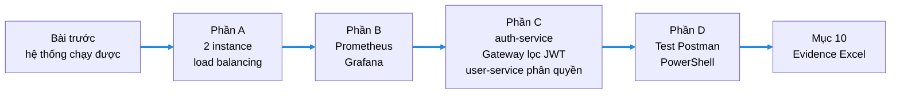

> **Lưu ý về thứ tự:** Phần A và Phần B làm khi hệ thống **chưa bật bảo mật**, tức gọi API không cần token, giống hệt Lesson 6. **Từ Phần C trở đi**, mọi API (trừ đăng nhập, đổi token, đăng xuất) đều **bắt buộc có access token**. Các lệnh PowerShell của Phần A/B ở phiên bản có kèm token nằm ở mục D7. Evidence load balancing/monitoring có thể chụp ngay ở Phần A/B, nhưng **khuyến khích chụp lại sau Phần C** để thấy đủ `auth-service` trên Eureka và Prometheus.

---

## 2. Chuẩn bị môi trường

| Công cụ | Dùng để | Ghi chú |
|---|---|---|
| **Docker Desktop** | Chạy toàn bộ hệ thống (MySQL, các service, Prometheus, Grafana) | Khi cài chọn *Use WSL 2 based engine*. Mở Docker Desktop và chờ biểu tượng cá voi báo *Engine running* trước khi gõ lệnh. Settings → Resources → Memory **≥ 6 GB (khuyến nghị 8 GB)** |
| **IntelliJ IDEA** hoặc **VS Code** | Viết code | Cài plugin Lombok (IntelliJ bản mới đã có sẵn) |
| **Postman** | Gọi thử API, test phân quyền | |
| **Excel** | Ghi test case + evidence | |
| **Trình duyệt** | Xem Eureka, Prometheus, Grafana | |
| JDK 21 + Maven *(không bắt buộc)* | Chạy app trực tiếp trên máy khi debug | Nếu chỉ chạy bằng Docker thì không cần cài, vì việc build `auth-service` diễn ra bên trong container |

Kiểm tra Docker bằng **PowerShell**:

```powershell
docker --version
docker compose version
```

Cả hai lệnh in ra số phiên bản là đạt.

Kiểm tra hệ thống của bài trước vẫn chạy được:

```powershell
Set-Location C:\microservice-demo
docker compose up -d --build
# chờ khoảng 2 phút rồi:
Invoke-RestMethod http://localhost:8080/api/users
```

Thấy danh sách user (kèm `department_name`) là đạt.

**Quy ước trong tài liệu**

- Mọi lệnh gõ trong **PowerShell**. Thư mục gốc của hệ thống là `C:\microservice-demo`.
- Khi cần `curl`, dùng **`curl.exe`**. Trong PowerShell, chữ `curl` là một lệnh khác (bí danh của `Invoke-WebRequest`).
- Nhãn **"MỚI"** / **"SỬA"** trong code cho biết đoạn đó được thêm hoặc thay đổi so với bài gốc.

---

## 3. Kiến thức nền

### 3.1. Load balancing là gì?

Nếu chỉ có **1 instance** `user-service`, nó sẽ quá tải khi nhiều người dùng cùng lúc, và nếu nó chết thì cả hệ thống ngừng. Giải pháp: chạy **nhiều bản sao (instance)** giống hệt nhau, rồi đặt một "người điều phối" phía trước để **chia request** cho các bản sao. Người điều phối đó gọi là **load balancer**.

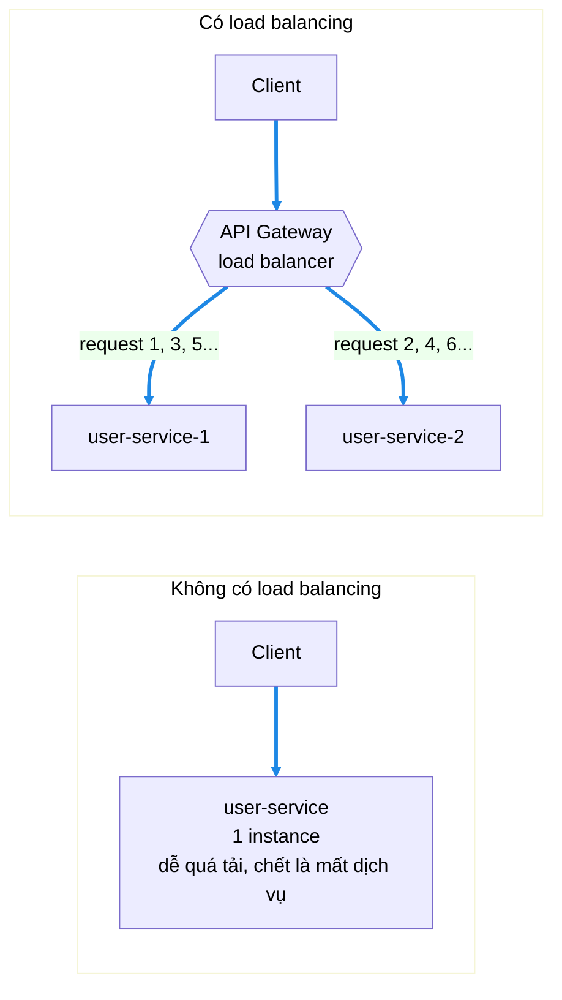

**Round robin (xoay vòng)** là thuật toán mặc định: request 1 → instance 1, request 2 → instance 2, request 3 → instance 1... lần lượt đều nhau.

### 3.2. Ai làm nhiệm vụ load balancing trong bài này?

- **Eureka** giữ "danh bạ": tên `user-service` đang có những instance nào, ở địa chỉ nào.
- **API Gateway** (route `lb://user-service` đã cấu hình ở bài trước) tra danh bạ rồi **chọn luân phiên** một instance để chuyển request đến.

> **Lưu ý so với slide:** Slide dùng **Netflix Ribbon** + FeignClient. Từ Spring Boot 3 / Spring Cloud 2022+, **Ribbon đã bị loại bỏ** và được thay bằng **Spring Cloud LoadBalancer** (cũng mặc định round robin). LoadBalancer đã nằm sẵn trong `eureka-client`, nên **bạn không cần thêm thư viện nào** để có load balancing; chỉ cần chạy thêm instance.

Bảng đối chiếu slide với bài thực hành này:

| Nội dung slide | Trong bài thực hành này |
|---|---|
| 4.1 Chạy nhiều instance `department-service` (port 8083, 8084), tên container/image khác nhau, **tên service giống nhau** | Chạy 2 instance `user-service`: container `user-service-1`, `user-service-2`, **cùng** `spring.application.name = user-service` |
| 4.2 Ribbon + FeignClient, round robin | Spring Cloud LoadBalancer (thay Ribbon) qua **API Gateway** `lb://user-service`, round robin |
| 5.1–5.2 Thêm dependency + `management.endpoints...include: prometheus` | Thêm Actuator + Micrometer vào `user-service` (và `auth-service`), bật endpoint `prometheus` qua Config Server |
| 5.3 Thư mục `monitoring` (prometheus, grafana, docker-compose) | Giống hệt: thư mục `monitoring` cùng cấp, compose riêng |
| Import dashboard ID **4701** | Giống hệt |

> **Vì sao không cần port khác nhau (8083/8084) như slide?** Slide chạy trực tiếp trên máy nên 2 instance phải khác port. Trong Docker, mỗi container là một "máy nhỏ" riêng, nên **cả hai cùng dùng port 8081** bên trong mà không đụng nhau, và ta không cần mở port ra Windows. (Port 8083 trong bài này được dùng cho `auth-service`.)

### 3.3. Monitoring: Prometheus và Grafana

| Thành phần | Vai trò (nói đơn giản) |
|---|---|
| **Spring Boot Actuator** | Biến ứng dụng thành thứ "đo được": mở các endpoint theo dõi sức khỏe, số liệu. |
| **Micrometer** (`micrometer-registry-prometheus`) | "Bộ đo": thu số liệu (request, bộ nhớ, CPU...) và trình bày theo định dạng Prometheus tại `/actuator/prometheus`. |
| **Prometheus** | "Kho số liệu": cứ **mỗi 5 giây** tự đi **kéo (scrape)** số liệu từ các service rồi lưu theo thời gian. Có thể truy vấn bằng ngôn ngữ **PromQL**. |
| **Grafana** | "Màn hình hiển thị": vẽ biểu đồ đẹp từ dữ liệu của Prometheus. |

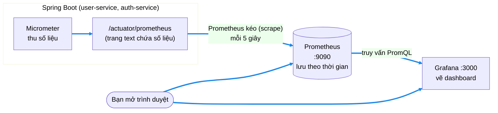

> Slide ghi *"Spring Boot 3 không hỗ trợ Hystrix Dashboard"*, vì vậy ta dùng Prometheus + Grafana thay thế.

### 3.4. Xác thực và phân quyền

| | Xác thực (Authentication) | Phân quyền (Authorization) |
|---|---|---|
| Trả lời câu hỏi | "Bạn là ai?" | "Bạn được làm gì?" |
| Thất bại trả về | `401 Unauthorized` | `403 Forbidden` |
| Ví dụ | Chưa gửi token, token hết hạn, sai mật khẩu | Manager gọi API xóa tài khoản |
| Trong bài này, ai kiểm tra? | **API Gateway** (cổng vào) và `auth-service` (khi đăng nhập) | **Service sở hữu API** (`auth-service`, `user-service`) |

### 3.5. JWT, access token và refresh token

JWT là một chuỗi gồm 3 phần ngăn cách bằng dấu chấm: `header.payload.signature`.

- **payload** chứa thông tin (gọi là *claims*): `sub` (username), `exp` (thời điểm hết hạn)... Phần này chỉ được mã hóa Base64 nên **ai cũng đọc được**. Vì vậy không bao giờ để mật khẩu trong token.
- **signature** được tạo từ header + payload + **khóa bí mật** của server. Chỉ cần sửa một ký tự trong payload là chữ ký sai ngay, server phát hiện được token bị giả mạo.

Dán thử token vào [https://jwt.io](https://jwt.io) để xem nội dung.

| | Access token | Refresh token |
|---|---|---|
| Dùng để | Gọi API (gửi ở header `Authorization: Bearer ...`) | Xin access token mới khi cái cũ hết hạn |
| Thời hạn | Ngắn (bài này: 15 phút) | Dài (bài này: 7 ngày) |
| Lưu ở server? | Không | Có (bảng `tbl_refresh_token` trong `auth_db`), nên thu hồi được khi đăng xuất |
| Ai kiểm tra? | Gateway, `auth-service`, `user-service` | Chỉ `auth-service` |

Vì sao cần hai loại token? Access token không lưu ở server nên **không thu hồi được**. Nếu bị lộ, kẻ xấu dùng được cho tới khi nó hết hạn, do đó phải cho nó sống ngắn. Nhưng nếu chỉ có access token sống ngắn thì cứ 15 phút người dùng lại phải đăng nhập một lần. Refresh token giải quyết việc đó.

### 3.6. Phân quyền trong kiến trúc microservice

#### 3.6.1. Vì sao khó hơn ứng dụng đơn khối?

Ở bài JWT gốc, mọi thứ nằm trong **một** ứng dụng: bảng user/role/permission, code đăng nhập, code kiểm tra quyền. Spring Security trong ứng dụng đó lo hết.

Trong microservice, hệ thống được tách thành nhiều service. Mỗi service là một process riêng, có DB riêng, và có thể chạy nhiều instance. Khi đó nảy ra 5 câu hỏi:

| # | Câu hỏi | Trả lời trong bài này |
|---|---|---|
| 1 | Ai giữ mật khẩu, kiểm tra đăng nhập, cấp token? | Chỉ **`auth-service`** (DB riêng `auth_db`) |
| 2 | Ai kiểm tra token khi gọi API? | **API Gateway** kiểm tra ngay ở cổng vào, sau đó **từng service** kiểm tra lại |
| 3 | `user-service` không có bảng role/permission, làm sao biết người gọi có quyền gì? | Quyền được **ghi sẵn trong access token** (claim `authorities`). Token có chữ ký nên không ai giả mạo được |
| 4 | `user-service` gọi sang `department-service` thì danh tính người dùng đi theo bằng cách nào? | Bằng **token relay**: chuyển tiếp nguyên header `Authorization` |
| 5 | Có 2 instance `user-service`: đăng nhập rồi, instance kia có biết không? | Token **stateless**: instance nào cũng tự kiểm tra chữ ký được, không cần chia sẻ session |

#### 3.6.2. Các cách làm phổ biến

| Cách | Mô tả | Ưu điểm | Nhược điểm |
|---|---|---|---|
| ① Mỗi service tự quản lý user và đăng nhập | Service nào cũng có bảng user riêng | — | Trùng lặp, mỗi nơi một mật khẩu, không dùng được trong thực tế |
| ② Chỉ Gateway kiểm tra (edge-only) | Gateway xác thực **và** phân quyền theo URL; service phía sau tin tưởng hoàn toàn | Đơn giản, service không cần code bảo mật | Ai lọt vào mạng nội bộ (bỏ qua Gateway) là gọi được mọi thứ. Gateway phải biết luật nghiệp vụ của mọi service (ví dụ "chỉ sửa chính mình") |
| ③ Hỏi `auth-service` ở mỗi request (token introspection) | Với mỗi request, service hỏi `auth-service`: "token này của ai, có quyền gì?" | Thu hồi quyền có hiệu lực ngay | Chậm; `auth-service` thành điểm nghẽn, nó chết là cả hệ thống chết |
| ④ **Gateway xác thực + từng service tự phân quyền bằng JWT** *(bài này chọn)* | `auth-service` cấp JWT có chữ ký, chứa danh sách quyền. Gateway chặn token sai (`401`). Service tự kiểm tra lại token và tự quyết định quyền (`403`) | Nhanh (không gọi DB/service khác), không phụ thuộc `auth-service` lúc xử lý request, mỗi service giữ luật của riêng mình, an toàn nhiều lớp | Khóa tài khoản/đổi quyền phải chờ access token hết hạn mới có hiệu lực ở các service khác. Service nào cũng cần khóa để kiểm tra chữ ký |

#### 3.6.3. Mô hình của bài: ai làm gì?

```mermaid
%%{init: {'theme':'base','themeVariables':{'lineColor':'#1E88E5','arrowheadColor':'#1E88E5','edgeLabelBackground':'#FFFFFF','primaryColor':'#ECECFF','primaryBorderColor':'#7A6BCB','primaryTextColor':'#000000','textColor':'#000000'},'themeCSS':'.marker{fill:#1E88E5 !important;stroke:#1E88E5 !important;} .arrowMarkerPath{fill:#1E88E5 !important;stroke:#1E88E5 !important;} .edgeLabel{color:#000000 !important;}'}}%%
flowchart LR
    AS["auth-service<br/>CẤP token<br/>(ký bằng khóa bí mật,<br/>ghi sẵn authorities)"]
    C["Client<br/>(Postman)"]
    G["API Gateway<br/>Lớp 1: XÁC THỰC<br/>token thật? còn hạn?<br/>sai → 401"]
    S["user-service-1 / -2<br/>Lớp 2: kiểm tra token lần 2<br/>+ PHÂN QUYỀN @PreAuthorize<br/>thiếu quyền → 403"]
    D["department-service<br/>nhận token qua<br/>token relay"]
    AS -.->|"1. đăng nhập xong,<br/>trả token"| C
    C ==>|"2. gọi API kèm token"| G
    G ==>|"3. token hợp lệ,<br/>chuyển tiếp"| S
    S ==>|"4. gọi tiếp,<br/>kèm cùng token"| D
    linkStyle default stroke:#1E88E5,stroke-width:3px
```

| Thành phần | Vai trò bảo mật | Mã lỗi trả về |
|---|---|---|
| `auth-service` | **Cấp token**: kiểm tra mật khẩu (BCrypt), ký access/refresh token bằng khóa bí mật, lưu và thu hồi refresh token, quản lý tài khoản; tự phân quyền các API `/api/accounts` của nó | `401` (sai mật khẩu, refresh token sai), `403` (`/api/accounts`) |
| `api-gateway-service` | **Xác thực ở cổng vào**: mọi API (trừ login/refresh/logout) phải có access token hợp lệ. Sai thì chặn luôn, request không đi vào bên trong | `401` |
| `user-service` ×2 | **Tự kiểm tra lại token** (không tin mù quáng vào Gateway), **phân quyền** bằng `@PreAuthorize` dựa trên `authorities` trong token, **chuyển tiếp token** khi gọi `department-service` | `401` (khi bị gọi thẳng không token), `403` |
| `department-service` | Bài chính: được Gateway bảo vệ (phải có token). Điểm cộng: tự kiểm tra token giống `user-service` | `401` |
| `config-service` | Phát **khóa bí mật JWT dùng chung** cho `auth-service`, Gateway, `user-service` | — |
| `eureka-service` | Danh bạ để Gateway tìm `auth-service`, `user-service`... | — |

#### 3.6.4. Access token mang những gì?

Ví dụ payload của access token khi `manager` đăng nhập (dán token vào jwt.io để xem):

```json
{
  "sub": "manager",
  "uid": 2,
  "authorities": ["ROLE_MANAGER", "USER_VIEW_LIST"],
  "type": "access",
  "iat": 1791936000,
  "exp": 1791936900
}
```

| Claim | Ý nghĩa | Ai dùng |
|---|---|---|
| `sub` | Username | Tất cả |
| `uid` | Id của user trong `auth_db` | `auth-service`, `user-service` (để kiểm tra "có phải chính mình không") |
| `authorities` | **MỚI so với bài gốc**: danh sách role (tiền tố `ROLE_`) + permission | `user-service` dùng trong `@PreAuthorize` |
| `type` | `access` hoặc `refresh` | Gateway và các service **chỉ nhận** `access` |
| `iat`, `exp` | Thời điểm cấp, thời điểm hết hạn | Tất cả |

> Payload ai cũng đọc được, nhưng **không ai sửa được**: sửa `"ROLE_MANAGER"` thành `"ROLE_ADMIN"` thì chữ ký sai ngay, Gateway trả `401`.

#### 3.6.5. Nguyên tắc cần nhớ

1. **Một nơi giữ mật khẩu.** Chỉ `auth-service` được đọc/ghi `auth_db` (nguyên tắc *database per service*).
2. **`401` ở cổng, `403` ở service.** Gateway trả lời "bạn là ai" (xác thực). Service sở hữu dữ liệu trả lời "bạn được làm gì" (phân quyền), vì chỉ nó hiểu luật nghiệp vụ, ví dụ "chỉ sửa chính mình".
3. **Zero trust.** Service không tin một request chỉ vì nó đến từ mạng nội bộ, nên luôn kiểm tra lại token.
4. **Code kiểm tra permission, không kiểm tra tên role.** Role nào có permission gì là do bảng `tbl_role_permission` quyết định.
5. **Token relay.** Service gọi service thì chuyển tiếp token của người dùng.
6. **Stateless.** Không dùng session, nên instance nào cũng xử lý được và load balancing hoạt động thoải mái.
7. **Không tin header tự đặt.** Không phân quyền dựa trên header kiểu `X-User-Role` do client gửi lên, vì ai cũng giả được. Chỉ tin token có chữ ký.

#### 3.6.6. Đánh đổi cần biết

| Vấn đề | Giải thích | Cách giảm thiểu trong thực tế |
|---|---|---|
| Thu hồi chậm | Khi khóa tài khoản hoặc đổi quyền: `auth-service` biết ngay (đọc DB mỗi request), còn `user-service` chỉ biết khi access token hết hạn (≤ 15 phút). Test case MS06 sẽ chứng minh điều này | Access token sống ngắn; API refresh kiểm tra lại trạng thái tài khoản; blacklist `jti` (Redis); dùng introspection cho API nhạy cảm |
| Khóa dùng chung (HS384) | Ai có khóa thì vừa kiểm tra được **vừa ký được** token | Môi trường thật dùng RS256/ES256: `auth-service` giữ private key, các service khác chỉ có public key (JWKS) |
| Token to dần | Càng nhiều permission thì token càng dài | Chỉ để các quyền cần thiết, hoặc chỉ để role |

#### 3.6.7. Vì sao JWT hợp với load balancing?

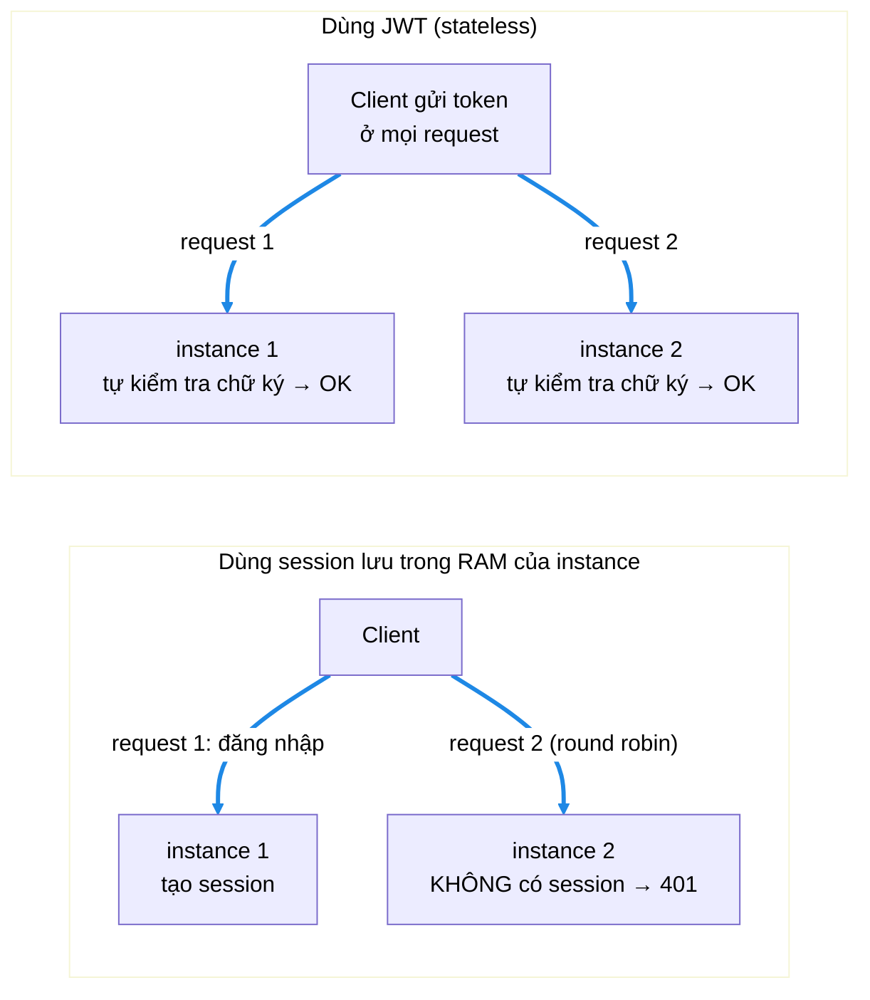

Với session, thông tin đăng nhập nằm trong RAM của instance đã xử lý request đăng nhập. Request sau bị round robin chuyển sang instance khác thì instance đó "không quen" người dùng. Muốn chữa phải dùng *sticky session* hoặc kho session chung (Redis), làm hệ thống phức tạp hơn. Với JWT, mọi thứ cần biết nằm sẵn trong token, nên **instance nào cũng tự xác thực được**. Test case MS04 sẽ chứng minh: cùng một token, request lần lượt rơi vào 2 instance khác nhau và đều thành công.

---

## 4. Kiến trúc hệ thống và các sơ đồ luồng

### 4.1. Sơ đồ kiến trúc tổng thể (sau khi hoàn thành cả 4 phần)

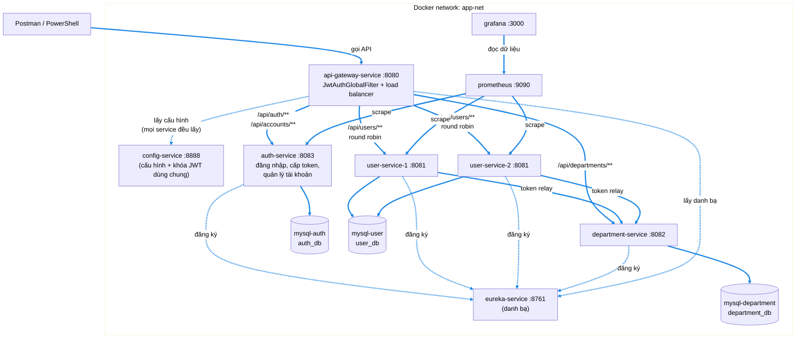

Điểm cần chú ý:

- Hai instance `user-service` dùng **chung một database** `mysql-user` (cùng một service, chỉ nhân bản để chịu tải), và đọc **cùng một cấu hình** từ Config Server (cùng tên `user-service`).
- `auth-service` có **DB riêng** `mysql-auth`. Không service nào khác được kết nối vào DB này.
- Mọi request từ bên ngoài **chỉ đi vào qua Gateway (port 8080)**. Các service nghiệp vụ không mở port ra Windows.
- Prometheus và Grafana nằm trong **cùng network `app-net`**, nên gọi nhau và gọi `user-service-1/2`, `auth-service` bằng **tên container**.

### 4.2. Bảng container và port

| Container | Port truy cập từ Windows | Ghi chú |
|---|---|---|
| `api-gateway-service` | 8080 | Cổng vào duy nhất cho API |
| `eureka-service` | 8761 | Dashboard Eureka |
| `config-service` | 8888 | Config Server |
| `auth-service` | không mở (nội bộ 8083) | **MỚI.** Chỉ truy cập qua Gateway |
| `user-service-1`, `user-service-2` | không mở (nội bộ 8081) | Chỉ truy cập qua Gateway |
| `department-service` | không mở (nội bộ 8082) | Chỉ truy cập qua Gateway |
| `mysql-user` | 3307 | DB của `user-service` |
| `mysql-department` | 3308 | DB của `department-service` |
| `mysql-auth` | **3309** | **MỚI.** DB của `auth-service` (DBeaver/Workbench: `localhost:3309`) |
| `prometheus` | 9090 | Giao diện Prometheus |
| `grafana` | 3000 | Giao diện Grafana (`admin` / `admin`) |

### 4.3. Sơ đồ đăng nhập (login)

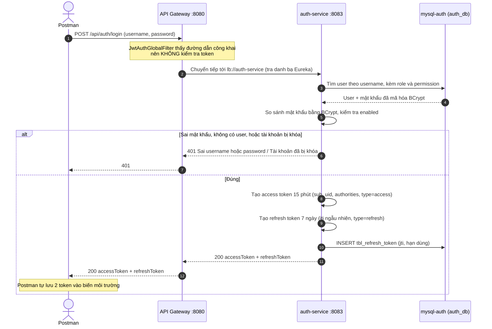

| Bước | Diễn giải |
|---|---|
| 1 | Postman gửi username/password tới Gateway. `/api/auth/login` nằm trong danh sách **đường dẫn công khai**, nên Gateway không đòi token. |
| 2 | Gateway tra danh bạ Eureka, tìm địa chỉ của `auth-service` rồi chuyển tiếp request. |
| 3–5 | `auth-service` dùng `AuthenticationManager`: lấy user từ `auth_db`, so sánh mật khẩu bằng BCrypt, kiểm tra cột `enabled`. |
| 6–7 | Sai mật khẩu, không có user hoặc tài khoản bị khóa → `401`. |
| 8–9 | Đúng thì tạo **2 token**. Access token chứa sẵn `authorities` để các service khác tự phân quyền. |
| 10 | Chỉ **mã định danh `jti`** của refresh token được lưu vào DB (để thu hồi được), không lưu cả chuỗi token. |
| 11–12 | Token trả về cho client. Từ giờ client gửi access token ở mọi request. |

### 4.4. Sơ đồ luồng gọi API nghiệp vụ (qua Gateway, load balancing, phân quyền, token relay)

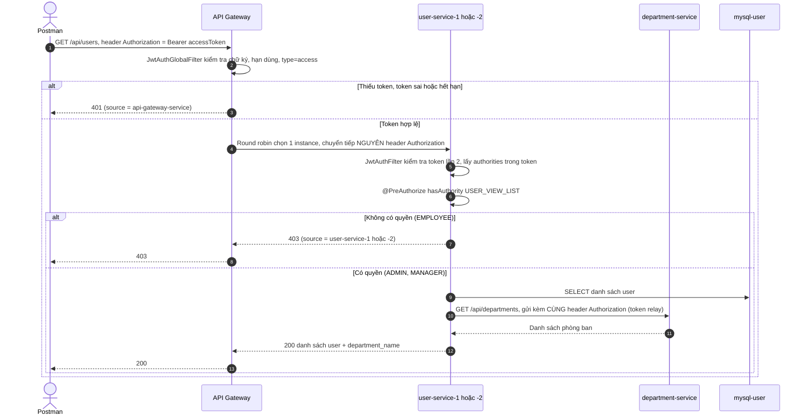

| Bước | Diễn giải |
|---|---|
| 1–2 | **Lớp 1 — xác thực tại cổng vào.** Gateway chỉ kiểm tra "token có thật, còn hạn, đúng loại access không". Gateway **không** biết luật nghiệp vụ. |
| 3 | Token sai → chặn ngay, request **không đi vào trong**. Vì vậy request này **không xuất hiện** trong metric của `user-service`. |
| 4 | Token đúng → **load balancer** chọn luân phiên instance 1 hoặc 2 (Phần A). |
| 5 | **Lớp 2 — zero trust.** `user-service` tự kiểm tra lại chữ ký bằng cùng khóa bí mật. Quyền được lấy **từ token**, không đọc DB của `auth-service`. |
| 6–8 | **Phân quyền.** `@PreAuthorize` so sánh với permission yêu cầu. Không đủ quyền → `403`, trường `source` cho biết instance nào đã từ chối. |
| 9 | Đủ quyền → lấy danh sách user từ DB **của chính `user-service`** (`mysql-user`). |
| 10–11 | **Token relay.** Khi gọi `department-service`, `user-service` gửi kèm đúng header `Authorization` của người dùng. |
| 12–13 | Kết quả trả về theo đường cũ qua Gateway. |

### 4.5. Sơ đồ quyết định: khi nào `200`, `401`, `403`?

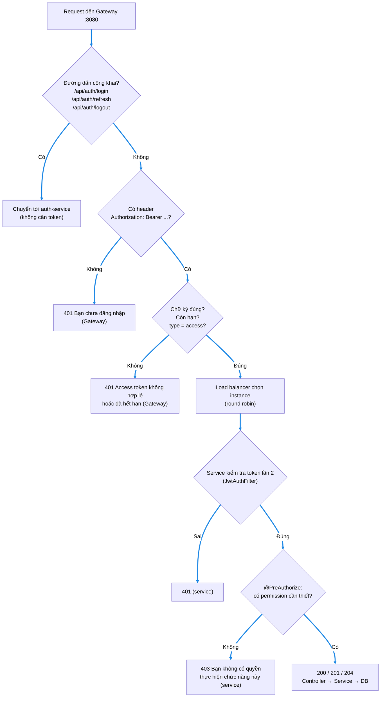

### 4.6. Sơ đồ đổi token (refresh) và đăng xuất (logout)

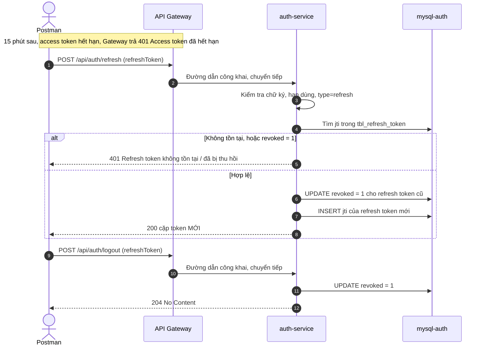

> Để sơ đồ gọn, các mũi tên phản hồi vẽ thẳng từ `auth-service` về Postman; thực tế phản hồi luôn đi ngược qua Gateway.
>
> Mỗi refresh token **chỉ dùng được 1 lần**: dùng xong bị thu hồi và được thay bằng cái mới. Đăng xuất là thu hồi refresh token, nên sau đó không xin được access token mới nữa. Access token đang có vẫn dùng được tới khi hết hạn (tối đa 15 phút).

### 4.7. Bên trong một service: chuỗi kiểm tra của Spring Security

Đường đi của một request có gắn token **bên trong** `auth-service` hoặc `user-service`:

```
Request
  → JwtAuthenticationFilter / JwtAuthFilter   đọc token, xác định user, nạp quyền vào SecurityContext
  → SecurityFilterChain                       API này có cần đăng nhập không? chưa đăng nhập → 401
  → @PreAuthorize                             user có đủ quyền không? không đủ → 403
  → Controller → Service → DB
```

Khác biệt duy nhất giữa hai service nằm ở **bước đầu tiên**:

| | `auth-service` (`JwtAuthenticationFilter`) | `user-service` (`JwtAuthFilter`) |
|---|---|---|
| Kiểm tra chữ ký + hạn dùng | ✅ | ✅ |
| Quyền lấy từ đâu | **Đọc lại DB** `auth_db` ở mỗi request (quyền mới nhất) | **Claim `authorities` trong token** (không có DB quyền) |
| Khóa tài khoản có hiệu lực | Ngay lập tức | Khi access token hết hạn |

### 4.8. Cấu trúc thư mục cuối cùng

```
C:\microservice-demo
├── docker-compose.yml                  ← hệ thống ứng dụng (SỬA ở Phần A và Phần C)
├── db-init
│   ├── user-db\init.sql                (bài trước)
│   ├── department-db\init.sql          (bài trước)
│   └── auth-db                         ← MỚI (Phần C)
│       ├── 01_schema.sql
│       └── 02_data.sql
├── eureka-service\...                  (bài trước, không sửa)
├── config-service
│   └── src\main\resources\config-repo
│       ├── application.yml             ← MỚI (Phần C): khóa JWT dùng chung
│       ├── auth-service.yml            ← MỚI (Phần C)
│       ├── auth-service-docker.yml     ← MỚI (Phần C)
│       ├── api-gateway-service.yml     ← SỬA (Phần C): thêm route auth-service
│       ├── user-service.yml            ← SỬA (Phần B): bật endpoint prometheus
│       └── ... (các file khác của bài trước giữ nguyên)
├── api-gateway-service                 ← SỬA (Phần C): pom.xml + JwtAuthGlobalFilter.java
├── user-service                        ← SỬA (Phần A, B, C): UserController.java, pom.xml, package security
├── department-service                  (bài trước; điểm cộng C12 mới sửa)
├── auth-service                        ← MỚI (Phần C)
│   ├── Dockerfile
│   ├── .dockerignore
│   ├── pom.xml
│   └── src\main\...
└── monitoring                          ← MỚI (Phần B)
    ├── docker-compose.yml
    ├── prometheus\prometheus.yml
    └── grafana\provisioning\datasources\datasources.yml
```

---

## 5. Phần A. Load balancing với 2 instance user-service

**Mục đích của phần A:** có 2 container `user-service` cùng đăng ký lên Eureka dưới tên `USER-SERVICE`, và chứng minh Gateway chia request luân phiên cho 2 container.

> Phần này làm khi **chưa bật bảo mật**, nên gọi API không cần token. Sau khi xong Phần C, dùng các lệnh có kèm token ở mục D7.

### A1. Thêm API "tôi là instance nào?" để quan sát

Để biết request rơi vào instance nào, ta thêm API `GET /api/users/whoami` trả về tên container đang xử lý. Mỗi container có `hostname` riêng (sẽ đặt ở bước A2).

Mở file `C:\microservice-demo\user-service\src\main\java\com\example\userservice\UserController.java` và **thay toàn bộ nội dung** bằng:

```java
package com.example.userservice;

import org.springframework.beans.factory.annotation.Autowired;
import org.springframework.web.bind.annotation.GetMapping;
import org.springframework.web.bind.annotation.RestController;
import org.springframework.web.client.RestTemplate;

import java.util.HashMap;
import java.util.List;
import java.util.Map;

@RestController
public class UserController {

    @Autowired
    private UserRepository userRepository;

    @Autowired
    private RestTemplate restTemplate;

    // Tên container đang chạy code này (user-service-1 hoặc user-service-2)
    private String instanceName() {
        return System.getenv().getOrDefault("HOSTNAME", "unknown");
    }

    // API MỚI: cho biết request được xử lý bởi instance nào
    @GetMapping("/api/users/whoami")
    public Map<String, String> whoami() {
        System.out.println("[" + instanceName() + "] handled GET /api/users/whoami");
        return Map.of("service", "user-service", "instance", instanceName());
    }

    // API lấy danh sách user -> [{id, user_name, department_name}]
    @GetMapping("/api/users")
    public List<UserResponse> getAllUsers() {
        System.out.println("[" + instanceName() + "] handled GET /api/users");

        // 1. Lấy user từ DB của user-service
        List<User> users = userRepository.findAll();

        // 2. Gọi department-service (theo TÊN service, không dùng IP/port)
        Map<Long, String> departmentNames = new HashMap<>();
        try {
            DepartmentDto[] departments = restTemplate.getForObject(
                    "http://department-service/api/departments", DepartmentDto[].class);
            if (departments != null) {
                for (DepartmentDto d : departments) {
                    departmentNames.put(d.getId(), d.getDepartmentName());
                }
            }
        } catch (Exception e) {
            // department-service lỗi/tắt -> vẫn trả user, department_name = null
            System.out.println("Cannot call department-service: " + e.getMessage());
        }

        // 3. Ghép department_name vào từng user theo department_id
        return users.stream()
                .map(u -> new UserResponse(
                        u.getId(),
                        u.getUserName(),
                        departmentNames.get(u.getDepartmentId())))
                .toList();
    }
}
```

> Chỉ có 2 thay đổi so với bản cũ: thêm hàm `instanceName()` + API `whoami`, và thêm 1 dòng `System.out.println` ở `getAllUsers` để sau này đọc log biết instance nào đã xử lý.
> Route của Gateway `Path=/api/users/**` đã khớp sẵn với `/api/users/whoami`, **không cần sửa Gateway**.
> Ở Phần C (bước C8.6), file này sẽ được sửa thêm một lần nữa để gắn phân quyền và token relay.

### A2. Sửa `docker-compose.yml`: tách `user-service` thành 2 container

Hai điều quan trọng (giống ghi chú trong slide): **tên container khác nhau**, nhưng **tên service Spring (`spring.application.name`) giống nhau**. Tên Spring đến từ file `application.yml` của `user-service` (`user-service`), nên cả 2 container tự động giống nhau; ta không phải đổi gì ở code.

Ngoài ra ta thêm `hostname` để mỗi container có tên dễ nhận biết, và đặt **tên cố định** cho network (`name: app-net`) để Prometheus/Grafana ở compose khác nối vào được.

Mở `C:\microservice-demo\docker-compose.yml` và **thay toàn bộ** bằng nội dung sau:

```yaml
services:

  # ---------- Hạ tầng ----------
  eureka-service:
    build: ./eureka-service
    image: eureka-service:1.0
    container_name: eureka-service
    ports:
      - "8761:8761"
    healthcheck:
      test: ["CMD-SHELL", "wget -qO- http://localhost:8761/actuator/health | grep -q UP"]
      interval: 10s
      timeout: 5s
      retries: 20
      start_period: 30s
    networks:
      - app-net

  config-service:
    build: ./config-service
    image: config-service:1.0
    container_name: config-service
    environment:
      EUREKA_URL: http://eureka-service:8761/eureka/
    ports:
      - "8888:8888"
    depends_on:
      eureka-service:
        condition: service_healthy
    healthcheck:
      test: ["CMD-SHELL", "wget -qO- http://localhost:8888/actuator/health | grep -q UP"]
      interval: 10s
      timeout: 5s
      retries: 20
      start_period: 30s
    networks:
      - app-net

  # ---------- Database riêng cho từng service ----------
  mysql-user:
    image: mysql:8.0
    container_name: mysql-user
    environment:
      MYSQL_ROOT_PASSWORD: Root@12345
      MYSQL_DATABASE: user_db
    ports:
      - "3307:3306"
    volumes:
      - mysql_user_data:/var/lib/mysql
      - ./db-init/user-db/init.sql:/docker-entrypoint-initdb.d/init.sql
    healthcheck:
      test: ["CMD", "mysqladmin", "ping", "-h", "localhost", "-uroot", "-pRoot@12345"]
      interval: 5s
      timeout: 5s
      retries: 20
    networks:
      - app-net

  mysql-department:
    image: mysql:8.0
    container_name: mysql-department
    environment:
      MYSQL_ROOT_PASSWORD: Root@12345
      MYSQL_DATABASE: department_db
    ports:
      - "3308:3306"
    volumes:
      - mysql_department_data:/var/lib/mysql
      - ./db-init/department-db/init.sql:/docker-entrypoint-initdb.d/init.sql
    healthcheck:
      test: ["CMD", "mysqladmin", "ping", "-h", "localhost", "-uroot", "-pRoot@12345"]
      interval: 5s
      timeout: 5s
      retries: 20
    networks:
      - app-net

  # ---------- Service nghiệp vụ (KHÔNG publish port) ----------
  department-service:
    build: ./department-service
    image: department-service:1.0
    container_name: department-service
    environment:
      SPRING_PROFILES_ACTIVE: docker
      CONFIG_SERVER_URL: http://config-service:8888
    depends_on:
      config-service:
        condition: service_healthy
      mysql-department:
        condition: service_healthy
    networks:
      - app-net

  # ----- user-service: INSTANCE 1 -----
  user-service-1:
    build: ./user-service
    image: user-service:1.0
    container_name: user-service-1
    hostname: user-service-1
    environment:
      SPRING_PROFILES_ACTIVE: docker
      CONFIG_SERVER_URL: http://config-service:8888
    depends_on:
      config-service:
        condition: service_healthy
      mysql-user:
        condition: service_healthy
      department-service:
        condition: service_started
    networks:
      - app-net

  # ----- user-service: INSTANCE 2 (cùng code, cùng tên service, khác container) -----
  user-service-2:
    build: ./user-service
    image: user-service:1.0
    container_name: user-service-2
    hostname: user-service-2
    environment:
      SPRING_PROFILES_ACTIVE: docker
      CONFIG_SERVER_URL: http://config-service:8888
    depends_on:
      config-service:
        condition: service_healthy
      mysql-user:
        condition: service_healthy
      department-service:
        condition: service_started
    networks:
      - app-net

  # ---------- Cổng vào duy nhất ----------
  api-gateway-service:
    build: ./api-gateway-service
    image: api-gateway-service:1.0
    container_name: api-gateway-service
    environment:
      SPRING_PROFILES_ACTIVE: docker
      CONFIG_SERVER_URL: http://config-service:8888
    ports:
      - "8080:8080"
    depends_on:
      config-service:
        condition: service_healthy
      user-service-1:
        condition: service_started
      user-service-2:
        condition: service_started
      department-service:
        condition: service_started
    networks:
      - app-net

networks:
  app-net:
    name: app-net        # tên cố định để compose "monitoring" nối vào được

volumes:
  mysql_user_data:
  mysql_department_data:
```

Điểm khác so với bài trước:

| Thay đổi | Ý nghĩa |
|---|---|
| `user-service` → `user-service-1` và `user-service-2` | 2 container chạy **cùng 1 image** `user-service:1.0` (cùng code), khác `container_name` |
| `hostname: user-service-1/2` | Tên máy bên trong container; API `whoami` đọc tên này. Eureka cũng hiển thị instance theo tên này |
| `name: app-net` | Network có tên cố định, để Prometheus/Grafana (compose riêng) dùng `external` nối vào |
| Gateway `depends_on` cả 2 instance | Gateway khởi động sau khi 2 instance đã được tạo |

> Slide có dặn *"tên container và tên image để khác nhau"*. Ở đây ta giữ **1 image dùng chung** vì code giống hệt (đúng tinh thần Docker: 1 image → nhiều container). Điều **bắt buộc** là tên container khác nhau và tên service giống nhau.
>
> Ở Phần C (bước C9.3), file này sẽ được bổ sung `mysql-auth` và `auth-service`.

### A3. Build và chạy

```powershell
Set-Location C:\microservice-demo
docker compose down
docker compose up -d --build
```

Chờ khoảng **2 phút**, rồi kiểm tra:

```powershell
docker compose ps
```

Phải thấy cả `user-service-1` và `user-service-2` ở trạng thái `Up`. → **Evidence LB01**

### A4. Kiểm tra trên Eureka Dashboard

Mở `http://localhost:8761`. Ở mục **Instances currently registered with Eureka**, dòng `USER-SERVICE` phải có **2 instance**:

- `user-service-1:user-service:8081`
- `user-service-2:user-service:8081`

Đây chính là ý nghĩa của "tên service giống nhau": Eureka gom 2 instance dưới **một tên**, Gateway chỉ cần nói "cho tôi `user-service`" là có cả 2 địa chỉ. → **Evidence LB02**

> **Chưa thấy đủ 2 instance?** Chờ thêm 30–60 giây, F5 lại trang.

### A5. Chứng minh Gateway chia request luân phiên

Sơ đồ những gì sẽ xảy ra:

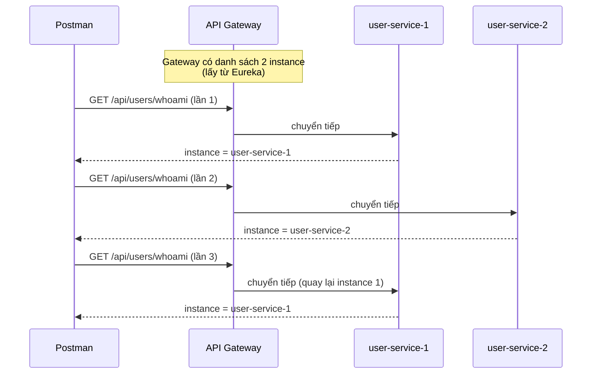

**Cách 1 — Postman:** gọi `GET http://localhost:8080/api/users/whoami` **nhiều lần liên tiếp** (bấm Send 4–6 lần). Kết quả luân phiên: → **Evidence LB04, LB05**

```json
{ "service": "user-service", "instance": "user-service-1" }
```
```json
{ "service": "user-service", "instance": "user-service-2" }
```

**Cách 2 — PowerShell** (gọi 20 lần, đếm mỗi instance trả lời bao nhiêu lần): → **Evidence LB06**

```powershell
1..20 | ForEach-Object { (Invoke-RestMethod http://localhost:8080/api/users/whoami).instance } | Group-Object | Select-Object Name, Count
```

Kết quả mong đợi (chia đều):

```
Name           Count
----           -----
user-service-1    10
user-service-2    10
```

**Gọi API nghiệp vụ thật** (dữ liệu trả về như nhau, dù instance nào xử lý): → **Evidence LB03**

```
GET http://localhost:8080/api/users
```

> **Nếu mọi request đều ra cùng một instance:** Gateway chưa cập nhật danh bạ. Chờ 1 phút rồi thử lại (Gateway lưu đệm danh sách instance vài chục giây).

### A6. Xem log để thấy instance nào xử lý

```powershell
docker logs user-service-1 --tail 5
docker logs user-service-2 --tail 5
```

Mỗi container chỉ in ra những dòng `[user-service-X] handled GET ...` của **chính nó**. Cộng số dòng của 2 container sẽ bằng tổng số request bạn đã gọi. → **Evidence LB07**

### A7. (Điểm cộng) Tắt 1 instance — hệ thống vẫn sống

```powershell
docker compose stop user-service-1
```

Chờ khoảng 30–60 giây để Eureka và Gateway cập nhật danh bạ, rồi gọi lại `whoami` nhiều lần: **mọi request đều về `user-service-2`**, hệ thống vẫn phục vụ được. Đây là lợi ích thứ hai của việc chạy nhiều instance: **chịu lỗi (high availability)**. → **Evidence LB08** (chụp thêm ảnh Prometheus ở bước B6/B7 khi instance 1 đang tắt)

> Trong khoảng thời gian ngắn ngay sau khi tắt, vài request có thể lỗi `503`, vì Gateway chưa kịp bỏ instance đã chết khỏi danh sách. Đây là hiện tượng bình thường.

Bật lại:

```powershell
docker compose start user-service-1
```

---

## 6. Phần B. Giám sát bằng Prometheus và Grafana

**Mục đích của phần B:** `user-service` (cả 2 instance) xuất số liệu theo định dạng Prometheus; Prometheus kéo số liệu về; Grafana hiển thị dashboard. Phần này chỉ giám sát `user-service` cho đơn giản. `auth-service` được thêm vào danh sách giám sát ở bước C9.4.

### B1. Thêm 2 dependency vào `user-service` (slide 5.1)

Mở `C:\microservice-demo\user-service\pom.xml`, trong thẻ `<dependencies>` **thêm 2 dependency** sau (đặt cạnh các dependency hiện có):

```xml
<dependency>
  <groupId>org.springframework.boot</groupId>
  <artifactId>spring-boot-starter-actuator</artifactId>
</dependency>
<dependency>
  <groupId>io.micrometer</groupId>
  <artifactId>micrometer-registry-prometheus</artifactId>
  <scope>runtime</scope>
</dependency>
```

- `actuator`: cung cấp các endpoint theo dõi.
- `micrometer-registry-prometheus`: trình bày số liệu theo định dạng Prometheus đọc được.

### B2. Bật endpoint `prometheus` qua Config Server (slide 5.2)

Slide thêm file `application.yml` trong từng service. Ở hệ thống của ta, cấu hình tập trung nằm trong **Config Server**, nên ta khai báo ở đó (đúng tinh thần bài trước).

Mở `C:\microservice-demo\config-service\src\main\resources\config-repo\user-service.yml` và **thay toàn bộ** bằng:

```yaml
server:
  port: 8081

spring:
  datasource:
    url: jdbc:mysql://localhost:3307/user_db?useSSL=false&allowPublicKeyRetrieval=true
    username: root
    password: Root@12345
  jpa:
    hibernate:
      ddl-auto: none
    show-sql: true

management:
  endpoints:
    web:
      exposure:
        include: health,info,prometheus   # mở endpoint /actuator/prometheus
  metrics:
    tags:
      application: user-service            # gắn nhãn "application" cho mọi metric (dashboard 4701 cần nhãn này)
```

Giải thích:

- `exposure.include: ... prometheus` → mở trang `/actuator/prometheus` (slide cũng chỉ `include: ["prometheus"]`; ta thêm `health` để xem trạng thái).
- `tags.application: user-service` → mỗi dòng số liệu được gắn nhãn `application="user-service"`, giúp lọc trên Grafana.
- Endpoint này **chỉ truy cập được bên trong network Docker** (container không mở port ra Windows, Gateway cũng không route `/actuator`), nên không bị lộ ra ngoài. Chính vì lý do này, ở Phần C ta cho phép `/actuator/prometheus` **không cần token**, để Prometheus vẫn kéo được số liệu.

### B3. Build lại và chạy

Phần cấu hình thay đổi nằm trong jar của `config-service`, phần code thay đổi nằm ở `user-service`, nên build lại toàn bộ:

```powershell
Set-Location C:\microservice-demo
docker compose up -d --build
```

Chờ khoảng 2 phút. Kiểm tra từng instance đã xuất metric chưa (lệnh chạy **bên trong** container): → **Evidence MON01**

```powershell
docker exec user-service-1 wget -qO- http://localhost:8081/actuator/health
docker exec user-service-1 wget -qO- http://localhost:8081/actuator/prometheus
```

- Lệnh đầu in ra `{"status":"UP"}`.
- Lệnh sau in ra rất nhiều dòng dạng `jvm_memory_used_bytes{application="user-service",area="heap",...} 12345678`. Đó chính là **metric** mà Prometheus sẽ đọc. Làm tương tự với `user-service-2`.

### B4. Tạo thư mục `monitoring` (slide 5.3)

Tạo thư mục `monitoring` **cùng cấp** với các thư mục service:

```powershell
New-Item -ItemType Directory -Force C:\microservice-demo\monitoring\prometheus | Out-Null
New-Item -ItemType Directory -Force C:\microservice-demo\monitoring\grafana\provisioning\datasources | Out-Null
```

Cấu trúc cần có:

```
C:\microservice-demo
├── docker-compose.yml            (hệ thống ứng dụng)
├── user-service ...
└── monitoring
    ├── docker-compose.yml        (Prometheus + Grafana)
    ├── prometheus
    │   └── prometheus.yml
    └── grafana
        └── provisioning
            └── datasources
                └── datasources.yml
```

#### B4.1. `monitoring\prometheus\prometheus.yml` — khai báo "đi kéo số liệu ở đâu"

```yaml
global:
  scrape_interval: 5s            # cứ 5 giây kéo số liệu 1 lần

scrape_configs:
  - job_name: 'user-service'
    metrics_path: '/actuator/prometheus'
    static_configs:
      - targets:
          - 'user-service-1:8081'   # instance 1 (tên container : port nội bộ)
          - 'user-service-2:8081'   # instance 2
```

Phần `targets` chính là danh sách "service và port cần monitor" như slide nói. Ta dùng **tên container** (thay vì `host.docker.internal` như slide), vì Prometheus và `user-service` cùng nằm trong network `app-net`. Muốn giám sát thêm service khác, chỉ cần thêm 1 `job_name` mới (bước C9.4 sẽ thêm `auth-service`).

#### B4.2. `monitoring\grafana\provisioning\datasources\datasources.yml` — tự nối Grafana với Prometheus

```yaml
apiVersion: 1
datasources:
  - name: Prometheus
    type: prometheus
    access: proxy
    url: http://prometheus:9090
    isDefault: true
```

File này giúp Grafana **có sẵn nguồn dữ liệu Prometheus** ngay khi khởi động, bạn khỏi phải cấu hình tay.

#### B4.3. `monitoring\docker-compose.yml`

```yaml
services:
  prometheus:
    image: prom/prometheus:v2.44.0
    container_name: prometheus
    ports:
      - "9090:9090"
    volumes:
      - ./prometheus/prometheus.yml:/etc/prometheus/prometheus.yml
    networks:
      - app-net

  grafana:
    image: grafana/grafana:9.5.2
    container_name: grafana
    ports:
      - "3000:3000"
    restart: unless-stopped
    volumes:
      - ./grafana/provisioning/datasources:/etc/grafana/provisioning/datasources
      - grafana_data:/var/lib/grafana      # giữ lại dashboard khi khởi động lại
    depends_on:
      - prometheus
    networks:
      - app-net

networks:
  app-net:
    external: true     # dùng lại network đã tạo bởi compose của ứng dụng
    name: app-net

volumes:
  grafana_data:
```

> `external: true` nghĩa là network `app-net` **phải có sẵn** (do compose ứng dụng ở bước A3 tạo). Vì vậy phải chạy hệ thống ứng dụng **trước**.

### B5. Chạy Prometheus và Grafana

```powershell
Set-Location C:\microservice-demo\monitoring
docker compose up -d
docker compose ps
```

Thấy `prometheus` và `grafana` đều `Up`. (Lần đầu Docker sẽ tải image nên hơi lâu.)

### B6. Kiểm tra Prometheus nhìn thấy cả 2 instance

Mở `http://localhost:9090/targets`. Mục `user-service` phải có **2 dòng**: → **Evidence MON02**

| Endpoint | State |
|---|---|
| `http://user-service-1:8081/actuator/prometheus` | **UP** |
| `http://user-service-2:8081/actuator/prometheus` | **UP** |

Nếu `DOWN`, xem mục 11 (lỗi thường gặp).

### B7. Thử truy vấn trong Prometheus

Tạo vài request để có số liệu. Chỉ gọi **một** API trong vòng lặp để Gateway chia đều cho 2 instance (sau Phần C, dùng phiên bản có token ở mục D7):

```powershell
1..100 | ForEach-Object { Invoke-RestMethod http://localhost:8080/api/users/whoami | Out-Null; Start-Sleep -Milliseconds 200 }
```

Vào `http://localhost:9090/graph`, dán từng truy vấn vào ô, bấm **Execute**, rồi chọn tab **Graph**:

```
up{job="user-service"}
```
→ có 2 dòng, giá trị `1` (đang sống).

```
sum by (instance) (http_server_requests_seconds_count{application="user-service", uri="/api/users/whoami"})
```
→ có 2 đường (2 instance), số lượng xấp xỉ nhau (khoảng 50/50). Đây là bằng chứng load balancing nhìn từ phía số liệu. → **Evidence MON04**

### B8. Đăng nhập Grafana và import dashboard (slide 5.3)

1. Mở `http://localhost:3000`, đăng nhập `admin` / `admin` (nếu được yêu cầu đổi mật khẩu, bấm **Skip**).
2. Kiểm tra nguồn dữ liệu: menu trái → **Connections → Data sources** → thấy `Prometheus`. Bấm vào, kéo xuống cuối, bấm **Save & test** → báo `Data source is working`. → **Evidence MON03**
3. Vào `http://localhost:3000/dashboard/import` (hoặc **Dashboards → New → Import**).
4. Ở ô **Import via grafana.com** gõ ID **`4701`** rồi bấm **Load**.
5. Ở mục **Prometheus**, chọn data source `Prometheus` → bấm **Import**.

> Dashboard **4701** là dashboard mẫu "JVM (Micrometer)" trên grafana.com. Grafana cần **truy cập internet** để tải nó. Nếu bị chặn mạng: tải file JSON của dashboard 4701 từ trang grafana.com về, rồi dùng ô **Upload dashboard JSON file**.

### B9. Đọc dashboard

Trên dashboard vừa import, góc trên có các ô chọn:

- **Application**: chọn `user-service` (sau Phần C sẽ có thêm `auth-service`).
- **Instance**: chọn `user-service-1:8081`, rồi đổi sang `user-service-2:8081` để xem từng instance. Đây là lý do ta gắn nhãn `application` ở bước B2. → **Evidence MON05, MON06**
- Góc trên bên phải: chọn khoảng thời gian **Last 15 minutes**, bật tự làm mới (**5s**).

Trong lúc xem, chạy lại vòng lặp tạo request ở B7 (hoặc vòng lặp dưới đây, tạo tải lâu hơn) để biểu đồ chuyển động:

```powershell
1..300 | ForEach-Object { Invoke-RestMethod http://localhost:8080/api/users | Out-Null; Start-Sleep -Milliseconds 200 }
```

Các nhóm biểu đồ chính của dashboard (tên có thể hơi khác tùy phiên bản): thông tin nhanh (uptime, heap), **I/O Overview** (số request, lỗi, thời gian phản hồi), **JVM Memory**, **JVM Misc** (CPU, thread), **Garbage Collection**.

> Ý nghĩa chi tiết của từng metric và cách đọc nằm ở **mục 9**.

---

## 7. Phần C. Xác thực và phân quyền trên microservice

**Mục đích của phần C:** đưa đăng nhập JWT và phân quyền RBAC vào hệ thống microservice. Đi theo thứ tự: **thiết kế DB → thiết kế API → code → cấu hình → Docker Compose → chạy thử**. Kiểm thử chi tiết bằng Postman nằm ở Phần D.

### C0. Tổng quan những gì sẽ thay đổi

| Thành phần | Thay đổi | Mục đích |
|---|---|---|
| `auth-service` **(MỚI)** | Project mới, xây từ bài JWT gốc: đăng nhập, cấp/đổi/thu hồi token, quản lý tài khoản `/api/accounts`. **Ghi `authorities` vào access token**, đăng ký Eureka, lấy cấu hình từ Config Server, xuất metric | Nơi **duy nhất** biết mật khẩu và bảng quyền |
| `mysql-auth` **(MỚI)** | MySQL chứa DB `auth_db` gồm 6 bảng RBAC | *Database per service* |
| `config-service` | Thêm `application.yml` (khóa JWT dùng chung), `auth-service.yml`, `auth-service-docker.yml`; thêm route `auth-service` vào cấu hình Gateway | Cấu hình tập trung |
| `api-gateway-service` | Thêm thư viện JJWT + class `JwtAuthGlobalFilter` | **Xác thực tại cổng vào**, chặn sớm bằng `401` |
| `user-service` (2 instance) | Thêm Spring Security + JJWT, package `security` (4 file), sửa `UserController` | **Tự kiểm tra token**, phân quyền bằng `@PreAuthorize`, **token relay** |
| `docker-compose.yml` | Thêm `mysql-auth`, `auth-service` | Chạy cả hệ thống bằng 1 lệnh |
| `monitoring\prometheus\prometheus.yml` | Thêm job `auth-service` | Giám sát đăng nhập thành công/thất bại |
| `department-service` | *(Điểm cộng, C12)* Tự kiểm tra token | Kiểm chứng token relay |

---

### C1. Thiết kế cơ sở dữ liệu `auth_db`

#### C1.1. Mô hình RBAC

Không gán quyền trực tiếp cho từng user, mà đi qua **role**:

```
User  ──(có)──>  Role  ──(gồm)──>  Permission
```

- **Permission** = một hành động cụ thể (ví dụ `USER_DELETE`). **Code chỉ kiểm tra permission.**
- **Role** = một nhóm permission, đặt tên theo chức danh (ví dụ `ADMIN`).
- Lợi ích: sau này muốn cho `MANAGER` thêm quyền xem chi tiết user, chỉ cần **thêm 1 dòng vào `tbl_role_permission`**, không phải sửa code. Trong microservice, lợi ích này còn lớn hơn: thay đổi dữ liệu ở `auth_db` sẽ có hiệu lực ở **mọi service** (qua token), không phải build lại service nào.

#### C1.2. ERD

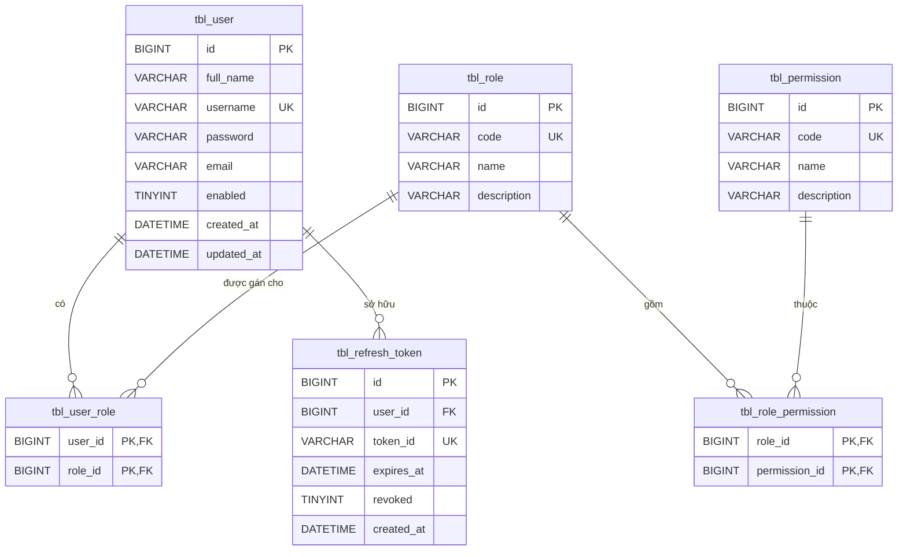

#### C1.3. Giải thích các bảng

**`tbl_user` — tài khoản người dùng**

| Cột | Kiểu | Ý nghĩa |
|---|---|---|
| `id` | BIGINT, PK, tự tăng | Khóa chính. Giá trị này được ghi vào token (claim `uid`) |
| `full_name` | VARCHAR(100) | Họ tên |
| `username` | VARCHAR(50), duy nhất | Tên đăng nhập. Giá trị này được ghi vào token (claim `sub`) |
| `password` | VARCHAR(100) | Mật khẩu **đã mã hóa BCrypt** (chuỗi 60 ký tự bắt đầu bằng `$2a$`). Không bao giờ lưu mật khẩu gốc |
| `email` | VARCHAR(100) | Email, có thể để trống |
| `enabled` | TINYINT(1) | `1` hoạt động, `0` bị khóa (không đăng nhập được) |
| `created_at`, `updated_at` | DATETIME | Thời điểm tạo / sửa lần cuối |

**`tbl_role` — vai trò** và **`tbl_permission` — quyền** (hai bảng có cấu trúc giống nhau)

| Cột | Ý nghĩa |
|---|---|
| `id` | Khóa chính |
| `code` | Mã dùng trong code, duy nhất, viết HOA (`ADMIN`, `USER_CREATE`) |
| `name` | Tên hiển thị cho người dùng |
| `description` | Mô tả |

**`tbl_user_role`** và **`tbl_role_permission` — bảng nối**

Quan hệ nhiều–nhiều không biểu diễn trực tiếp được, nên cần bảng nối. Mỗi dòng nghĩa là "user X có role Y" hoặc "role Y có permission Z". Khóa chính gồm cả hai cột để một cặp không bị lặp lại.

**`tbl_refresh_token` — refresh token đã cấp**

| Cột | Ý nghĩa |
|---|---|
| `user_id` | Token của user nào |
| `token_id` | Giá trị `jti` nằm trong refresh token. Chỉ lưu mã định danh, không lưu cả chuỗi token |
| `expires_at` | Thời điểm hết hạn |
| `revoked` | `1` = đã thu hồi (do đăng xuất, hoặc đã dùng để đổi token mới) |

#### C1.4. Dữ liệu mẫu

**Role**

| id | code | name | Ý nghĩa |
|---|---|---|---|
| 1 | `ADMIN` | Quản trị viên | Toàn quyền |
| 2 | `MANAGER` | Quản lý | Chỉ xem danh sách user |
| 3 | `EMPLOYEE` | Nhân viên | Chỉ xem và sửa thông tin của chính mình |

**Permission và việc gán cho role** (✅ = có dòng tương ứng trong `tbl_role_permission`)

| id | code | Ý nghĩa | ADMIN | MANAGER | EMPLOYEE |
|---|---|---|:---:|:---:|:---:|
| 1 | `USER_CREATE` | Tạo user | ✅ | | |
| 2 | `USER_VIEW_LIST` | Xem danh sách user | ✅ | ✅ | |
| 3 | `USER_VIEW_DETAIL` | Xem chi tiết user **bất kỳ** | ✅ | | |
| 4 | `USER_UPDATE` | Sửa user **bất kỳ** | ✅ | | |
| 5 | `USER_DELETE` | Xóa user | ✅ | | |
| 6 | `USER_VIEW_SELF` | Xem thông tin **của mình** | ✅ | | ✅ |
| 7 | `USER_UPDATE_SELF` | Sửa thông tin **của mình** | ✅ | | ✅ |

> Điểm cần chú ý: "xem user bất kỳ" và "xem chính mình" là **hai permission khác nhau**. Nhờ vậy mới diễn tả được yêu cầu "employee chỉ xem được chính mình".
> `USER_VIEW_LIST` được **hai service** dùng: `auth-service` (danh sách tài khoản) và `user-service` (danh sách nhân sự). Một permission, hai nơi kiểm tra.

**User** (mật khẩu của cả 4 tài khoản là `123456`)

| id | username | full_name | role |
|---|---|---|---|
| 1 | `admin` | Nguyễn Văn Admin | ADMIN |
| 2 | `manager` | Trần Thị Quản Lý | MANAGER |
| 3 | `employee` | Lê Văn Nhân Viên | EMPLOYEE |
| 4 | `employee2` | Phạm Thị Hoa | EMPLOYEE |

`employee2` tồn tại để test trường hợp "employee xem thông tin của **người khác**".

#### C1.5. Vì sao `auth_db` tách riêng, và khác gì `user_db`?

| | `auth_db.tbl_user` (MỚI, của `auth-service`) | `user_db` (bài trước, của `user-service`) |
|---|---|---|
| Là gì | **Tài khoản đăng nhập**: username, mật khẩu BCrypt, role, permission | **Dữ liệu nghiệp vụ nhân sự**: user thuộc phòng ban nào |
| Ai được đọc/ghi | **Chỉ** `auth-service` | **Chỉ** `user-service` |
| Service khác biết user là ai bằng cách nào | Qua **access token** (`sub`, `uid`, `authorities`) | Qua API `/api/users` |

Đây là nguyên tắc **database per service**: mỗi service sở hữu dữ liệu của mình. `user-service` **không được** kết nối thẳng vào `auth_db` để đọc quyền. Nó chỉ dựa vào token có chữ ký do `auth-service` cấp.

---

### C2. Thiết kế API và ma trận phân quyền

#### C2.1. Danh sách API của toàn hệ thống (gọi qua Gateway `http://localhost:8080`)

| # | Service xử lý | Method | URL | Chức năng | Cần access token | Thành công |
|---|---|---|---|---|:---:|---|
| 1 | `auth-service` | POST | `/api/auth/login` | Đăng nhập | Không | `200` |
| 2 | `auth-service` | POST | `/api/auth/refresh` | Đổi cặp token mới | Không | `200` |
| 3 | `auth-service` | POST | `/api/auth/logout` | Đăng xuất (thu hồi refresh token) | Không | `204` |
| 4 | `auth-service` | POST | `/api/accounts` | Tạo tài khoản | Có | `201` |
| 5 | `auth-service` | GET | `/api/accounts` | Xem danh sách tài khoản | Có | `200` |
| 6 | `auth-service` | GET | `/api/accounts/{id}` | Lấy tài khoản theo id | Có | `200` |
| 7 | `auth-service` | PUT | `/api/accounts/{id}` | Cập nhật tài khoản | Có | `200` |
| 8 | `auth-service` | DELETE | `/api/accounts/{id}` | Xóa tài khoản theo id | Có | `204` |
| 9 | `user-service` ×2 | GET | `/api/users` | Danh sách nhân sự kèm tên phòng ban (bài trước) | Có | `200` |
| 10 | `user-service` ×2 | GET | `/api/users/whoami` | Instance nào xử lý, token của ai | Có | `200` |
| 11 | `department-service` | GET | `/api/departments` | Danh sách phòng ban (bài trước) | Có | `200` |

> **Vì sao 5 API quản lý user ở bài JWT gốc đổi từ `/api/users` sang `/api/accounts`?** Gateway định tuyến **theo đường dẫn**, và `/api/users/**` đã thuộc về `user-service`. Nếu `auth-service` cũng dùng `/api/users`, Gateway sẽ không biết phải chuyển request cho ai. Đổi tên đường dẫn là cách đơn giản nhất. Bên trong `auth-service`, entity và bảng vẫn tên là `User` / `tbl_user`.

#### C2.2. Ma trận phân quyền

| API | Kiểm tra quyền tại | Permission yêu cầu | ADMIN | MANAGER | EMPLOYEE |
|---|---|---|:---:|:---:|:---:|
| POST `/api/accounts` | `auth-service` | `USER_CREATE` | ✅ | ❌ 403 | ❌ 403 |
| GET `/api/accounts` | `auth-service` | `USER_VIEW_LIST` | ✅ | ✅ | ❌ 403 |
| GET `/api/accounts/{id}` | `auth-service` | `USER_VIEW_DETAIL`, hoặc `USER_VIEW_SELF` + id là của mình | ✅ | ❌ 403 | ✅ chỉ id của mình |
| PUT `/api/accounts/{id}` | `auth-service` | `USER_UPDATE`, hoặc `USER_UPDATE_SELF` + id là của mình | ✅ | ❌ 403 | ✅ chỉ id của mình |
| DELETE `/api/accounts/{id}` | `auth-service` | `USER_DELETE` | ✅ | ❌ 403 | ❌ 403 |
| GET `/api/users` | `user-service` (đọc quyền **từ token**) | `USER_VIEW_LIST` | ✅ | ✅ | ❌ 403 |
| GET `/api/users/whoami` | `user-service` | Chỉ cần đã đăng nhập | ✅ | ✅ | ✅ |
| GET `/api/departments` | Gateway | Chỉ cần token hợp lệ | ✅ | ✅ | ✅ |
| **Mọi API trên**, khi thiếu/sai/hết hạn token | **Gateway** | — | ❌ 401 | ❌ 401 | ❌ 401 |

> Theo đúng yêu cầu "manager **chỉ** xem được danh sách", manager gọi `GET /api/accounts/2` (id của chính mình) vẫn nhận `403`.

#### C2.3. Ai trả mã lỗi nào?

Mọi lỗi đều có trường **`source`** cho biết thành phần nào đã trả lỗi. Nhờ đó, khi chụp evidence, học viên thấy rõ request bị chặn ở **Gateway** hay ở **service**.

| Mã | Thành phần trả | Khi nào | Giá trị `source` |
|---|---|---|---|
| `401` | API Gateway | Gọi API cần đăng nhập mà thiếu token, token sai, hết hạn, hoặc là refresh token | `api-gateway-service` |
| `401` | `auth-service` | Sai mật khẩu; refresh token sai/đã thu hồi; tài khoản bị khóa | `auth-service` |
| `401` | `user-service` | Bị gọi thẳng (bỏ qua Gateway) mà không có token — xem MS07 | `user-service-1` / `user-service-2` |
| `403` | `auth-service` | Thiếu quyền trên `/api/accounts` | `auth-service` |
| `403` | `user-service` | Thiếu quyền trên `/api/users` | `user-service-1` / `user-service-2` |
| `400`, `404`, `409` | `auth-service` | Dữ liệu sai / không tìm thấy / trùng username | `auth-service` |
| `503` | API Gateway | Service đích chưa đăng ký Eureka hoặc đang tắt | *(định dạng mặc định của Gateway)* |

#### C2.4. Mẫu request / response

**Đăng nhập** — `POST /api/auth/login`

```json
{ "username": "admin", "password": "123456" }
```

```json
{
  "tokenType": "Bearer",
  "accessToken": "eyJhbGciOiJIUzM4NCJ9...",
  "expiresIn": 900,
  "refreshToken": "eyJhbGciOiJIUzM4NCJ9..."
}
```

**Đổi token / đăng xuất** — `POST /api/auth/refresh`, `POST /api/auth/logout`

```json
{ "refreshToken": "eyJhbGciOiJIUzM4NCJ9..." }
```

**Tạo tài khoản** — `POST /api/accounts` (`roles` bỏ trống thì mặc định là `EMPLOYEE`)

```json
{
  "fullName": "Đỗ Văn Mới",
  "username": "newuser",
  "password": "123456",
  "email": "new@example.com",
  "roles": ["MANAGER"]
}
```

**Cập nhật tài khoản** — `PUT /api/accounts/{id}` (`password` bỏ trống thì giữ mật khẩu cũ)

```json
{ "fullName": "Lê Văn Nhân Viên", "email": "employee@example.com" }
```

**Thông tin tài khoản trả về**

```json
{
  "id": 3,
  "fullName": "Lê Văn Nhân Viên",
  "username": "employee",
  "email": "employee@example.com",
  "enabled": true,
  "roles": ["EMPLOYEE"],
  "createdAt": "2026-10-07T18:33:22",
  "updatedAt": "2026-10-07T18:33:22"
}
```

**`whoami` của `user-service`** — `GET /api/users/whoami` (khi đăng nhập bằng `manager`)

```json
{
  "service": "user-service",
  "instance": "user-service-2",
  "userId": 2,
  "username": "manager",
  "authorities": ["ROLE_MANAGER", "USER_VIEW_LIST"]
}
```

**Mọi lỗi đều có chung định dạng**

```json
{
  "timestamp": "2026-10-07T18:33:36.58814651",
  "status": 403,
  "error": "Forbidden",
  "message": "Bạn không có quyền thực hiện chức năng này",
  "path": "/api/users",
  "source": "user-service-1"
}
```

#### C2.5. Bảng mã trạng thái

| Mã | Khi nào |
|---|---|
| `400` | Dữ liệu gửi lên sai (thiếu trường, sai định dạng, role không tồn tại, tự xóa chính mình) |
| `401` | Chưa đăng nhập, sai mật khẩu, token sai / hết hạn / đã thu hồi, tài khoản bị khóa |
| `403` | Đã đăng nhập nhưng không đủ quyền |
| `404` | Không tìm thấy tài khoản |
| `409` | Username đã tồn tại |
| `503` | Gateway chưa tìm thấy service đích (vừa khởi động, hoặc service đang tắt) |

---

### C3. Tạo project `auth-service`

#### C3.1. Cấu trúc thư mục

Tạo thư mục `C:\microservice-demo\auth-service` với cấu trúc sau. Các bước tiếp theo sẽ lần lượt tạo từng file. File SQL nằm ở `C:\microservice-demo\db-init\auth-db` cho thống nhất với các DB khác của hệ thống.

```
C:\microservice-demo
├── db-init
│   └── auth-db
│       ├── 01_schema.sql              ← tạo bảng
│       └── 02_data.sql                ← dữ liệu mẫu
└── auth-service
    ├── src/main
    │   ├── java/com/example/authservice
    │   │   ├── AuthServiceApplication.java
    │   │   ├── controller                 ← nhận request, khai báo quyền
    │   │   │   ├── AuthController.java
    │   │   │   └── AccountController.java
    │   │   ├── dto                        ← dữ liệu vào/ra của API
    │   │   ├── entity                     ← ánh xạ với bảng DB
    │   │   ├── exception                  ← xử lý lỗi tập trung
    │   │   ├── repository                 ← truy vấn DB
    │   │   ├── security                   ← JWT + cấu hình Spring Security
    │   │   └── service                    ← xử lý nghiệp vụ
    │   └── resources
    │       └── application.yml
    ├── .dockerignore
    ├── Dockerfile
    └── pom.xml
```

> Có thể sinh khung project tại [https://start.spring.io](https://start.spring.io) (Maven, Java 21, Spring Boot 3.5.x, Group `com.example`, Artifact `auth-service`, các dependency: *Spring Web, Spring Security, Spring Data JPA, Validation, MySQL Driver, Lombok, Eureka Discovery Client, Config Client, Spring Boot Actuator, Prometheus*), rồi thay `pom.xml` bằng nội dung bên dưới.
>
> `auth-service` là một project **độc lập**, nên có thể dùng phiên bản Spring Boot khác với các service của bài trước. Đây là một ưu điểm của microservice.

#### C3.2. `auth-service\pom.xml`

```xml
<?xml version="1.0" encoding="UTF-8"?>
<project xmlns="http://maven.apache.org/POM/4.0.0"
         xmlns:xsi="http://www.w3.org/2001/XMLSchema-instance"
         xsi:schemaLocation="http://maven.apache.org/POM/4.0.0 https://maven.apache.org/xsd/maven-4.0.0.xsd">
    <modelVersion>4.0.0</modelVersion>

    <!-- Kế thừa cấu hình mặc định của Spring Boot (phiên bản thư viện, plugin build...) -->
    <parent>
        <groupId>org.springframework.boot</groupId>
        <artifactId>spring-boot-starter-parent</artifactId>
        <version>3.5.16</version>
        <relativePath/>
    </parent>

    <groupId>com.example</groupId>
    <artifactId>auth-service</artifactId>
    <version>1.0.0</version>
    <name>auth-service</name>
    <description>Microservice xác thực JWT, quản lý tài khoản và phân quyền RBAC</description>

    <properties>
        <java.version>21</java.version>
        <jjwt.version>0.12.7</jjwt.version>
        <!-- Spring Cloud 2025.0.x tương thích Spring Boot 3.5.x -->
        <spring-cloud.version>2025.0.0</spring-cloud.version>
    </properties>

    <dependencies>
        <!-- Viết REST API -->
        <dependency>
            <groupId>org.springframework.boot</groupId>
            <artifactId>spring-boot-starter-web</artifactId>
        </dependency>
        <!-- Spring Security: xác thực + phân quyền -->
        <dependency>
            <groupId>org.springframework.boot</groupId>
            <artifactId>spring-boot-starter-security</artifactId>
        </dependency>
        <!-- JPA/Hibernate: thao tác với DB -->
        <dependency>
            <groupId>org.springframework.boot</groupId>
            <artifactId>spring-boot-starter-data-jpa</artifactId>
        </dependency>
        <!-- Kiểm tra dữ liệu đầu vào (@NotBlank, @Size...) -->
        <dependency>
            <groupId>org.springframework.boot</groupId>
            <artifactId>spring-boot-starter-validation</artifactId>
        </dependency>
        <!-- Driver kết nối MySQL -->
        <dependency>
            <groupId>com.mysql</groupId>
            <artifactId>mysql-connector-j</artifactId>
            <scope>runtime</scope>
        </dependency>

        <!-- MỚI so với bài JWT gốc: tham gia hệ thống microservice -->
        <!-- Đăng ký lên Eureka với tên auth-service -> Gateway gọi được bằng lb://auth-service -->
        <dependency>
            <groupId>org.springframework.cloud</groupId>
            <artifactId>spring-cloud-starter-netflix-eureka-client</artifactId>
        </dependency>
        <!-- Lấy cấu hình (DB, khóa JWT...) từ Config Server -->
        <dependency>
            <groupId>org.springframework.cloud</groupId>
            <artifactId>spring-cloud-starter-config</artifactId>
        </dependency>

        <!-- MỚI: xuất metric cho Prometheus (giống user-service ở Phần B) -->
        <dependency>
            <groupId>org.springframework.boot</groupId>
            <artifactId>spring-boot-starter-actuator</artifactId>
        </dependency>
        <dependency>
            <groupId>io.micrometer</groupId>
            <artifactId>micrometer-registry-prometheus</artifactId>
            <scope>runtime</scope>
        </dependency>

        <!-- Thư viện JJWT: tạo và kiểm tra JWT -->
        <dependency>
            <groupId>io.jsonwebtoken</groupId>
            <artifactId>jjwt-api</artifactId>
            <version>${jjwt.version}</version>
        </dependency>
        <dependency>
            <groupId>io.jsonwebtoken</groupId>
            <artifactId>jjwt-impl</artifactId>
            <version>${jjwt.version}</version>
            <scope>runtime</scope>
        </dependency>
        <dependency>
            <groupId>io.jsonwebtoken</groupId>
            <artifactId>jjwt-jackson</artifactId>
            <version>${jjwt.version}</version>
            <scope>runtime</scope>
        </dependency>

        <!-- Lombok: sinh getter/setter/constructor tự động -->
        <dependency>
            <groupId>org.projectlombok</groupId>
            <artifactId>lombok</artifactId>
            <optional>true</optional>
        </dependency>
    </dependencies>

    <!-- Quản lý phiên bản các thư viện Spring Cloud -->
    <dependencyManagement>
        <dependencies>
            <dependency>
                <groupId>org.springframework.cloud</groupId>
                <artifactId>spring-cloud-dependencies</artifactId>
                <version>${spring-cloud.version}</version>
                <type>pom</type>
                <scope>import</scope>
            </dependency>
        </dependencies>
    </dependencyManagement>

    <build>
        <plugins>
            <plugin>
                <groupId>org.apache.maven.plugins</groupId>
                <artifactId>maven-compiler-plugin</artifactId>
                <configuration>
                    <annotationProcessorPaths>
                        <path>
                            <groupId>org.projectlombok</groupId>
                            <artifactId>lombok</artifactId>
                        </path>
                    </annotationProcessorPaths>
                </configuration>
            </plugin>
            <plugin>
                <groupId>org.springframework.boot</groupId>
                <artifactId>spring-boot-maven-plugin</artifactId>
                <configuration>
                    <excludes>
                        <exclude>
                            <groupId>org.projectlombok</groupId>
                            <artifactId>lombok</artifactId>
                        </exclude>
                    </excludes>
                </configuration>
            </plugin>
        </plugins>
    </build>
</project>
```

#### C3.3. `auth-service\src\main\resources\application.yml`

File này chỉ chứa những gì `auth-service` cần **trước khi** lấy được cấu hình từ Config Server, cộng với thời hạn token (để đổi nhanh bằng biến môi trường khi test). Datasource, port, metric và khóa bí mật nằm trên Config Server (bước C6).

```yaml
spring:
  application:
    name: auth-service            # tên đăng ký trên Eureka; Gateway gọi bằng lb://auth-service
  config:
    # Lấy cấu hình từ Config Server: auth-service.yml, auth-service-docker.yml
    # và application.yml (dùng chung - chứa khóa JWT)
    import: configserver:${CONFIG_SERVER_URL:http://localhost:8888}

app:
  jwt:
    # Chỉ auth-service dùng 2 giá trị này. Đổi nhanh bằng biến môi trường trong docker-compose.
    # ${TÊN_BIẾN:giá_trị_mặc_định} -> ưu tiên lấy từ biến môi trường (docker compose truyền vào),
    # nếu không có thì dùng giá trị mặc định (khi chạy app trực tiếp trên máy)
    access-token-minutes: ${JWT_ACCESS_MINUTES:15}    # access token sống 15 phút
    refresh-token-days: ${JWT_REFRESH_DAYS:7}         # refresh token sống 7 ngày

eureka:
  client:
    service-url:
      defaultZone: http://localhost:8761/eureka/      # chạy trong Docker sẽ bị auth-service-docker.yml ghi đè
```

#### C3.4. `AuthServiceApplication.java`

```java
package com.example.authservice;

import org.springframework.boot.SpringApplication;
import org.springframework.boot.autoconfigure.SpringBootApplication;

@SpringBootApplication
public class AuthServiceApplication {

    public static void main(String[] args) {
        SpringApplication.run(AuthServiceApplication.class, args);
    }
}
```

> Không cần `@EnableDiscoveryClient`: chỉ cần có thư viện `eureka-client`, service sẽ tự đăng ký lên Eureka.

---

### C4. Tạo DB bằng file SQL

Image MySQL có sẵn một cơ chế: **mọi file `.sql` đặt trong thư mục `/docker-entrypoint-initdb.d` của container sẽ tự chạy theo thứ tự tên file, ở lần khởi động đầu tiên** (khi thư mục dữ liệu còn trống). Ta chỉ cần viết 2 file và gắn thư mục `db-init\auth-db` vào đó (xem `docker-compose.yml` ở bước C9.3).

```powershell
New-Item -ItemType Directory -Force C:\microservice-demo\db-init\auth-db | Out-Null
```

> ⚠️ Lưu cả 2 file với encoding **UTF-8** (VS Code: góc dưới bên phải hiện `UTF-8`). Nếu lưu sai encoding, tên tiếng Việt sẽ thành ký tự lạ.

#### C4.1. `db-init\auth-db\01_schema.sql` — tạo bảng

```sql
-- Bắt buộc: báo cho MySQL biết file này được lưu dạng UTF-8 (để không lỗi font tiếng Việt)
SET NAMES utf8mb4;

-- 1. Người dùng (tài khoản đăng nhập)
CREATE TABLE tbl_user (
    id          BIGINT       NOT NULL AUTO_INCREMENT,
    full_name   VARCHAR(100) NOT NULL,
    username    VARCHAR(50)  NOT NULL,
    password    VARCHAR(100) NOT NULL,               -- lưu chuỗi đã mã hóa BCrypt, KHÔNG lưu mật khẩu gốc
    email       VARCHAR(100) NULL,
    enabled     TINYINT(1)   NOT NULL DEFAULT 1,     -- 1: hoạt động, 0: bị khóa
    created_at  DATETIME     NOT NULL DEFAULT CURRENT_TIMESTAMP,
    updated_at  DATETIME     NOT NULL DEFAULT CURRENT_TIMESTAMP ON UPDATE CURRENT_TIMESTAMP,
    PRIMARY KEY (id),
    CONSTRAINT uk_user_username UNIQUE (username)
) ENGINE = InnoDB DEFAULT CHARSET = utf8mb4;

-- 2. Vai trò (nhóm quyền)
CREATE TABLE tbl_role (
    id          BIGINT       NOT NULL AUTO_INCREMENT,
    code        VARCHAR(50)  NOT NULL,               -- ADMIN, MANAGER, EMPLOYEE
    name        VARCHAR(100) NOT NULL,
    description VARCHAR(255) NULL,
    PRIMARY KEY (id),
    CONSTRAINT uk_role_code UNIQUE (code)
) ENGINE = InnoDB DEFAULT CHARSET = utf8mb4;

-- 3. Quyền (một hành động cụ thể trong hệ thống)
CREATE TABLE tbl_permission (
    id          BIGINT       NOT NULL AUTO_INCREMENT,
    code        VARCHAR(50)  NOT NULL,               -- USER_CREATE, USER_VIEW_LIST...
    name        VARCHAR(100) NOT NULL,
    description VARCHAR(255) NULL,
    PRIMARY KEY (id),
    CONSTRAINT uk_permission_code UNIQUE (code)
) ENGINE = InnoDB DEFAULT CHARSET = utf8mb4;

-- 4. Bảng nối user - role (quan hệ nhiều - nhiều)
CREATE TABLE tbl_user_role (
    user_id BIGINT NOT NULL,
    role_id BIGINT NOT NULL,
    PRIMARY KEY (user_id, role_id),
    CONSTRAINT fk_user_role_user FOREIGN KEY (user_id) REFERENCES tbl_user (id) ON DELETE CASCADE,
    CONSTRAINT fk_user_role_role FOREIGN KEY (role_id) REFERENCES tbl_role (id)
) ENGINE = InnoDB DEFAULT CHARSET = utf8mb4;

-- 5. Bảng nối role - permission (quan hệ nhiều - nhiều)
CREATE TABLE tbl_role_permission (
    role_id       BIGINT NOT NULL,
    permission_id BIGINT NOT NULL,
    PRIMARY KEY (role_id, permission_id),
    CONSTRAINT fk_role_permission_role       FOREIGN KEY (role_id)       REFERENCES tbl_role (id),
    CONSTRAINT fk_role_permission_permission FOREIGN KEY (permission_id) REFERENCES tbl_permission (id)
) ENGINE = InnoDB DEFAULT CHARSET = utf8mb4;

-- 6. Refresh token đã cấp (để thu hồi được khi logout / khi bị lộ)
CREATE TABLE tbl_refresh_token (
    id          BIGINT      NOT NULL AUTO_INCREMENT,
    user_id     BIGINT      NOT NULL,
    token_id    VARCHAR(36) NOT NULL,                -- giá trị "jti" nằm trong refresh token
    expires_at  DATETIME    NOT NULL,
    revoked     TINYINT(1)  NOT NULL DEFAULT 0,      -- 1: đã thu hồi, không dùng được nữa
    created_at  DATETIME    NOT NULL DEFAULT CURRENT_TIMESTAMP,
    PRIMARY KEY (id),
    CONSTRAINT uk_refresh_token_token_id UNIQUE (token_id),
    CONSTRAINT fk_refresh_token_user FOREIGN KEY (user_id) REFERENCES tbl_user (id) ON DELETE CASCADE
) ENGINE = InnoDB DEFAULT CHARSET = utf8mb4;
```

`ON DELETE CASCADE` ở `tbl_user_role` và `tbl_refresh_token`: khi xóa một user, các dòng liên quan ở hai bảng này tự xóa theo.

#### C4.2. `db-init\auth-db\02_data.sql` — dữ liệu mẫu

```sql
SET NAMES utf8mb4;

-- ---------- ROLE ----------
INSERT INTO tbl_role (id, code, name, description) VALUES
    (1, 'ADMIN',    'Quản trị viên', 'Toàn quyền trên hệ thống'),
    (2, 'MANAGER',  'Quản lý',       'Chỉ xem được danh sách user'),
    (3, 'EMPLOYEE', 'Nhân viên',     'Chỉ xem và sửa thông tin của chính mình');

-- ---------- PERMISSION ----------
INSERT INTO tbl_permission (id, code, name, description) VALUES
    (1, 'USER_CREATE',      'Tạo user',                 'POST /api/accounts'),
    (2, 'USER_VIEW_LIST',   'Xem danh sách user',       'GET /api/accounts (auth-service), GET /api/users (user-service)'),
    (3, 'USER_VIEW_DETAIL', 'Xem chi tiết user bất kỳ', 'GET /api/accounts/{id}'),
    (4, 'USER_UPDATE',      'Sửa user bất kỳ',          'PUT /api/accounts/{id}'),
    (5, 'USER_DELETE',      'Xóa user',                 'DELETE /api/accounts/{id}'),
    (6, 'USER_VIEW_SELF',   'Xem thông tin của mình',   'GET /api/accounts/{id} với id của chính mình'),
    (7, 'USER_UPDATE_SELF', 'Sửa thông tin của mình',   'PUT /api/accounts/{id} với id của chính mình');

-- ---------- ROLE - PERMISSION ----------
-- ADMIN: có tất cả các quyền
INSERT INTO tbl_role_permission (role_id, permission_id) VALUES
    (1, 1), (1, 2), (1, 3), (1, 4), (1, 5), (1, 6), (1, 7);
-- MANAGER: chỉ xem danh sách
INSERT INTO tbl_role_permission (role_id, permission_id) VALUES
    (2, 2);
-- EMPLOYEE: chỉ xem và sửa chính mình
INSERT INTO tbl_role_permission (role_id, permission_id) VALUES
    (3, 6), (3, 7);

-- ---------- USER ----------
-- Mật khẩu của cả 4 tài khoản đều là: 123456 (đã mã hóa BCrypt)
INSERT INTO tbl_user (id, full_name, username, password, email, enabled) VALUES
    (1, 'Nguyễn Văn Admin', 'admin',     '$2a$10$.PVKOaZADsvldsCtj2TVeeugO.ucRt073Ev4PjpJho1q4rY3PGQXm', 'admin@example.com',     1),
    (2, 'Trần Thị Quản Lý', 'manager',   '$2a$10$.PVKOaZADsvldsCtj2TVeeugO.ucRt073Ev4PjpJho1q4rY3PGQXm', 'manager@example.com',   1),
    (3, 'Lê Văn Nhân Viên', 'employee',  '$2a$10$.PVKOaZADsvldsCtj2TVeeugO.ucRt073Ev4PjpJho1q4rY3PGQXm', 'employee@example.com',  1),
    (4, 'Phạm Thị Hoa',     'employee2', '$2a$10$.PVKOaZADsvldsCtj2TVeeugO.ucRt073Ev4PjpJho1q4rY3PGQXm', 'employee2@example.com', 1);

-- ---------- USER - ROLE ----------
INSERT INTO tbl_user_role (user_id, role_id) VALUES
    (1, 1),   -- admin     -> ADMIN
    (2, 2),   -- manager   -> MANAGER
    (3, 3),   -- employee  -> EMPLOYEE
    (4, 3);   -- employee2 -> EMPLOYEE
```

Chuỗi `$2a$10$...` là kết quả mã hóa BCrypt của `123456`. Mỗi lần mã hóa, BCrypt cho ra một chuỗi khác nhau (do có *salt* ngẫu nhiên) nhưng vẫn kiểm tra được, nên học viên dùng nguyên chuỗi trên là được.

---

### C5. Viết code `auth-service`

Thứ tự viết đi từ dưới lên: **entity → repository → dto → exception → security → service → controller**. Tất cả các file nằm trong `auth-service\src\main\java\com\example\authservice\`.

So với bài JWT gốc, code giữ nguyên gần như toàn bộ. Chỉ có **4 điểm thay đổi** (đánh dấu **MỚI**/**SỬA** trong code):

| # | File | Thay đổi | Lý do |
|---|---|---|---|
| 1 | Mọi file | Package `com.example.authdemo` → `com.example.authservice` | Tên project mới |
| 2 | `JwtService` | Access token có thêm claim **`authorities`** | Để Gateway/`user-service` tự phân quyền mà không cần đọc `auth_db` |
| 3 | `ErrorResponse` | Thêm trường **`source`** | Biết lỗi do thành phần nào trả |
| 4 | `SecurityConfig`, `AccountController` | Cho phép `/actuator/health`, `/actuator/prometheus`; API quản lý đổi sang `/api/accounts` | Prometheus kéo metric được; tránh trùng route với `user-service` |

#### C5.1. Entity — ánh xạ với bảng

**`entity/Permission.java`**

```java
package com.example.authservice.entity;

import jakarta.persistence.*;
import lombok.Getter;
import lombok.Setter;

/** Quyền: một hành động cụ thể, ví dụ USER_CREATE. Ánh xạ với bảng tbl_permission. */
@Entity
@Table(name = "tbl_permission")
@Getter
@Setter
public class Permission {

    @Id
    @GeneratedValue(strategy = GenerationType.IDENTITY)
    private Long id;

    /** Mã quyền, dùng trong code: hasAuthority('USER_CREATE') */
    @Column(nullable = false, unique = true, length = 50)
    private String code;

    @Column(nullable = false, length = 100)
    private String name;

    private String description;
}
```

**`entity/Role.java`**

```java
package com.example.authservice.entity;

import jakarta.persistence.*;
import lombok.Getter;
import lombok.Setter;

import java.util.HashSet;
import java.util.Set;

/** Vai trò: một nhóm quyền (ADMIN, MANAGER, EMPLOYEE). Ánh xạ với bảng tbl_role. */
@Entity
@Table(name = "tbl_role")
@Getter
@Setter
public class Role {

    @Id
    @GeneratedValue(strategy = GenerationType.IDENTITY)
    private Long id;

    @Column(nullable = false, unique = true, length = 50)
    private String code;

    @Column(nullable = false, length = 100)
    private String name;

    private String description;

    /**
     * Một role có nhiều permission, một permission thuộc nhiều role
     * -> quan hệ nhiều-nhiều thông qua bảng nối tbl_role_permission.
     * EAGER: lấy role là lấy luôn danh sách quyền (đơn giản cho bài thực hành).
     */
    @ManyToMany(fetch = FetchType.EAGER)
    @JoinTable(
            name = "tbl_role_permission",
            joinColumns = @JoinColumn(name = "role_id"),
            inverseJoinColumns = @JoinColumn(name = "permission_id"))
    private Set<Permission> permissions = new HashSet<>();
}
```

**`entity/User.java`**

```java
package com.example.authservice.entity;

import jakarta.persistence.*;
import lombok.Getter;
import lombok.Setter;
import org.hibernate.annotations.CreationTimestamp;
import org.hibernate.annotations.UpdateTimestamp;

import java.time.LocalDateTime;
import java.util.HashSet;
import java.util.Set;

/** Tài khoản người dùng. Ánh xạ với bảng tbl_user. */
@Entity
@Table(name = "tbl_user")
@Getter
@Setter
public class User {

    @Id
    @GeneratedValue(strategy = GenerationType.IDENTITY)
    private Long id;

    @Column(name = "full_name", nullable = false, length = 100)
    private String fullName;

    @Column(nullable = false, unique = true, length = 50)
    private String username;

    /** Mật khẩu ĐÃ MÃ HÓA BCrypt */
    @Column(nullable = false, length = 100)
    private String password;

    @Column(length = 100)
    private String email;

    /** true: đang hoạt động, false: bị khóa (không đăng nhập được) */
    @Column(nullable = false)
    private boolean enabled = true;

    @CreationTimestamp
    @Column(name = "created_at", nullable = false, updatable = false)
    private LocalDateTime createdAt;

    @UpdateTimestamp
    @Column(name = "updated_at", nullable = false)
    private LocalDateTime updatedAt;

    /** Một user có thể có nhiều role -> bảng nối tbl_user_role */
    @ManyToMany(fetch = FetchType.EAGER)
    @JoinTable(
            name = "tbl_user_role",
            joinColumns = @JoinColumn(name = "user_id"),
            inverseJoinColumns = @JoinColumn(name = "role_id"))
    private Set<Role> roles = new HashSet<>();
}
```

**`entity/RefreshToken.java`**

```java
package com.example.authservice.entity;

import jakarta.persistence.*;
import lombok.Getter;
import lombok.Setter;
import org.hibernate.annotations.CreationTimestamp;

import java.time.LocalDateTime;

/** Refresh token đã cấp cho user. Ánh xạ với bảng tbl_refresh_token. */
@Entity
@Table(name = "tbl_refresh_token")
@Getter
@Setter
public class RefreshToken {

    @Id
    @GeneratedValue(strategy = GenerationType.IDENTITY)
    private Long id;

    @ManyToOne(fetch = FetchType.LAZY, optional = false)
    @JoinColumn(name = "user_id")
    private User user;

    /** Giá trị claim "jti" nằm trong refresh token (không lưu cả chuỗi token) */
    @Column(name = "token_id", nullable = false, unique = true, length = 36)
    private String tokenId;

    @Column(name = "expires_at", nullable = false)
    private LocalDateTime expiresAt;

    /** true: đã bị thu hồi (do logout hoặc đã được dùng để đổi token mới) */
    @Column(nullable = false)
    private boolean revoked = false;

    @CreationTimestamp
    @Column(name = "created_at", nullable = false, updatable = false)
    private LocalDateTime createdAt;
}
```

#### C5.2. Repository — truy vấn DB

Chỉ cần khai báo interface; Spring Data JPA tự sinh câu SQL dựa theo **tên hàm**.

**`repository/UserRepository.java`**

```java
package com.example.authservice.repository;

import com.example.authservice.entity.User;
import org.springframework.data.jpa.repository.JpaRepository;

import java.util.Optional;

public interface UserRepository extends JpaRepository<User, Long> {

    /** Tìm user theo username (dùng khi đăng nhập) */
    Optional<User> findByUsername(String username);

    /** Kiểm tra username đã tồn tại chưa (dùng khi tạo user) */
    boolean existsByUsername(String username);
}
```

**`repository/RoleRepository.java`**

```java
package com.example.authservice.repository;

import com.example.authservice.entity.Role;
import org.springframework.data.jpa.repository.JpaRepository;

import java.util.Collection;
import java.util.List;

public interface RoleRepository extends JpaRepository<Role, Long> {

    /** Lấy các role theo danh sách mã, ví dụ ["ADMIN", "MANAGER"] */
    List<Role> findByCodeIn(Collection<String> codes);
}
```

**`repository/RefreshTokenRepository.java`**

```java
package com.example.authservice.repository;

import com.example.authservice.entity.RefreshToken;
import org.springframework.data.jpa.repository.JpaRepository;

import java.util.Optional;

public interface RefreshTokenRepository extends JpaRepository<RefreshToken, Long> {

    /** Tìm refresh token theo jti */
    Optional<RefreshToken> findByTokenId(String tokenId);
}
```

#### C5.3. DTO — dữ liệu vào/ra của API

Không dùng thẳng entity làm dữ liệu vào/ra, vì entity có cột `password` và vì client không được phép gửi lên mọi trường. Dùng `record` của Java cho gọn.

**`dto/LoginRequest.java`**

```java
package com.example.authservice.dto;

import jakarta.validation.constraints.NotBlank;

/** Dữ liệu client gửi lên khi đăng nhập */
public record LoginRequest(
        @NotBlank(message = "username không được để trống") String username,
        @NotBlank(message = "password không được để trống") String password) {
}
```

**`dto/RefreshTokenRequest.java`**

```java
package com.example.authservice.dto;

import jakarta.validation.constraints.NotBlank;

/** Dữ liệu client gửi lên khi đổi token mới hoặc đăng xuất */
public record RefreshTokenRequest(
        @NotBlank(message = "refreshToken không được để trống") String refreshToken) {
}
```

**`dto/TokenResponse.java`**

```java
package com.example.authservice.dto;

/** Kết quả trả về khi đăng nhập / đổi token thành công */
public record TokenResponse(
        String tokenType,      // luôn là "Bearer"
        String accessToken,    // dùng để gọi API
        long expiresIn,        // số giây access token còn hiệu lực
        String refreshToken) { // dùng để xin access token mới
}
```

**`dto/UserCreateRequest.java`**

```java
package com.example.authservice.dto;

import jakarta.validation.constraints.Email;
import jakarta.validation.constraints.NotBlank;
import jakarta.validation.constraints.Size;

import java.util.Set;

/** Dữ liệu tạo tài khoản mới (chỉ ADMIN được gọi) */
public record UserCreateRequest(
        @NotBlank(message = "fullName không được để trống")
        @Size(max = 100, message = "fullName tối đa 100 ký tự")
        String fullName,

        @NotBlank(message = "username không được để trống")
        @Size(min = 3, max = 50, message = "username từ 3 đến 50 ký tự")
        String username,

        @NotBlank(message = "password không được để trống")
        @Size(min = 6, max = 50, message = "password từ 6 đến 50 ký tự")
        String password,

        @Email(message = "email không đúng định dạng")
        String email,

        // Danh sách mã role, ví dụ ["MANAGER"]. Bỏ trống -> mặc định là EMPLOYEE
        Set<String> roles) {
}
```

**`dto/UserUpdateRequest.java`**

```java
package com.example.authservice.dto;

import jakarta.validation.constraints.Email;
import jakarta.validation.constraints.NotBlank;
import jakarta.validation.constraints.Size;

/**
 * Dữ liệu cập nhật tài khoản.
 * Cố ý KHÔNG có username và roles: employee tự sửa thông tin của mình
 * thì không thể tự nâng quyền cho mình.
 */
public record UserUpdateRequest(
        @NotBlank(message = "fullName không được để trống")
        @Size(max = 100, message = "fullName tối đa 100 ký tự")
        String fullName,

        @Email(message = "email không đúng định dạng")
        String email,

        // Bỏ trống -> giữ nguyên mật khẩu cũ
        @Size(min = 6, max = 50, message = "password từ 6 đến 50 ký tự")
        String password) {
}
```

**`dto/UserResponse.java`**

```java
package com.example.authservice.dto;

import com.example.authservice.entity.Role;
import com.example.authservice.entity.User;

import java.time.LocalDateTime;
import java.util.Set;
import java.util.TreeSet;
import java.util.stream.Collectors;

/** Thông tin tài khoản trả về cho client. Tuyệt đối KHÔNG trả về password. */
public record UserResponse(
        Long id,
        String fullName,
        String username,
        String email,
        boolean enabled,
        Set<String> roles,
        LocalDateTime createdAt,
        LocalDateTime updatedAt) {

    /** Chuyển entity User -> UserResponse */
    public static UserResponse from(User user) {
        Set<String> roleCodes = user.getRoles().stream()
                .map(Role::getCode)
                .collect(Collectors.toCollection(TreeSet::new));
        return new UserResponse(
                user.getId(),
                user.getFullName(),
                user.getUsername(),
                user.getEmail(),
                user.isEnabled(),
                roleCodes,
                user.getCreatedAt(),
                user.getUpdatedAt());
    }
}
```

**`dto/ErrorResponse.java`** — **SỬA**: thêm trường `source`

```java
package com.example.authservice.dto;

import org.springframework.http.HttpStatus;

import java.time.LocalDateTime;

/** Định dạng lỗi thống nhất cho mọi API (Gateway và user-service dùng cùng định dạng này) */
public record ErrorResponse(
        LocalDateTime timestamp,
        int status,       // mã HTTP: 400, 401, 403, 404, 409...
        String error,     // tên lỗi: Bad Request, Unauthorized, Forbidden...
        String message,   // mô tả cho người dùng
        String path,      // API đã gọi
        String source) {  // MỚI: thành phần nào trả lỗi

    /** Tên container đang chạy (Docker tự đặt biến môi trường HOSTNAME) */
    private static final String SOURCE = System.getenv().getOrDefault("HOSTNAME", "auth-service");

    public static ErrorResponse of(HttpStatus status, String message, String path) {
        return new ErrorResponse(LocalDateTime.now(), status.value(), status.getReasonPhrase(),
                message, path, SOURCE);
    }
}
```

#### C5.4. Exception — xử lý lỗi tập trung

**`exception/ApiException.java`**

```java
package com.example.authservice.exception;

import lombok.Getter;
import org.springframework.http.HttpStatus;

/** Lỗi nghiệp vụ do chính code của mình ném ra, kèm mã HTTP muốn trả về */
@Getter
public class ApiException extends RuntimeException {

    private final HttpStatus status;

    public ApiException(HttpStatus status, String message) {
        super(message);
        this.status = status;
    }
}
```

**`exception/GlobalExceptionHandler.java`**

```java
package com.example.authservice.exception;

import com.example.authservice.dto.ErrorResponse;
import jakarta.servlet.http.HttpServletRequest;
import org.springframework.http.HttpStatus;
import org.springframework.http.ResponseEntity;
import org.springframework.http.converter.HttpMessageNotReadableException;
import org.springframework.security.access.AccessDeniedException;
import org.springframework.security.authentication.BadCredentialsException;
import org.springframework.security.authentication.DisabledException;
import org.springframework.security.core.AuthenticationException;
import org.springframework.web.bind.MethodArgumentNotValidException;
import org.springframework.web.bind.annotation.ExceptionHandler;
import org.springframework.web.bind.annotation.RestControllerAdvice;
import org.springframework.web.method.annotation.MethodArgumentTypeMismatchException;

import java.util.stream.Collectors;

/** Bắt mọi exception ném ra từ controller/service và đổi thành JSON ErrorResponse */
@RestControllerAdvice
public class GlobalExceptionHandler {

    /** Lỗi nghiệp vụ: 404 không tìm thấy, 409 trùng username... */
    @ExceptionHandler(ApiException.class)
    public ResponseEntity<ErrorResponse> handleApi(ApiException ex, HttpServletRequest request) {
        return build(ex.getStatus(), ex.getMessage(), request);
    }

    /** Dữ liệu đầu vào sai (@NotBlank, @Size...) -> 400 */
    @ExceptionHandler(MethodArgumentNotValidException.class)
    public ResponseEntity<ErrorResponse> handleValidation(MethodArgumentNotValidException ex,
                                                          HttpServletRequest request) {
        String message = ex.getBindingResult().getFieldErrors().stream()
                .map(error -> error.getDefaultMessage())
                .sorted()
                .collect(Collectors.joining("; "));
        return build(HttpStatus.BAD_REQUEST, message, request);
    }

    /** Body không phải JSON hợp lệ -> 400 */
    @ExceptionHandler(HttpMessageNotReadableException.class)
    public ResponseEntity<ErrorResponse> handleUnreadable(HttpMessageNotReadableException ex,
                                                          HttpServletRequest request) {
        return build(HttpStatus.BAD_REQUEST, "Body không đúng định dạng JSON", request);
    }

    /** Tham số trên URL sai kiểu, ví dụ /api/accounts/abc -> 400 */
    @ExceptionHandler(MethodArgumentTypeMismatchException.class)
    public ResponseEntity<ErrorResponse> handleTypeMismatch(MethodArgumentTypeMismatchException ex,
                                                            HttpServletRequest request) {
        return build(HttpStatus.BAD_REQUEST, "Tham số " + ex.getName() + " không hợp lệ", request);
    }

    /** Đăng nhập thất bại -> 401 */
    @ExceptionHandler(AuthenticationException.class)
    public ResponseEntity<ErrorResponse> handleAuthentication(AuthenticationException ex,
                                                              HttpServletRequest request) {
        String message = "Xác thực thất bại";
        if (ex instanceof BadCredentialsException) {
            // Không nói rõ sai username hay sai password để tránh bị dò tài khoản
            message = "Sai username hoặc password";
        } else if (ex instanceof DisabledException) {
            message = "Tài khoản đã bị khóa";
        }
        return build(HttpStatus.UNAUTHORIZED, message, request);
    }

    /**
     * Đã đăng nhập nhưng không đủ quyền (@PreAuthorize trả về false) -> 403.
     * Phải bắt riêng ở đây, nếu không hàm handleOther bên dưới sẽ "nuốt" mất và trả về 500.
     */
    @ExceptionHandler(AccessDeniedException.class)
    public ResponseEntity<ErrorResponse> handleAccessDenied(AccessDeniedException ex,
                                                            HttpServletRequest request) {
        return build(HttpStatus.FORBIDDEN, "Bạn không có quyền thực hiện chức năng này", request);
    }

    /** Các lỗi còn lại -> 500 */
    @ExceptionHandler(Exception.class)
    public ResponseEntity<ErrorResponse> handleOther(Exception ex, HttpServletRequest request) {
        // Lỗi có sẵn mã HTTP của Spring MVC (sai URL -> 404, sai method -> 405...): giữ nguyên mã đó
        if (ex instanceof org.springframework.web.ErrorResponse springError) {
            HttpStatus status = HttpStatus.valueOf(springError.getStatusCode().value());
            return build(status, status.getReasonPhrase(), request);
        }
        ex.printStackTrace();
        return build(HttpStatus.INTERNAL_SERVER_ERROR, "Lỗi hệ thống", request);
    }

    private ResponseEntity<ErrorResponse> build(HttpStatus status, String message, HttpServletRequest request) {
        return ResponseEntity.status(status)
                .body(ErrorResponse.of(status, message, request.getRequestURI()));
    }
}
```

#### C5.5. Security — phần quan trọng nhất

Đường đi của một request có gắn token **bên trong `auth-service`** (xem lại mục 4.7):

```
Request
  → JwtAuthenticationFilter      đọc token, xác định user, nạp quyền MỚI NHẤT từ DB vào SecurityContext
  → SecurityFilterChain          API này có cần đăng nhập không? chưa đăng nhập → 401
  → @PreAuthorize                user có đủ quyền không? không đủ → 403
  → Controller → Service → DB
```

**`security/CustomUserDetails.java`** — "người dùng đang đăng nhập"

```java
package com.example.authservice.security;

import com.example.authservice.entity.Permission;
import com.example.authservice.entity.Role;
import com.example.authservice.entity.User;
import lombok.Getter;
import org.springframework.security.core.GrantedAuthority;
import org.springframework.security.core.authority.SimpleGrantedAuthority;
import org.springframework.security.core.userdetails.UserDetails;

import java.util.Collection;
import java.util.HashSet;
import java.util.Set;

/**
 * "Người dùng đang đăng nhập" theo cách hiểu của Spring Security.
 * Spring Security không biết entity User của mình, nó chỉ làm việc với UserDetails
 * -> lớp này chuyển User thành UserDetails.
 */
@Getter
public class CustomUserDetails implements UserDetails {

    private final Long id;          // giữ lại id để kiểm tra "có phải chính mình không"
    private final String username;
    private final String password;
    private final boolean enabled;
    private final Set<GrantedAuthority> authorities = new HashSet<>();

    public CustomUserDetails(User user) {
        this.id = user.getId();
        this.username = user.getUsername();
        this.password = user.getPassword();
        this.enabled = user.isEnabled();

        for (Role role : user.getRoles()) {
            // Role được thêm tiền tố ROLE_ -> dùng với hasRole('ADMIN')
            authorities.add(new SimpleGrantedAuthority("ROLE_" + role.getCode()));
            // Permission giữ nguyên mã -> dùng với hasAuthority('USER_CREATE')
            for (Permission permission : role.getPermissions()) {
                authorities.add(new SimpleGrantedAuthority(permission.getCode()));
            }
        }
    }

    @Override
    public Collection<? extends GrantedAuthority> getAuthorities() {
        return authorities;
    }

    @Override
    public boolean isEnabled() {
        return enabled;
    }
}
```

Ví dụ: user `employee` có danh sách authority là `ROLE_EMPLOYEE`, `USER_VIEW_SELF`, `USER_UPDATE_SELF`. **Chính danh sách này** sẽ được ghi vào access token (claim `authorities`) ở `JwtService`.

**`security/CustomUserDetailsService.java`** — lấy user từ DB

```java
package com.example.authservice.security;

import com.example.authservice.repository.UserRepository;
import lombok.RequiredArgsConstructor;
import org.springframework.security.core.userdetails.UserDetails;
import org.springframework.security.core.userdetails.UserDetailsService;
import org.springframework.security.core.userdetails.UsernameNotFoundException;
import org.springframework.stereotype.Service;
import org.springframework.transaction.annotation.Transactional;

/** Chỉ cho Spring Security cách lấy user từ DB theo username */
@Service
@RequiredArgsConstructor
public class CustomUserDetailsService implements UserDetailsService {

    private final UserRepository userRepository;

    @Override
    @Transactional(readOnly = true)
    public UserDetails loadUserByUsername(String username) throws UsernameNotFoundException {
        return userRepository.findByUsername(username)
                .map(CustomUserDetails::new)
                .orElseThrow(() -> new UsernameNotFoundException("Không tìm thấy user: " + username));
    }
}
```

**`security/JwtService.java`** — tạo và kiểm tra token (**SỬA**: thêm claim `authorities`)

```java
package com.example.authservice.security;

import io.jsonwebtoken.Claims;
import io.jsonwebtoken.Jwts;
import io.jsonwebtoken.io.Decoders;
import io.jsonwebtoken.security.Keys;
import lombok.Getter;
import org.springframework.beans.factory.annotation.Value;
import org.springframework.security.core.GrantedAuthority;
import org.springframework.stereotype.Service;

import javax.crypto.SecretKey;
import java.time.Duration;
import java.time.Instant;
import java.util.Date;
import java.util.List;

/** Tạo và kiểm tra JWT */
@Service
public class JwtService {

    public static final String CLAIM_TYPE = "type";
    public static final String CLAIM_AUTHORITIES = "authorities";   // MỚI
    public static final String TYPE_ACCESS = "access";
    public static final String TYPE_REFRESH = "refresh";

    private final SecretKey key;
    @Getter
    private final Duration accessTokenTtl;
    @Getter
    private final Duration refreshTokenTtl;

    public JwtService(@Value("${app.jwt.secret}") String secret,
                      @Value("${app.jwt.access-token-minutes}") long accessTokenMinutes,
                      @Value("${app.jwt.refresh-token-days}") long refreshTokenDays) {
        // Khóa bí mật dạng Base64 -> SecretKey dùng cho thuật toán HMAC-SHA.
        // Khóa này lấy từ application.yml DÙNG CHUNG trên Config Server: Gateway và user-service có cùng khóa.
        this.key = Keys.hmacShaKeyFor(Decoders.BASE64.decode(secret));
        this.accessTokenTtl = Duration.ofMinutes(accessTokenMinutes);
        this.refreshTokenTtl = Duration.ofDays(refreshTokenDays);
    }

    /** Access token: sống ngắn, gửi kèm mỗi lần gọi API */
    public String generateAccessToken(CustomUserDetails user) {
        Instant now = Instant.now();

        // MỚI: đưa danh sách role + permission vào token, để các service khác
        // (user-service...) tự phân quyền mà KHÔNG cần đọc auth_db
        List<String> authorities = user.getAuthorities().stream()
                .map(GrantedAuthority::getAuthority)
                .sorted()
                .toList();

        return Jwts.builder()
                .subject(user.getUsername())               // sub: token này của ai
                .claim("uid", user.getId())
                .claim(CLAIM_AUTHORITIES, authorities)     // MỚI: ["ROLE_MANAGER", "USER_VIEW_LIST"]
                .claim(CLAIM_TYPE, TYPE_ACCESS)            // đánh dấu loại token
                .issuedAt(Date.from(now))                  // iat: thời điểm cấp
                .expiration(Date.from(now.plus(accessTokenTtl)))   // exp: thời điểm hết hạn
                .signWith(key)                             // ký bằng khóa bí mật
                .compact();
    }

    /** Refresh token: sống dài, chỉ dùng để xin access token mới. tokenId (jti) được lưu trong DB */
    public String generateRefreshToken(String username, String tokenId) {
        Instant now = Instant.now();
        return Jwts.builder()
                .subject(username)
                .id(tokenId)                               // jti: mã định danh của token
                .claim(CLAIM_TYPE, TYPE_REFRESH)
                .issuedAt(Date.from(now))
                .expiration(Date.from(now.plus(refreshTokenTtl)))
                .signWith(key)
                .compact();
    }

    /**
     * Kiểm tra chữ ký + hạn dùng rồi trả về nội dung (claims) của token.
     * Ném ExpiredJwtException nếu hết hạn, JwtException nếu token sai/bị sửa.
     */
    public Claims parse(String token) {
        return Jwts.parser()
                .verifyWith(key)
                .build()
                .parseSignedClaims(token)
                .getPayload();
    }
}
```

**`security/JwtAuthenticationFilter.java`** — kiểm tra token ở mỗi request

```java
package com.example.authservice.security;

import io.jsonwebtoken.Claims;
import io.jsonwebtoken.ExpiredJwtException;
import io.jsonwebtoken.JwtException;
import jakarta.servlet.FilterChain;
import jakarta.servlet.ServletException;
import jakarta.servlet.http.HttpServletRequest;
import jakarta.servlet.http.HttpServletResponse;
import lombok.RequiredArgsConstructor;
import org.springframework.http.HttpHeaders;
import org.springframework.security.authentication.UsernamePasswordAuthenticationToken;
import org.springframework.security.core.context.SecurityContextHolder;
import org.springframework.security.core.userdetails.UserDetails;
import org.springframework.security.core.userdetails.UsernameNotFoundException;
import org.springframework.stereotype.Component;
import org.springframework.web.filter.OncePerRequestFilter;

import java.io.IOException;

/**
 * Filter chạy MỘT lần cho MỖI request, trước khi request tới controller.
 * Nhiệm vụ: đọc access token ở header Authorization, nếu hợp lệ thì báo cho
 * Spring Security biết "request này là của user nào, có những quyền gì".
 */
@Component
@RequiredArgsConstructor
public class JwtAuthenticationFilter extends OncePerRequestFilter {

    /** Tên attribute dùng để chuyển lý do lỗi sang RestAuthenticationEntryPoint */
    public static final String AUTH_ERROR_ATTRIBUTE = "auth_error";
    private static final String BEARER_PREFIX = "Bearer ";

    private final JwtService jwtService;
    private final CustomUserDetailsService userDetailsService;

    @Override
    protected void doFilterInternal(HttpServletRequest request,
                                    HttpServletResponse response,
                                    FilterChain filterChain) throws ServletException, IOException {
        String header = request.getHeader(HttpHeaders.AUTHORIZATION);

        // Không gửi token -> cho đi tiếp. Nếu API cần đăng nhập, Spring Security sẽ tự trả 401.
        if (header == null || !header.startsWith(BEARER_PREFIX)) {
            filterChain.doFilter(request, response);
            return;
        }

        String token = header.substring(BEARER_PREFIX.length());
        try {
            // 1. Kiểm tra chữ ký và hạn dùng
            Claims claims = jwtService.parse(token);

            // 2. Chỉ chấp nhận access token (không cho dùng refresh token để gọi API)
            if (!JwtService.TYPE_ACCESS.equals(claims.get(JwtService.CLAIM_TYPE, String.class))) {
                throw new JwtException("Không phải access token");
            }

            // 3. Lấy lại user + quyền MỚI NHẤT từ DB
            //    (nếu user vừa bị xóa/khóa/đổi quyền thì có hiệu lực ngay ở auth-service).
            //    Khác với user-service: user-service không có DB quyền nên chỉ đọc quyền trong token.
            UserDetails userDetails = userDetailsService.loadUserByUsername(claims.getSubject());
            if (!userDetails.isEnabled()) {
                throw new JwtException("Tài khoản đã bị khóa");
            }

            // 4. Đặt thông tin người dùng vào SecurityContext -> request được coi là đã xác thực
            UsernamePasswordAuthenticationToken authentication =
                    new UsernamePasswordAuthenticationToken(userDetails, null, userDetails.getAuthorities());
            SecurityContextHolder.getContext().setAuthentication(authentication);

        } catch (ExpiredJwtException ex) {
            request.setAttribute(AUTH_ERROR_ATTRIBUTE, "Access token đã hết hạn");
        } catch (JwtException | IllegalArgumentException | UsernameNotFoundException ex) {
            request.setAttribute(AUTH_ERROR_ATTRIBUTE, "Access token không hợp lệ");
        }

        // Token lỗi -> không đặt authentication -> Spring Security trả 401 ở bước sau
        filterChain.doFilter(request, response);
    }
}
```

**`security/RestAuthenticationEntryPoint.java`** — trả 401 dạng JSON

```java
package com.example.authservice.security;

import com.example.authservice.dto.ErrorResponse;
import com.fasterxml.jackson.databind.ObjectMapper;
import jakarta.servlet.http.HttpServletRequest;
import jakarta.servlet.http.HttpServletResponse;
import lombok.RequiredArgsConstructor;
import org.springframework.http.HttpStatus;
import org.springframework.http.MediaType;
import org.springframework.security.core.AuthenticationException;
import org.springframework.security.web.AuthenticationEntryPoint;
import org.springframework.stereotype.Component;

import java.io.IOException;
import java.nio.charset.StandardCharsets;

/** Được gọi khi request CHƯA xác thực mà gọi API cần đăng nhập -> trả 401 dạng JSON */
@Component
@RequiredArgsConstructor
public class RestAuthenticationEntryPoint implements AuthenticationEntryPoint {

    private final ObjectMapper objectMapper;

    @Override
    public void commence(HttpServletRequest request,
                         HttpServletResponse response,
                         AuthenticationException authException) throws IOException {
        // Lý do cụ thể do JwtAuthenticationFilter để lại (hết hạn / không hợp lệ)
        Object reason = request.getAttribute(JwtAuthenticationFilter.AUTH_ERROR_ATTRIBUTE);
        String message = reason != null ? reason.toString() : "Bạn chưa đăng nhập";

        response.setStatus(HttpStatus.UNAUTHORIZED.value());
        response.setContentType(MediaType.APPLICATION_JSON_VALUE);
        response.setCharacterEncoding(StandardCharsets.UTF_8.name());
        objectMapper.writeValue(response.getWriter(),
                ErrorResponse.of(HttpStatus.UNAUTHORIZED, message, request.getRequestURI()));
    }
}
```

**`security/SecurityConfig.java`** — cấu hình tổng (**SỬA**: mở `/actuator/health`, `/actuator/prometheus`)

```java
package com.example.authservice.security;

import lombok.RequiredArgsConstructor;
import org.springframework.context.annotation.Bean;
import org.springframework.context.annotation.Configuration;
import org.springframework.security.authentication.AuthenticationManager;
import org.springframework.security.config.annotation.authentication.configuration.AuthenticationConfiguration;
import org.springframework.security.config.annotation.method.configuration.EnableMethodSecurity;
import org.springframework.security.config.annotation.web.builders.HttpSecurity;
import org.springframework.security.config.annotation.web.configurers.AbstractHttpConfigurer;
import org.springframework.security.config.http.SessionCreationPolicy;
import org.springframework.security.crypto.bcrypt.BCryptPasswordEncoder;
import org.springframework.security.crypto.password.PasswordEncoder;
import org.springframework.security.web.SecurityFilterChain;
import org.springframework.security.web.authentication.UsernamePasswordAuthenticationFilter;

@Configuration
@EnableMethodSecurity   // bật @PreAuthorize trên các hàm của controller
@RequiredArgsConstructor
public class SecurityConfig {

    private final JwtAuthenticationFilter jwtAuthenticationFilter;
    private final RestAuthenticationEntryPoint authenticationEntryPoint;

    @Bean
    public SecurityFilterChain securityFilterChain(HttpSecurity http) throws Exception {
        http
                // API dùng token, không dùng cookie/session -> không cần CSRF
                .csrf(AbstractHttpConfigurer::disable)
                // Không tạo session: mỗi request phải tự mang token (stateless -> chạy nhiều instance được)
                .sessionManagement(session -> session.sessionCreationPolicy(SessionCreationPolicy.STATELESS))
                .authorizeHttpRequests(auth -> auth
                        // login / refresh / logout: không cần access token
                        .requestMatchers("/api/auth/**").permitAll()
                        // MỚI: Prometheus kéo metric + kiểm tra sức khỏe. An toàn vì Gateway KHÔNG route /actuator
                        // và auth-service không mở port ra ngoài -> chỉ gọi được từ bên trong mạng Docker
                        .requestMatchers("/actuator/health", "/actuator/prometheus").permitAll()
                        // Mọi API còn lại: bắt buộc đã đăng nhập.
                        // Quyền chi tiết của từng API được khai báo bằng @PreAuthorize ở controller.
                        .anyRequest().authenticated())
                // Chưa đăng nhập -> trả 401 dạng JSON
                .exceptionHandling(ex -> ex.authenticationEntryPoint(authenticationEntryPoint))
                // Chạy filter JWT trước filter đăng nhập mặc định của Spring
                .addFilterBefore(jwtAuthenticationFilter, UsernamePasswordAuthenticationFilter.class);
        return http.build();
    }

    /** Thuật toán mã hóa mật khẩu. BCrypt tự sinh salt, mỗi lần mã hóa cho ra một chuỗi khác nhau. */
    @Bean
    public PasswordEncoder passwordEncoder() {
        return new BCryptPasswordEncoder();
    }

    /** AuthenticationManager: dùng trong AuthService để kiểm tra username/password khi đăng nhập */
    @Bean
    public AuthenticationManager authenticationManager(AuthenticationConfiguration configuration) throws Exception {
        return configuration.getAuthenticationManager();
    }
}
```

#### C5.6. Service — nghiệp vụ

**`service/AuthService.java`** — đăng nhập, đổi token, đăng xuất

```java
package com.example.authservice.service;

import com.example.authservice.dto.LoginRequest;
import com.example.authservice.dto.TokenResponse;
import com.example.authservice.entity.RefreshToken;
import com.example.authservice.entity.User;
import com.example.authservice.exception.ApiException;
import com.example.authservice.repository.RefreshTokenRepository;
import com.example.authservice.repository.UserRepository;
import com.example.authservice.security.CustomUserDetails;
import com.example.authservice.security.JwtService;
import io.jsonwebtoken.Claims;
import io.jsonwebtoken.JwtException;
import lombok.RequiredArgsConstructor;
import org.springframework.http.HttpStatus;
import org.springframework.security.authentication.AuthenticationManager;
import org.springframework.security.authentication.UsernamePasswordAuthenticationToken;
import org.springframework.security.core.Authentication;
import org.springframework.stereotype.Service;
import org.springframework.transaction.annotation.Transactional;

import java.time.LocalDateTime;
import java.util.UUID;

@Service
@RequiredArgsConstructor
public class AuthService {

    private final AuthenticationManager authenticationManager;
    private final JwtService jwtService;
    private final UserRepository userRepository;
    private final RefreshTokenRepository refreshTokenRepository;

    /** Đăng nhập: kiểm tra username/password, đúng thì cấp cặp access + refresh token */
    @Transactional
    public TokenResponse login(LoginRequest request) {
        // AuthenticationManager sẽ gọi CustomUserDetailsService để lấy user,
        // rồi dùng PasswordEncoder so sánh mật khẩu.
        // Sai -> ném BadCredentialsException, tài khoản bị khóa -> DisabledException
        // (GlobalExceptionHandler đổi thành 401).
        Authentication authentication = authenticationManager.authenticate(
                new UsernamePasswordAuthenticationToken(request.username(), request.password()));

        CustomUserDetails userDetails = (CustomUserDetails) authentication.getPrincipal();
        User user = userRepository.getReferenceById(userDetails.getId());
        return issueTokens(user, userDetails);
    }

    /**
     * Đổi token: nhận refresh token còn hiệu lực, trả về cặp token MỚI.
     * Refresh token cũ bị thu hồi ngay (mỗi refresh token chỉ dùng được 1 lần).
     * Quyền trong access token mới được đọc lại từ DB -> đổi quyền có hiệu lực sau lần refresh.
     */
    @Transactional
    public TokenResponse refresh(String refreshTokenValue) {
        RefreshToken stored = findValidRefreshToken(refreshTokenValue);

        // Thu hồi token cũ
        stored.setRevoked(true);

        User user = stored.getUser();
        if (!user.isEnabled()) {
            throw new ApiException(HttpStatus.UNAUTHORIZED, "Tài khoản đã bị khóa");
        }
        return issueTokens(user, new CustomUserDetails(user));
    }

    /** Đăng xuất: thu hồi refresh token để không xin được access token mới nữa */
    @Transactional
    public void logout(String refreshTokenValue) {
        RefreshToken stored = findValidRefreshToken(refreshTokenValue);
        stored.setRevoked(true);
    }

    // ------------------------------------------------------------------

    /** Tạo cặp token và lưu jti của refresh token vào DB */
    private TokenResponse issueTokens(User user, CustomUserDetails userDetails) {
        String tokenId = UUID.randomUUID().toString();

        RefreshToken refreshToken = new RefreshToken();
        refreshToken.setUser(user);
        refreshToken.setTokenId(tokenId);
        refreshToken.setExpiresAt(LocalDateTime.now().plus(jwtService.getRefreshTokenTtl()));
        refreshTokenRepository.save(refreshToken);

        return new TokenResponse(
                "Bearer",
                jwtService.generateAccessToken(userDetails),
                jwtService.getAccessTokenTtl().toSeconds(),
                jwtService.generateRefreshToken(userDetails.getUsername(), tokenId));
    }

    /** Kiểm tra refresh token: đúng chữ ký, đúng loại, còn hạn, có trong DB và chưa bị thu hồi */
    private RefreshToken findValidRefreshToken(String refreshTokenValue) {
        Claims claims;
        try {
            claims = jwtService.parse(refreshTokenValue);
        } catch (JwtException | IllegalArgumentException ex) {
            throw new ApiException(HttpStatus.UNAUTHORIZED, "Refresh token không hợp lệ hoặc đã hết hạn");
        }
        if (!JwtService.TYPE_REFRESH.equals(claims.get(JwtService.CLAIM_TYPE, String.class))) {
            throw new ApiException(HttpStatus.UNAUTHORIZED, "Refresh token không hợp lệ hoặc đã hết hạn");
        }

        RefreshToken stored = refreshTokenRepository.findByTokenId(claims.getId())
                .orElseThrow(() -> new ApiException(HttpStatus.UNAUTHORIZED, "Refresh token không tồn tại"));
        if (stored.isRevoked()) {
            throw new ApiException(HttpStatus.UNAUTHORIZED, "Refresh token đã bị thu hồi");
        }
        return stored;
    }
}
```

**`service/UserService.java`** — quản lý tài khoản

```java
package com.example.authservice.service;

import com.example.authservice.dto.UserCreateRequest;
import com.example.authservice.dto.UserResponse;
import com.example.authservice.dto.UserUpdateRequest;
import com.example.authservice.entity.Role;
import com.example.authservice.entity.User;
import com.example.authservice.exception.ApiException;
import com.example.authservice.repository.RoleRepository;
import com.example.authservice.repository.UserRepository;
import lombok.RequiredArgsConstructor;
import org.springframework.data.domain.Sort;
import org.springframework.http.HttpStatus;
import org.springframework.security.crypto.password.PasswordEncoder;
import org.springframework.stereotype.Service;
import org.springframework.transaction.annotation.Transactional;

import java.util.HashSet;
import java.util.List;
import java.util.Set;

@Service
@RequiredArgsConstructor
public class UserService {

    private static final String DEFAULT_ROLE = "EMPLOYEE";

    private final UserRepository userRepository;
    private final RoleRepository roleRepository;
    private final PasswordEncoder passwordEncoder;

    /** Tạo tài khoản mới */
    @Transactional
    public UserResponse create(UserCreateRequest request) {
        if (userRepository.existsByUsername(request.username())) {
            throw new ApiException(HttpStatus.CONFLICT, "Username đã tồn tại: " + request.username());
        }

        User user = new User();
        user.setFullName(request.fullName());
        user.setUsername(request.username());
        // Luôn mã hóa mật khẩu trước khi lưu
        user.setPassword(passwordEncoder.encode(request.password()));
        user.setEmail(request.email());
        user.setRoles(resolveRoles(request.roles()));

        return UserResponse.from(userRepository.save(user));
    }

    /** Lấy danh sách tài khoản, sắp xếp theo id tăng dần */
    @Transactional(readOnly = true)
    public List<UserResponse> findAll() {
        return userRepository.findAll(Sort.by("id")).stream()
                .map(UserResponse::from)
                .toList();
    }

    /** Lấy 1 tài khoản theo id */
    @Transactional(readOnly = true)
    public UserResponse findById(Long id) {
        return UserResponse.from(getUserOrThrow(id));
    }

    /** Cập nhật họ tên, email, mật khẩu */
    @Transactional
    public UserResponse update(Long id, UserUpdateRequest request) {
        User user = getUserOrThrow(id);
        user.setFullName(request.fullName());
        user.setEmail(request.email());
        // Chỉ đổi mật khẩu khi client có gửi mật khẩu mới
        if (request.password() != null && !request.password().isBlank()) {
            user.setPassword(passwordEncoder.encode(request.password()));
        }
        // saveAndFlush: ghi xuống DB ngay để updatedAt trong kết quả trả về là giá trị mới
        return UserResponse.from(userRepository.saveAndFlush(user));
    }

    /** Xóa tài khoản theo id. currentUserId: id của người đang thao tác */
    @Transactional
    public void delete(Long id, Long currentUserId) {
        if (id.equals(currentUserId)) {
            throw new ApiException(HttpStatus.BAD_REQUEST, "Không thể tự xóa tài khoản của chính mình");
        }
        User user = getUserOrThrow(id);
        // Các dòng trong tbl_user_role và tbl_refresh_token của user này được xóa theo
        userRepository.delete(user);
    }

    // ------------------------------------------------------------------

    private User getUserOrThrow(Long id) {
        return userRepository.findById(id)
                .orElseThrow(() -> new ApiException(HttpStatus.NOT_FOUND, "Không tìm thấy user có id = " + id));
    }

    /** Đổi danh sách mã role (["ADMIN"]) thành danh sách entity Role */
    private Set<Role> resolveRoles(Set<String> roleCodes) {
        Set<String> codes = (roleCodes == null || roleCodes.isEmpty()) ? Set.of(DEFAULT_ROLE) : roleCodes;
        List<Role> roles = roleRepository.findByCodeIn(codes);
        if (roles.size() != codes.size()) {
            throw new ApiException(HttpStatus.BAD_REQUEST, "Role không hợp lệ: " + codes);
        }
        return new HashSet<>(roles);
    }
}
```

#### C5.7. Controller — khai báo API và quyền

**`controller/AuthController.java`**

```java
package com.example.authservice.controller;

import com.example.authservice.dto.LoginRequest;
import com.example.authservice.dto.RefreshTokenRequest;
import com.example.authservice.dto.TokenResponse;
import com.example.authservice.service.AuthService;
import jakarta.validation.Valid;
import lombok.RequiredArgsConstructor;
import org.springframework.http.ResponseEntity;
import org.springframework.web.bind.annotation.PostMapping;
import org.springframework.web.bind.annotation.RequestBody;
import org.springframework.web.bind.annotation.RequestMapping;
import org.springframework.web.bind.annotation.RestController;

/** Các API xác thực. Tất cả đều KHÔNG cần access token (xem SecurityConfig và Gateway). */
@RestController
@RequestMapping("/api/auth")
@RequiredArgsConstructor
public class AuthController {

    private final AuthService authService;

    /** POST /api/auth/login - đăng nhập, nhận access token + refresh token */
    @PostMapping("/login")
    public TokenResponse login(@Valid @RequestBody LoginRequest request) {
        return authService.login(request);
    }

    /** POST /api/auth/refresh - dùng refresh token để lấy cặp token mới */
    @PostMapping("/refresh")
    public TokenResponse refresh(@Valid @RequestBody RefreshTokenRequest request) {
        return authService.refresh(request.refreshToken());
    }

    /** POST /api/auth/logout - thu hồi refresh token */
    @PostMapping("/logout")
    public ResponseEntity<Void> logout(@Valid @RequestBody RefreshTokenRequest request) {
        authService.logout(request.refreshToken());
        return ResponseEntity.noContent().build();   // 204 No Content
    }
}
```

**`controller/AccountController.java`** (**SỬA**: bài gốc tên `UserController`, đường dẫn `/api/users`)

```java
package com.example.authservice.controller;

import com.example.authservice.dto.UserCreateRequest;
import com.example.authservice.dto.UserResponse;
import com.example.authservice.dto.UserUpdateRequest;
import com.example.authservice.security.CustomUserDetails;
import com.example.authservice.service.UserService;
import jakarta.validation.Valid;
import lombok.RequiredArgsConstructor;
import org.springframework.http.HttpStatus;
import org.springframework.http.ResponseEntity;
import org.springframework.security.access.prepost.PreAuthorize;
import org.springframework.security.core.annotation.AuthenticationPrincipal;
import org.springframework.web.bind.annotation.*;

import java.util.List;

/**
 * Các API quản lý tài khoản. Tất cả đều cần access token.
 * Đường dẫn /api/accounts (không phải /api/users) vì /api/users/** đã được Gateway route sang user-service.
 * @PreAuthorize được kiểm tra TRƯỚC khi vào thân hàm; không thỏa -> 403 Forbidden.
 */
@RestController
@RequestMapping("/api/accounts")
@RequiredArgsConstructor
public class AccountController {

    private final UserService userService;

    /** POST /api/accounts - tạo tài khoản. Chỉ ai có quyền USER_CREATE (ADMIN). */
    @PostMapping
    @PreAuthorize("hasAuthority('USER_CREATE')")
    public ResponseEntity<UserResponse> create(@Valid @RequestBody UserCreateRequest request) {
        return ResponseEntity.status(HttpStatus.CREATED).body(userService.create(request));
    }

    /** GET /api/accounts - xem danh sách. Ai có quyền USER_VIEW_LIST (ADMIN, MANAGER). */
    @GetMapping
    @PreAuthorize("hasAuthority('USER_VIEW_LIST')")
    public List<UserResponse> findAll() {
        return userService.findAll();
    }

    /**
     * GET /api/accounts/{id} - xem 1 tài khoản. Được phép khi:
     * - có quyền USER_VIEW_DETAIL (ADMIN: xem ai cũng được), HOẶC
     * - có quyền USER_VIEW_SELF và id trên URL là id của chính mình (EMPLOYEE).
     * Trong biểu thức: #id là tham số id của hàm, authentication.principal là CustomUserDetails.
     */
    @GetMapping("/{id}")
    @PreAuthorize("hasAuthority('USER_VIEW_DETAIL') "
            + "or (hasAuthority('USER_VIEW_SELF') and #id == authentication.principal.id)")
    public UserResponse findById(@PathVariable Long id) {
        return userService.findById(id);
    }

    /** PUT /api/accounts/{id} - cập nhật. ADMIN sửa ai cũng được, EMPLOYEE chỉ sửa chính mình. */
    @PutMapping("/{id}")
    @PreAuthorize("hasAuthority('USER_UPDATE') "
            + "or (hasAuthority('USER_UPDATE_SELF') and #id == authentication.principal.id)")
    public UserResponse update(@PathVariable Long id, @Valid @RequestBody UserUpdateRequest request) {
        return userService.update(id, request);
    }

    /** DELETE /api/accounts/{id} - xóa tài khoản. Chỉ ai có quyền USER_DELETE (ADMIN). */
    @DeleteMapping("/{id}")
    @PreAuthorize("hasAuthority('USER_DELETE')")
    public ResponseEntity<Void> delete(@PathVariable Long id,
                                       @AuthenticationPrincipal CustomUserDetails currentUser) {
        userService.delete(id, currentUser.getId());
        return ResponseEntity.noContent().build();   // 204 No Content
    }
}
```

Đọc lại 5 dòng `@PreAuthorize` và đối chiếu với ma trận phân quyền ở **C2.2**: mỗi dòng trong ma trận tương ứng đúng một biểu thức. Code **chỉ kiểm tra permission**, không kiểm tra tên role. Role nào có permission gì là do dữ liệu trong `tbl_role_permission` quyết định.

---

### C6. Cấu hình tập trung trên Config Server

Tất cả file ở bước này nằm trong `C:\microservice-demo\config-service\src\main\resources\config-repo\`.

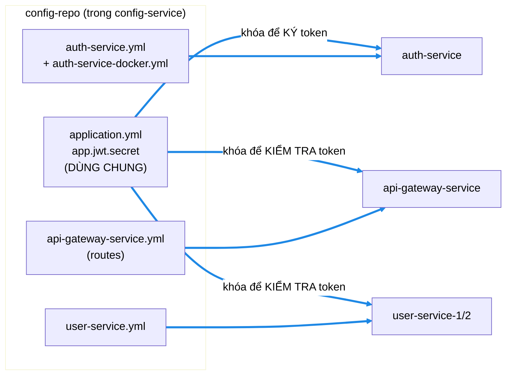

> Config Server tự động gửi file **`application.yml`** trong `config-repo` cho **mọi** service. Đây là nơi lý tưởng để đặt **khóa bí mật JWT**: một chỗ duy nhất, ba service dùng chung. Nếu khóa ở ba nơi khác nhau, token do `auth-service` ký sẽ bị Gateway coi là "không hợp lệ".

#### C6.1. `config-repo\application.yml` — MỚI: khóa JWT dùng chung

> Nếu `config-repo` của bạn **đã có** `application.yml` từ bài trước, **giữ nguyên nội dung cũ** và chỉ thêm khối `app:` vào cuối file.

```yaml
# ============================================================
# Cấu hình DÙNG CHUNG: Config Server gửi file này cho MỌI service
# (auth-service, api-gateway-service, user-service, department-service...)
# ============================================================
app:
  jwt:
    # Khóa bí mật ký/kiểm tra JWT (chuỗi Base64, tối thiểu 32 byte).
    #  - auth-service dùng để KÝ token
    #  - api-gateway-service và user-service dùng để KIỂM TRA token
    # Ba bên BẮT BUỘC dùng cùng một khóa.
    # Thực tế: KHÔNG để khóa thật trong source code/git (dùng biến môi trường, Vault...).
    secret: 6Pr9/U5s61/UL4ntVZRAGHYVzbddUBpj9jdtFUDCmsxszZ+Yb7Hl58/Gt8U18Ewe
```

#### C6.2. `config-repo\auth-service.yml` — MỚI

```yaml
server:
  port: 8083

spring:
  datasource:
    # Khi chạy trực tiếp trên máy (không Docker): MySQL ở localhost:3309
    url: jdbc:mysql://localhost:3309/auth_db?useUnicode=true&characterEncoding=UTF-8&serverTimezone=Asia/Ho_Chi_Minh
    username: auth_user
    password: auth_pass
  jpa:
    hibernate:
      ddl-auto: validate      # bảng do file SQL tạo; Hibernate chỉ kiểm tra entity có khớp với bảng không
    open-in-view: false
    show-sql: false

management:
  endpoints:
    web:
      exposure:
        include: health,info,prometheus   # mở /actuator/prometheus cho Prometheus kéo số liệu
  metrics:
    tags:
      application: auth-service            # nhãn để lọc trên Grafana (dashboard 4701)
```

#### C6.3. `config-repo\auth-service-docker.yml` — MỚI: ghi đè khi chạy trong Docker

```yaml
# Được dùng khi SPRING_PROFILES_ACTIVE=docker (đặt trong docker-compose.yml)
spring:
  datasource:
    # Trong mạng Docker: gọi DB bằng tên container "mysql-auth" và cổng 3306 (không phải localhost:3309)
    url: jdbc:mysql://mysql-auth:3306/auth_db?useUnicode=true&characterEncoding=UTF-8&serverTimezone=Asia/Ho_Chi_Minh

eureka:
  client:
    service-url:
      defaultZone: http://eureka-service:8761/eureka/
```

**Thứ tự ưu tiên** khi `auth-service` chạy trong Docker (cái trên ghi đè cái dưới):

| Ưu tiên | Nguồn | Chứa gì |
|---|---|---|
| 1 | Biến môi trường trong `docker-compose.yml` | `JWT_ACCESS_MINUTES`, `JWT_REFRESH_DAYS`... |
| 2 | `auth-service-docker.yml` (Config Server) | DB `mysql-auth:3306`, Eureka trong Docker |
| 3 | `auth-service.yml` (Config Server) | port 8083, JPA, metric |
| 4 | `application.yml` (Config Server, dùng chung) | `app.jwt.secret` |
| 5 | `application.yml` trong jar của `auth-service` | tên service, địa chỉ Config Server, thời hạn token |

#### C6.4. Thêm route `auth-service` cho API Gateway

Mở file cấu hình route của Gateway ở bài trước (thường là `config-repo\api-gateway-service.yml`; nếu bài trước khai báo route trong `application.yml` của `api-gateway-service`, thì sửa ở đó). **Giữ nguyên** các route cũ và các cấu hình khác (port, Eureka...), chỉ **thêm route `auth-service`**. Phần `routes` sau khi sửa có dạng:

```yaml
spring:
  cloud:
    gateway:
      routes:
        # (bài trước) user-service: Gateway tự chia tải cho user-service-1 và user-service-2
        - id: user-service
          uri: lb://user-service
          predicates:
            - Path=/api/users/**

        # (bài trước) department-service
        - id: department-service
          uri: lb://department-service
          predicates:
            - Path=/api/departments/**

        # MỚI: auth-service (đăng nhập, đổi token, đăng xuất + quản lý tài khoản)
        - id: auth-service
          uri: lb://auth-service
          predicates:
            - Path=/api/auth/**,/api/accounts/**
```

> Nếu project Gateway của bạn dùng Spring Cloud **2025.0 trở lên** và file cũ đang khai báo route dưới `spring.cloud.gateway.server.webflux.routes`, hãy thêm route mới vào **đúng chỗ đó**. Tóm lại: giữ đúng tiền tố mà file của bạn đang dùng.

---

### C7. API Gateway: kiểm tra token ở cổng vào

**Mục đích:** mọi request (trừ login/refresh/logout) phải có access token hợp lệ thì mới được đi vào bên trong. Đây là **lớp bảo vệ thứ nhất**, chỉ làm **xác thực**.

#### C7.1. Thêm thư viện JJWT vào `api-gateway-service\pom.xml`

Trong thẻ `<dependencies>`, thêm:

```xml
<!-- MỚI: Thư viện JJWT để Gateway kiểm tra chữ ký và hạn dùng của access token -->
<dependency>
  <groupId>io.jsonwebtoken</groupId>
  <artifactId>jjwt-api</artifactId>
  <version>0.12.7</version>
</dependency>
<dependency>
  <groupId>io.jsonwebtoken</groupId>
  <artifactId>jjwt-impl</artifactId>
  <version>0.12.7</version>
  <scope>runtime</scope>
</dependency>
<dependency>
  <groupId>io.jsonwebtoken</groupId>
  <artifactId>jjwt-jackson</artifactId>
  <version>0.12.7</version>
  <scope>runtime</scope>
</dependency>
```

> ⚠️ **Không** thêm `spring-boot-starter-security` vào Gateway. Spring Cloud Gateway chạy trên nền **WebFlux (reactive)**. Thêm starter security sẽ bật cơ chế đăng nhập mặc định và chặn mọi request. Bài này dùng một **GlobalFilter** đơn giản, dễ hiểu hơn.

#### C7.2. Tạo `JwtAuthGlobalFilter.java`

Tạo file trong package `security` nằm **bên dưới package gốc** của Gateway, tức là package chứa class có `@SpringBootApplication`. Ví dụ: `api-gateway-service\src\main\java\com\example\apigatewayservice\security\JwtAuthGlobalFilter.java`. **Đổi dòng `package` cho khớp** với package gốc của project bạn.

```java
package com.example.apigatewayservice.security;

import io.jsonwebtoken.Claims;
import io.jsonwebtoken.ExpiredJwtException;
import io.jsonwebtoken.JwtException;
import io.jsonwebtoken.Jwts;
import io.jsonwebtoken.io.Decoders;
import io.jsonwebtoken.security.Keys;
import org.springframework.beans.factory.annotation.Value;
import org.springframework.cloud.gateway.filter.GatewayFilterChain;
import org.springframework.cloud.gateway.filter.GlobalFilter;
import org.springframework.core.Ordered;
import org.springframework.core.io.buffer.DataBuffer;
import org.springframework.http.HttpHeaders;
import org.springframework.http.HttpStatus;
import org.springframework.http.MediaType;
import org.springframework.http.server.reactive.ServerHttpResponse;
import org.springframework.stereotype.Component;
import org.springframework.web.server.ServerWebExchange;
import reactor.core.publisher.Mono;

import javax.crypto.SecretKey;
import java.nio.charset.StandardCharsets;
import java.time.LocalDateTime;
import java.util.List;

/**
 * Lớp bảo vệ thứ nhất: kiểm tra access token NGAY TẠI CỔNG VÀO, cho MỌI route.
 * - Chỉ làm XÁC THỰC (token thật? còn hạn? đúng loại access?) -> sai thì trả 401, request không đi vào trong.
 * - KHÔNG làm phân quyền chi tiết: việc "ai được làm gì" do từng service tự quyết (403).
 */
@Component
public class JwtAuthGlobalFilter implements GlobalFilter, Ordered {

    /** Các API không cần access token */
    private static final List<String> PUBLIC_PATHS = List.of(
            "/api/auth/login",
            "/api/auth/refresh",
            "/api/auth/logout");

    private static final String BEARER_PREFIX = "Bearer ";

    private final SecretKey key;

    public JwtAuthGlobalFilter(@Value("${app.jwt.secret}") String secret) {
        // CÙNG khóa với auth-service (lấy từ application.yml dùng chung trên Config Server)
        this.key = Keys.hmacShaKeyFor(Decoders.BASE64.decode(secret));
    }

    @Override
    public Mono<Void> filter(ServerWebExchange exchange, GatewayFilterChain chain) {
        String path = exchange.getRequest().getURI().getPath();

        // 1. Đường dẫn công khai -> cho qua, không cần token
        if (PUBLIC_PATHS.contains(path)) {
            return chain.filter(exchange);
        }

        // 2. Phải có header "Authorization: Bearer <token>"
        String header = exchange.getRequest().getHeaders().getFirst(HttpHeaders.AUTHORIZATION);
        if (header == null || !header.startsWith(BEARER_PREFIX)) {
            return reject(exchange, "Bạn chưa đăng nhập");
        }

        // 3. Kiểm tra chữ ký + hạn dùng + loại token
        try {
            Claims claims = Jwts.parser()
                    .verifyWith(key)
                    .build()
                    .parseSignedClaims(header.substring(BEARER_PREFIX.length()))
                    .getPayload();
            if (!"access".equals(claims.get("type", String.class))) {
                return reject(exchange, "Access token không hợp lệ");   // không cho dùng refresh token gọi API
            }
        } catch (ExpiredJwtException ex) {
            return reject(exchange, "Access token đã hết hạn");
        } catch (JwtException | IllegalArgumentException ex) {
            return reject(exchange, "Access token không hợp lệ");
        }

        // 4. Token hợp lệ -> chuyển tiếp NGUYÊN request (kể cả header Authorization) xuống service phía sau.
        //    Service phía sau sẽ tự kiểm tra lại token và tự phân quyền.
        return chain.filter(exchange);
    }

    /** Chạy sớm, trước các filter định tuyến và load balancing của Gateway */
    @Override
    public int getOrder() {
        return -100;
    }

    /** Trả 401 dạng JSON, cùng định dạng lỗi với auth-service và user-service */
    private Mono<Void> reject(ServerWebExchange exchange, String message) {
        ServerHttpResponse response = exchange.getResponse();
        response.setStatusCode(HttpStatus.UNAUTHORIZED);
        response.getHeaders().setContentType(MediaType.APPLICATION_JSON);
        String body = """
                {"timestamp":"%s","status":401,"error":"Unauthorized","message":"%s","path":"%s","source":"api-gateway-service"}"""
                .formatted(LocalDateTime.now(), message, exchange.getRequest().getURI().getPath());
        DataBuffer buffer = response.bufferFactory().wrap(body.getBytes(StandardCharsets.UTF_8));
        return response.writeWith(Mono.just(buffer));
    }
}
```

#### C7.3. Giải thích

| Câu hỏi | Trả lời |
|---|---|
| Vì sao kiểm tra ở Gateway? | Chặn sớm request rác/giả mạo ngay ở cổng vào; các service phía sau không tốn tài nguyên xử lý. Đây cũng là lý do request không có token **không xuất hiện** trong metric của `user-service` (câu hỏi số 5 ở mục 10.6) |
| Vì sao Gateway **không** phân quyền chi tiết? | Gateway không hiểu luật nghiệp vụ, ví dụ "employee chỉ sửa được id của mình". Nếu nhét luật của mọi service vào Gateway, mỗi lần một service đổi luật lại phải sửa và triển khai lại Gateway |
| Gateway có cần gọi `auth-service` hay DB để kiểm tra token? | **Không.** Chỉ cần khóa bí mật để kiểm tra chữ ký. Nhờ vậy, khi `auth-service` tạm chết, các token đã cấp vẫn dùng được |
| `GlobalFilter` khác `GatewayFilter` thế nào? | `GlobalFilter` tự áp dụng cho **mọi route**, không cần khai báo trong YAML |

---

### C8. `user-service`: tự kiểm tra token và phân quyền

**Mục đích:** `user-service` **không tin mù quáng** vào Gateway (zero trust). Nó tự kiểm tra lại token, tự phân quyền bằng `@PreAuthorize` dựa trên `authorities` **ghi trong token**, và chuyển tiếp token khi gọi `department-service`.

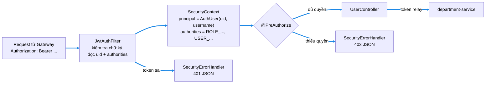

Các file mới nằm trong package `com.example.userservice.security`:

```
user-service\src\main\java\com\example\userservice
├── UserController.java          ← SỬA (C8.6)
└── security                     ← MỚI
    ├── AuthUser.java
    ├── JwtAuthFilter.java
    ├── SecurityErrorHandler.java
    └── SecurityConfig.java
```

#### C8.1. Thêm thư viện vào `user-service\pom.xml`

Trong thẻ `<dependencies>`, thêm (cạnh 2 dependency đã thêm ở Phần B):

```xml
<!-- MỚI: Spring Security để phân quyền bằng @PreAuthorize -->
<dependency>
  <groupId>org.springframework.boot</groupId>
  <artifactId>spring-boot-starter-security</artifactId>
</dependency>
<!-- MỚI: JJWT để tự kiểm tra access token -->
<dependency>
  <groupId>io.jsonwebtoken</groupId>
  <artifactId>jjwt-api</artifactId>
  <version>0.12.7</version>
</dependency>
<dependency>
  <groupId>io.jsonwebtoken</groupId>
  <artifactId>jjwt-impl</artifactId>
  <version>0.12.7</version>
  <scope>runtime</scope>
</dependency>
<dependency>
  <groupId>io.jsonwebtoken</groupId>
  <artifactId>jjwt-jackson</artifactId>
  <version>0.12.7</version>
  <scope>runtime</scope>
</dependency>
```

#### C8.2. `security/AuthUser.java` — người đang gọi API (dựng từ token)

```java
package com.example.userservice.security;

/**
 * Người dùng đang gọi API, dựng lại từ access token.
 * user-service KHÔNG có bảng user/role/permission của auth-service
 * -> mọi thông tin về người gọi đều lấy từ token (đã được kiểm tra chữ ký).
 */
public class AuthUser {

    private final Long id;          // claim "uid": dùng khi cần kiểm tra "có phải chính mình không"
    private final String username;  // claim "sub"

    public AuthUser(Long id, String username) {
        this.id = id;
        this.username = username;
    }

    public Long getId() {
        return id;
    }

    public String getUsername() {
        return username;
    }
}
```

#### C8.3. `security/JwtAuthFilter.java` — kiểm tra token, KHÔNG đọc DB

```java
package com.example.userservice.security;

import io.jsonwebtoken.Claims;
import io.jsonwebtoken.ExpiredJwtException;
import io.jsonwebtoken.JwtException;
import io.jsonwebtoken.Jwts;
import io.jsonwebtoken.io.Decoders;
import io.jsonwebtoken.security.Keys;
import jakarta.servlet.FilterChain;
import jakarta.servlet.ServletException;
import jakarta.servlet.http.HttpServletRequest;
import jakarta.servlet.http.HttpServletResponse;
import org.springframework.beans.factory.annotation.Value;
import org.springframework.http.HttpHeaders;
import org.springframework.security.authentication.UsernamePasswordAuthenticationToken;
import org.springframework.security.core.authority.SimpleGrantedAuthority;
import org.springframework.security.core.context.SecurityContextHolder;
import org.springframework.stereotype.Component;
import org.springframework.web.filter.OncePerRequestFilter;

import javax.crypto.SecretKey;
import java.io.IOException;
import java.util.List;

/**
 * Lớp bảo vệ thứ hai (zero trust): dù Gateway đã kiểm tra, user-service vẫn tự kiểm tra lại token.
 * Khác auth-service: KHÔNG đọc DB, mà lấy danh sách quyền ngay trong claim "authorities" của token.
 */
@Component
public class JwtAuthFilter extends OncePerRequestFilter {

    /** Tên attribute dùng để chuyển lý do lỗi sang SecurityErrorHandler */
    public static final String AUTH_ERROR_ATTRIBUTE = "auth_error";
    private static final String BEARER_PREFIX = "Bearer ";

    private final SecretKey key;

    public JwtAuthFilter(@Value("${app.jwt.secret}") String secret) {
        // CÙNG khóa với auth-service (lấy từ application.yml dùng chung trên Config Server)
        this.key = Keys.hmacShaKeyFor(Decoders.BASE64.decode(secret));
    }

    @Override
    protected void doFilterInternal(HttpServletRequest request,
                                    HttpServletResponse response,
                                    FilterChain filterChain) throws ServletException, IOException {
        String header = request.getHeader(HttpHeaders.AUTHORIZATION);

        // Không gửi token -> cho đi tiếp. API cần đăng nhập sẽ bị Spring Security trả 401.
        if (header == null || !header.startsWith(BEARER_PREFIX)) {
            filterChain.doFilter(request, response);
            return;
        }

        try {
            // 1. Kiểm tra chữ ký + hạn dùng (không gọi auth-service, không đọc DB)
            Claims claims = Jwts.parser()
                    .verifyWith(key)
                    .build()
                    .parseSignedClaims(header.substring(BEARER_PREFIX.length()))
                    .getPayload();

            // 2. Chỉ chấp nhận access token
            if (!"access".equals(claims.get("type", String.class))) {
                throw new JwtException("Không phải access token");
            }

            // 3. Đọc danh sách quyền NGAY TRONG TOKEN (auth-service đã ghi vào lúc đăng nhập)
            List<?> rawAuthorities = claims.get("authorities", List.class);
            List<SimpleGrantedAuthority> authorities = rawAuthorities == null
                    ? List.of()
                    : rawAuthorities.stream()
                            .map(a -> new SimpleGrantedAuthority(a.toString()))
                            .toList();

            Number uid = claims.get("uid", Number.class);
            AuthUser principal = new AuthUser(uid == null ? null : uid.longValue(), claims.getSubject());

            // 4. Báo cho Spring Security: request này của ai, có quyền gì
            SecurityContextHolder.getContext().setAuthentication(
                    new UsernamePasswordAuthenticationToken(principal, null, authorities));

        } catch (ExpiredJwtException ex) {
            request.setAttribute(AUTH_ERROR_ATTRIBUTE, "Access token đã hết hạn");
        } catch (JwtException | IllegalArgumentException ex) {
            request.setAttribute(AUTH_ERROR_ATTRIBUTE, "Access token không hợp lệ");
        }

        // Token lỗi -> không đặt authentication -> Spring Security trả 401 ở bước sau
        filterChain.doFilter(request, response);
    }
}
```

#### C8.4. `security/SecurityErrorHandler.java` — trả `401`/`403` dạng JSON

`user-service` không có `GlobalExceptionHandler` như `auth-service`, nên ta dùng **một** class làm cả hai việc: `AuthenticationEntryPoint` (401) và `AccessDeniedHandler` (403).

```java
package com.example.userservice.security;

import com.fasterxml.jackson.databind.ObjectMapper;
import jakarta.servlet.http.HttpServletRequest;
import jakarta.servlet.http.HttpServletResponse;
import org.springframework.http.HttpStatus;
import org.springframework.http.MediaType;
import org.springframework.security.access.AccessDeniedException;
import org.springframework.security.core.AuthenticationException;
import org.springframework.security.web.AuthenticationEntryPoint;
import org.springframework.security.web.access.AccessDeniedHandler;
import org.springframework.stereotype.Component;

import java.io.IOException;
import java.nio.charset.StandardCharsets;
import java.time.LocalDateTime;
import java.util.LinkedHashMap;
import java.util.Map;

/**
 * Trả lỗi bảo mật dạng JSON, cùng định dạng với auth-service và Gateway:
 * - 401: chưa xác thực (thiếu token / token sai / hết hạn)
 * - 403: đã xác thực nhưng không đủ quyền (@PreAuthorize trả về false)
 */
@Component
public class SecurityErrorHandler implements AuthenticationEntryPoint, AccessDeniedHandler {

    private final ObjectMapper objectMapper;

    public SecurityErrorHandler(ObjectMapper objectMapper) {
        this.objectMapper = objectMapper;
    }

    /** 401 */
    @Override
    public void commence(HttpServletRequest request, HttpServletResponse response,
                         AuthenticationException authException) throws IOException {
        Object reason = request.getAttribute(JwtAuthFilter.AUTH_ERROR_ATTRIBUTE);
        write(request, response, HttpStatus.UNAUTHORIZED,
                reason != null ? reason.toString() : "Bạn chưa đăng nhập");
    }

    /** 403 */
    @Override
    public void handle(HttpServletRequest request, HttpServletResponse response,
                       AccessDeniedException accessDeniedException) throws IOException {
        write(request, response, HttpStatus.FORBIDDEN, "Bạn không có quyền thực hiện chức năng này");
    }

    private void write(HttpServletRequest request, HttpServletResponse response,
                       HttpStatus status, String message) throws IOException {
        Map<String, Object> body = new LinkedHashMap<>();
        body.put("timestamp", LocalDateTime.now().toString());
        body.put("status", status.value());
        body.put("error", status.getReasonPhrase());
        body.put("message", message);
        body.put("path", request.getRequestURI());
        // Instance nào trả lỗi: user-service-1 hay user-service-2 (Docker đặt biến HOSTNAME)
        body.put("source", System.getenv().getOrDefault("HOSTNAME", "user-service"));

        response.setStatus(status.value());
        response.setContentType(MediaType.APPLICATION_JSON_VALUE);
        response.setCharacterEncoding(StandardCharsets.UTF_8.name());
        objectMapper.writeValue(response.getWriter(), body);
    }
}
```

#### C8.5. `security/SecurityConfig.java`

```java
package com.example.userservice.security;

import org.springframework.context.annotation.Bean;
import org.springframework.context.annotation.Configuration;
import org.springframework.security.config.annotation.method.configuration.EnableMethodSecurity;
import org.springframework.security.config.annotation.web.builders.HttpSecurity;
import org.springframework.security.config.annotation.web.configurers.AbstractHttpConfigurer;
import org.springframework.security.config.http.SessionCreationPolicy;
import org.springframework.security.web.SecurityFilterChain;
import org.springframework.security.web.authentication.UsernamePasswordAuthenticationFilter;

@Configuration
@EnableMethodSecurity   // bật @PreAuthorize trên các hàm của controller
public class SecurityConfig {

    private final JwtAuthFilter jwtAuthFilter;
    private final SecurityErrorHandler securityErrorHandler;

    public SecurityConfig(JwtAuthFilter jwtAuthFilter, SecurityErrorHandler securityErrorHandler) {
        this.jwtAuthFilter = jwtAuthFilter;
        this.securityErrorHandler = securityErrorHandler;
    }

    @Bean
    public SecurityFilterChain securityFilterChain(HttpSecurity http) throws Exception {
        http
                // API dùng token, không dùng cookie/session -> không cần CSRF
                .csrf(AbstractHttpConfigurer::disable)
                // STATELESS: không lưu session -> instance nào cũng xử lý được (load balancing thoải mái)
                .sessionManagement(session -> session.sessionCreationPolicy(SessionCreationPolicy.STATELESS))
                .authorizeHttpRequests(auth -> auth
                        // Prometheus kéo metric + kiểm tra sức khỏe: không cần token.
                        // An toàn vì Gateway KHÔNG route /actuator và user-service không mở port ra ngoài.
                        .requestMatchers("/actuator/health", "/actuator/prometheus").permitAll()
                        // Mọi API còn lại: bắt buộc có access token hợp lệ.
                        // Quyền chi tiết khai báo bằng @PreAuthorize ở controller.
                        .anyRequest().authenticated())
                .exceptionHandling(ex -> ex
                        .authenticationEntryPoint(securityErrorHandler)   // 401
                        .accessDeniedHandler(securityErrorHandler))       // 403
                // Chạy filter JWT trước filter đăng nhập mặc định của Spring
                .addFilterBefore(jwtAuthFilter, UsernamePasswordAuthenticationFilter.class);
        return http.build();
    }
}
```

> Khi khởi động, log của `user-service` có thể có dòng `Using generated security password: ...`. Đây là tài khoản mặc định Spring tự tạo nhưng ta **không dùng tới**, cứ bỏ qua.

#### C8.6. Sửa `UserController.java` — phân quyền + token relay

Mở `C:\microservice-demo\user-service\src\main\java\com\example\userservice\UserController.java` và **thay toàn bộ** bằng:

```java
package com.example.userservice;

import com.example.userservice.security.AuthUser;
import org.springframework.beans.factory.annotation.Autowired;
import org.springframework.http.HttpEntity;
import org.springframework.http.HttpHeaders;
import org.springframework.http.HttpMethod;
import org.springframework.security.access.prepost.PreAuthorize;
import org.springframework.security.core.Authentication;
import org.springframework.security.core.GrantedAuthority;
import org.springframework.web.bind.annotation.GetMapping;
import org.springframework.web.bind.annotation.RequestHeader;
import org.springframework.web.bind.annotation.RestController;
import org.springframework.web.client.RestTemplate;

import java.util.HashMap;
import java.util.LinkedHashMap;
import java.util.List;
import java.util.Map;

@RestController
public class UserController {

    @Autowired
    private UserRepository userRepository;

    @Autowired
    private RestTemplate restTemplate;

    // Tên container đang chạy code này (user-service-1 hoặc user-service-2)
    private String instanceName() {
        return System.getenv().getOrDefault("HOSTNAME", "unknown");
    }

    /**
     * GET /api/users/whoami - ai đã đăng nhập cũng gọi được.
     * Cho biết: instance nào xử lý (load balancing) + token của ai, có quyền gì (phân quyền).
     */
    @GetMapping("/api/users/whoami")
    public Map<String, Object> whoami(Authentication authentication) {
        AuthUser currentUser = (AuthUser) authentication.getPrincipal();
        System.out.println("[" + instanceName() + "] handled GET /api/users/whoami by " + currentUser.getUsername());

        Map<String, Object> result = new LinkedHashMap<>();
        result.put("service", "user-service");
        result.put("instance", instanceName());
        result.put("userId", currentUser.getId());
        result.put("username", currentUser.getUsername());
        result.put("authorities", authentication.getAuthorities().stream()
                .map(GrantedAuthority::getAuthority)
                .sorted()
                .toList());
        return result;
    }

    /**
     * GET /api/users - danh sách nhân sự kèm tên phòng ban.
     * PHÂN QUYỀN: chỉ ai có quyền USER_VIEW_LIST (ADMIN, MANAGER).
     * Quyền đọc từ access token -> user-service KHÔNG cần truy cập DB của auth-service.
     */
    @GetMapping("/api/users")
    @PreAuthorize("hasAuthority('USER_VIEW_LIST')")
    public List<UserResponse> getAllUsers(@RequestHeader(HttpHeaders.AUTHORIZATION) String authorization) {
        System.out.println("[" + instanceName() + "] handled GET /api/users");

        // 1. Lấy user từ DB của user-service
        List<User> users = userRepository.findAll();

        // 2. Gọi department-service (theo TÊN service, không dùng IP/port)
        Map<Long, String> departmentNames = new HashMap<>();
        try {
            // TOKEN RELAY: chuyển tiếp NGUYÊN header Authorization của người dùng sang department-service,
            // để department-service cũng biết "ai đang gọi" và tự kiểm tra quyền nếu cần
            HttpHeaders headers = new HttpHeaders();
            headers.set(HttpHeaders.AUTHORIZATION, authorization);

            DepartmentDto[] departments = restTemplate.exchange(
                    "http://department-service/api/departments",
                    HttpMethod.GET,
                    new HttpEntity<>(headers),
                    DepartmentDto[].class).getBody();
            if (departments != null) {
                for (DepartmentDto d : departments) {
                    departmentNames.put(d.getId(), d.getDepartmentName());
                }
            }
        } catch (Exception e) {
            // department-service lỗi/tắt/từ chối -> vẫn trả user, department_name = null
            System.out.println("Cannot call department-service: " + e.getMessage());
        }

        // 3. Ghép department_name vào từng user theo department_id
        return users.stream()
                .map(u -> new UserResponse(
                        u.getId(),
                        u.getUserName(),
                        departmentNames.get(u.getDepartmentId())))
                .toList();
    }
}
```

So với bản ở Phần A:

| Thay đổi | Ý nghĩa |
|---|---|
| `whoami(Authentication authentication)` trả thêm `userId`, `username`, `authorities` | Một API chứng minh được cả **load balancing** (instance nào) lẫn **xác thực** (token của ai) |
| `@PreAuthorize("hasAuthority('USER_VIEW_LIST')")` trên `getAllUsers` | **Phân quyền tại `user-service`**: `EMPLOYEE` nhận `403` |
| `restTemplate.exchange(..., new HttpEntity<>(headers), ...)` thay cho `getForObject` | **Token relay**: gửi kèm header `Authorization` khi gọi `department-service` |

#### C8.7. So sánh cách bảo mật của hai service

| | `auth-service` | `user-service` |
|---|---|---|
| Kiểm tra chữ ký token | ✅ | ✅ |
| Quyền lấy từ đâu | DB `auth_db` ở **mỗi request** | Claim `authorities` **trong token** |
| Khóa tài khoản có hiệu lực | Ngay lập tức | Khi access token hết hạn (≤ 15 phút) |
| Được truy cập `auth_db` | Có | **Không** |
| Trả lỗi `403` bằng | `GlobalExceptionHandler` | `SecurityErrorHandler` |
| Kiểm tra "chính mình" bằng | `authentication.principal.id` (`CustomUserDetails`) | `authentication.principal.id` (`AuthUser`) — sẵn sàng nếu sau này cần |

---

### C9. Đóng gói bằng Docker

#### C9.1. `auth-service\Dockerfile`

Build theo 2 giai đoạn: giai đoạn 1 dùng image có Maven để tạo file jar, giai đoạn 2 chỉ lấy file jar đặt vào image JRE gọn nhẹ. Nhờ đó máy học viên **không cần cài JDK/Maven**.

```dockerfile
# ---------- Giai đoạn 1: build file jar bằng Maven ----------
FROM maven:3.9-eclipse-temurin-21 AS build
WORKDIR /app

# Copy pom.xml trước để Docker cache lại bước tải thư viện
# (chỉ tải lại khi pom.xml thay đổi)
COPY pom.xml .
RUN mvn -B -q dependency:go-offline

# Copy source code và đóng gói
COPY src ./src
RUN mvn -B -q clean package -DskipTests

# ---------- Giai đoạn 2: image chạy ứng dụng (chỉ cần JRE, nhẹ hơn) ----------
FROM eclipse-temurin:21-jre
WORKDIR /app
COPY --from=build /app/target/auth-service-1.0.0.jar app.jar
EXPOSE 8083
ENTRYPOINT ["java", "-jar", "app.jar"]
```

#### C9.2. `auth-service\.dockerignore`

```
target
.git
.idea
*.iml
```

#### C9.3. `docker-compose.yml` — bản cuối cùng

Mở `C:\microservice-demo\docker-compose.yml` và **thay toàn bộ** bằng nội dung sau. Các khối mới được đánh dấu `MỚI`.

```yaml
services:

  # ---------- Hạ tầng ----------
  eureka-service:
    build: ./eureka-service
    image: eureka-service:1.0
    container_name: eureka-service
    ports:
      - "8761:8761"
    healthcheck:
      test: ["CMD-SHELL", "wget -qO- http://localhost:8761/actuator/health | grep -q UP"]
      interval: 10s
      timeout: 5s
      retries: 20
      start_period: 30s
    networks:
      - app-net

  config-service:
    build: ./config-service
    image: config-service:1.0
    container_name: config-service
    environment:
      EUREKA_URL: http://eureka-service:8761/eureka/
    ports:
      - "8888:8888"
    depends_on:
      eureka-service:
        condition: service_healthy
    healthcheck:
      test: ["CMD-SHELL", "wget -qO- http://localhost:8888/actuator/health | grep -q UP"]
      interval: 10s
      timeout: 5s
      retries: 20
      start_period: 30s
    networks:
      - app-net

  # ---------- Database riêng cho từng service ----------
  mysql-user:
    image: mysql:8.0
    container_name: mysql-user
    environment:
      MYSQL_ROOT_PASSWORD: Root@12345
      MYSQL_DATABASE: user_db
    ports:
      - "3307:3306"
    volumes:
      - mysql_user_data:/var/lib/mysql
      - ./db-init/user-db/init.sql:/docker-entrypoint-initdb.d/init.sql
    healthcheck:
      test: ["CMD", "mysqladmin", "ping", "-h", "localhost", "-uroot", "-pRoot@12345"]
      interval: 5s
      timeout: 5s
      retries: 20
    networks:
      - app-net

  mysql-department:
    image: mysql:8.0
    container_name: mysql-department
    environment:
      MYSQL_ROOT_PASSWORD: Root@12345
      MYSQL_DATABASE: department_db
    ports:
      - "3308:3306"
    volumes:
      - mysql_department_data:/var/lib/mysql
      - ./db-init/department-db/init.sql:/docker-entrypoint-initdb.d/init.sql
    healthcheck:
      test: ["CMD", "mysqladmin", "ping", "-h", "localhost", "-uroot", "-pRoot@12345"]
      interval: 5s
      timeout: 5s
      retries: 20
    networks:
      - app-net

  # ----- MỚI: DB của auth-service -----
  mysql-auth:
    image: mysql:8.0
    container_name: mysql-auth
    environment:
      MYSQL_ROOT_PASSWORD: Root@12345
      MYSQL_DATABASE: auth_db          # DB được tạo tự động khi container khởi động lần đầu
      MYSQL_USER: auth_user            # tài khoản riêng cho auth-service, chỉ có quyền trên auth_db
      MYSQL_PASSWORD: auth_pass
      TZ: Asia/Ho_Chi_Minh
    # Dùng utf8mb4 để lưu được tiếng Việt có dấu
    command: --character-set-server=utf8mb4 --collation-server=utf8mb4_unicode_ci
    ports:
      - "3309:3306"                    # máy Windows dùng cổng 3309 (3307, 3308 đã dùng cho 2 DB kia)
    volumes:
      - mysql_auth_data:/var/lib/mysql                      # giữ dữ liệu khi container bị xóa
      - ./db-init/auth-db:/docker-entrypoint-initdb.d:ro    # 01_schema.sql, 02_data.sql tự chạy ở lần đầu
    healthcheck:
      # Kiểm tra qua TCP (127.0.0.1) chứ không dùng "localhost": lúc đang chạy các file .sql khởi tạo,
      # MySQL chỉ mở socket nội bộ; nếu ping qua socket sẽ báo "healthy" quá sớm và app kết nối thất bại
      test: ["CMD-SHELL", "mysqladmin ping -h 127.0.0.1 --protocol=tcp -uroot -p$$MYSQL_ROOT_PASSWORD --silent"]
      interval: 5s
      timeout: 5s
      retries: 20
      start_period: 20s
    networks:
      - app-net

  # ---------- Service nghiệp vụ (KHÔNG publish port) ----------
  department-service:
    build: ./department-service
    image: department-service:1.0
    container_name: department-service
    hostname: department-service       # MỚI: để trường "source" trong lỗi hiển thị tên dễ đọc (C12)
    environment:
      SPRING_PROFILES_ACTIVE: docker
      CONFIG_SERVER_URL: http://config-service:8888
    depends_on:
      config-service:
        condition: service_healthy
      mysql-department:
        condition: service_healthy
    networks:
      - app-net

  # ----- user-service: INSTANCE 1 -----
  user-service-1:
    build: ./user-service
    image: user-service:1.0
    container_name: user-service-1
    hostname: user-service-1
    environment:
      SPRING_PROFILES_ACTIVE: docker
      CONFIG_SERVER_URL: http://config-service:8888
    depends_on:
      config-service:
        condition: service_healthy
      mysql-user:
        condition: service_healthy
      department-service:
        condition: service_started
    networks:
      - app-net

  # ----- user-service: INSTANCE 2 (cùng code, cùng tên service, khác container) -----
  user-service-2:
    build: ./user-service
    image: user-service:1.0
    container_name: user-service-2
    hostname: user-service-2
    environment:
      SPRING_PROFILES_ACTIVE: docker
      CONFIG_SERVER_URL: http://config-service:8888
    depends_on:
      config-service:
        condition: service_healthy
      mysql-user:
        condition: service_healthy
      department-service:
        condition: service_started
    networks:
      - app-net

  # ----- MỚI: auth-service (đăng nhập, cấp token, quản lý tài khoản) -----
  auth-service:
    build: ./auth-service
    image: auth-service:1.0
    container_name: auth-service
    hostname: auth-service
    restart: on-failure                # nếu khởi động lỗi (vd DB/Config chưa kịp sẵn sàng) thì tự chạy lại
    environment:
      SPRING_PROFILES_ACTIVE: docker   # -> đọc thêm auth-service-docker.yml trên Config Server
      CONFIG_SERVER_URL: http://config-service:8888
      JWT_ACCESS_MINUTES: 15           # đổi thành 1 khi test access token hết hạn (D5)
      JWT_REFRESH_DAYS: 7
      TZ: Asia/Ho_Chi_Minh
    depends_on:
      config-service:
        condition: service_healthy
      mysql-auth:
        condition: service_healthy     # chỉ chạy khi DB đã sẵn sàng
    networks:
      - app-net

  # ---------- Cổng vào duy nhất ----------
  api-gateway-service:
    build: ./api-gateway-service
    image: api-gateway-service:1.0
    container_name: api-gateway-service
    environment:
      SPRING_PROFILES_ACTIVE: docker
      CONFIG_SERVER_URL: http://config-service:8888
    ports:
      - "8080:8080"
    depends_on:
      config-service:
        condition: service_healthy
      user-service-1:
        condition: service_started
      user-service-2:
        condition: service_started
      department-service:
        condition: service_started
      auth-service:                    # MỚI
        condition: service_started
    networks:
      - app-net

networks:
  app-net:
    name: app-net        # tên cố định để compose "monitoring" nối vào được

volumes:
  mysql_user_data:
  mysql_department_data:
  mysql_auth_data:       # MỚI
```

Ba điểm cần hiểu:

1. **`mysql-auth:3306` và `localhost:3309`.** Bên trong mạng Docker, `auth-service` gọi DB bằng tên container `mysql-auth`, cổng `3306` (khai báo trong `auth-service-docker.yml`). Từ máy Windows (DBeaver, MySQL Workbench), kết nối `localhost`, cổng `3309`.
2. **`depends_on` + `healthcheck`.** MySQL cần vài chục giây để khởi động và chạy file SQL. `auth-service` chỉ được chạy khi DB báo *healthy* và Config Server đã sẵn sàng.
3. **Volume `mysql_auth_data`.** Dữ liệu DB nằm ở đây, vẫn còn nguyên khi tắt/bật container. Vì vậy file SQL **chỉ chạy đúng một lần**. Muốn chạy lại phải xóa volume (xem C11).

#### C9.4. Cho Prometheus giám sát thêm `auth-service`

Mở `C:\microservice-demo\monitoring\prometheus\prometheus.yml` và **thay toàn bộ** bằng:

```yaml
global:
  scrape_interval: 5s            # cứ 5 giây kéo số liệu 1 lần

scrape_configs:
  - job_name: 'user-service'
    metrics_path: '/actuator/prometheus'
    static_configs:
      - targets:
          - 'user-service-1:8081'   # instance 1 (tên container : port nội bộ)
          - 'user-service-2:8081'   # instance 2

  # MỚI: giám sát auth-service (đếm đăng nhập thành công/thất bại, 401/403...)
  - job_name: 'auth-service'
    metrics_path: '/actuator/prometheus'
    static_configs:
      - targets:
          - 'auth-service:8083'
```

---

### C10. Build và chạy

```powershell
Set-Location C:\microservice-demo

# Build lại các service đã sửa (config-service, api-gateway-service, user-service)
# và service mới (auth-service). Lần đầu mất vài phút vì phải tải image và thư viện Maven.
docker compose up -d --build

# Xem trạng thái: mysql-auth phải "healthy", auth-service và các service khác phải "Up"
docker compose ps

# Xem log của auth-service, thấy dòng "Started AuthServiceApplication" là thành công (Ctrl+C để thoát)
docker compose logs -f auth-service
```

> Không chạy `docker compose down` khi Prometheus/Grafana đang chạy, vì network `app-net` đang được chúng dùng. Chỉ cần `up -d --build`: Docker tự tạo lại các container có thay đổi.

**Áp dụng cấu hình Prometheus mới (C9.4):**

```powershell
Set-Location C:\microservice-demo\monitoring
docker compose restart prometheus
```

**Kiểm tra từng lớp, theo thứ tự:**

| # | Kiểm tra | Cách làm | Kết quả đạt |
|---|---|---|---|
| 1 | Eureka thấy `auth-service` | Mở `http://localhost:8761` | Có dòng `AUTH-SERVICE` (1 instance) và `USER-SERVICE` (2 instance) |
| 2 | Gateway chặn request không token | `curl.exe -i http://localhost:8080/api/users` | `HTTP/1.1 401`, `"message":"Bạn chưa đăng nhập"`, `"source":"api-gateway-service"` |
| 3 | Đăng nhập qua Gateway được | Lệnh PowerShell bên dưới | In ra một chuỗi token dài bắt đầu bằng `eyJ` |
| 4 | Prometheus thấy `auth-service` | Mở `http://localhost:9090/targets` | Job `auth-service` **UP**, job `user-service` 2 dòng **UP** |

Lệnh kiểm tra số 3:

```powershell
$login = Invoke-RestMethod -Method Post -Uri http://localhost:8080/api/auth/login `
  -ContentType "application/json" -Body '{"username":"admin","password":"123456"}'
$login.accessToken
```

Kết quả số 2 trông như sau: app đang chạy và Gateway đang bảo vệ API.

```
HTTP/1.1 401 Unauthorized
Content-Type: application/json

{"timestamp":"2026-10-14T09:12:30.12","status":401,"error":"Unauthorized","message":"Bạn chưa đăng nhập","path":"/api/users","source":"api-gateway-service"}
```

**Kiểm tra dữ liệu trong DB `auth_db`:**

```powershell
docker exec -it mysql-auth mysql -uauth_user -pauth_pass --default-character-set=utf8mb4 auth_db
```

```sql
SHOW TABLES;
SELECT id, full_name, username, enabled FROM tbl_user;

-- Xem mỗi role có những quyền gì
SELECT r.code AS role, p.code AS permission
FROM tbl_role r
JOIN tbl_role_permission rp ON rp.role_id = r.id
JOIN tbl_permission p ON p.id = rp.permission_id
ORDER BY r.id, p.id;

exit
```

### C11. Các lệnh hay dùng cho phần này

| Việc cần làm | Lệnh (chạy trong `C:\microservice-demo`) |
|---|---|
| Sửa code `auth-service` xong, build và chạy lại | `docker compose up -d --build auth-service` |
| Sửa code `user-service` xong (cả 2 instance) | `docker compose up -d --build user-service-1 user-service-2` |
| Sửa code Gateway xong | `docker compose up -d --build api-gateway-service` |
| Sửa file trong `config-repo` xong | `docker compose up -d --build config-service` rồi `docker compose restart auth-service api-gateway-service user-service-1 user-service-2` |
| Xem log `auth-service` / DB | `docker compose logs -f auth-service` / `docker compose logs mysql-auth` |
| **Chỉ** xóa sạch dữ liệu `auth_db` (để file SQL chạy lại từ đầu) | `docker compose rm -sf mysql-auth auth-service` → `docker volume rm microservice-demo_mysql_auth_data` → `docker compose up -d` |
| Dừng toàn bộ (giữ dữ liệu) | Dừng monitoring trước, rồi `docker compose down` |
| Dừng và xóa **mọi** dữ liệu DB (các file SQL của cả 3 DB chạy lại) | Dừng monitoring trước, rồi `docker compose down -v` |

> Tên volume có tiền tố là tên thư mục (`microservice-demo_`). Xem đúng tên bằng `docker volume ls`.

---

### C12. (Điểm cộng) Bảo vệ `department-service` và kiểm chứng token relay

**Mục đích:** chứng minh rằng khi service phía sau cũng đòi token, nếu **không có token relay** thì lời gọi service-to-service sẽ thất bại.

1. **Thêm thư viện** vào `department-service\pom.xml`: đúng 4 dependency như **C8.1** (`spring-boot-starter-security` + 3 gói `jjwt`).
2. **Tạo package `security`** bên dưới package gốc của `department-service` (ví dụ `com.example.departmentservice.security`). **Copy nguyên** 4 file `AuthUser.java`, `JwtAuthFilter.java`, `SecurityErrorHandler.java`, `SecurityConfig.java` từ C8.2–C8.5, rồi **đổi dòng `package`** ở đầu mỗi file cho khớp. Trong `SecurityErrorHandler`, đổi giá trị mặc định `"user-service"` thành `"department-service"`.
3. **Build lại:** `docker compose up -d --build department-service`.
4. **Kiểm chứng** (chụp evidence **MS08**):

| Bước | Thao tác | Kết quả mong đợi |
|---|---|---|
| a | Postman `GET {{baseUrl}}/api/departments`, **No Auth** | `401`, `source` = `api-gateway-service` |
| b | Như trên, có token (bất kỳ role nào) | `200`, danh sách phòng ban |
| c | Đăng nhập `admin`, gọi `GET {{baseUrl}}/api/users` | `200`, `department_name` **có giá trị** (nhờ token relay ở C8.6) |
| d | Tạm sửa `UserController`: thay `new HttpEntity<>(headers)` bằng `HttpEntity.EMPTY`, build lại `user-service-1 user-service-2`, gọi lại bước c | `200` nhưng `department_name` = **`null`**; `docker logs user-service-1 --tail 5` có dòng `Cannot call department-service: 401 ...` |
| e | **Hoàn tác** bước d, build lại | Trở về như bước c |

> Bước d cho thấy rõ: `department-service` không biết "ai đang gọi" nếu `user-service` không chuyển tiếp token, nên từ chối bằng `401`.

---

## 8. Phần D. Kiểm thử bằng Postman và PowerShell

**Mục đích của phần D:** kiểm thử đăng nhập, phân quyền trên `auth-service`, phân quyền xuyên service, rồi chạy lại load balancing và monitoring **khi đã bật bảo mật**. Mọi request đều gọi qua Gateway `http://localhost:8080`.

### D1. Tạo Environment trong Postman

Tạo environment tên `microservice-demo` với các biến:

| Biến | Giá trị ban đầu | Ghi chú |
|---|---|---|
| `baseUrl` | `http://localhost:8080` | Luôn gọi qua Gateway |
| `accessToken` | *(để trống)* | Script tự điền sau khi đăng nhập |
| `refreshToken` | *(để trống)* | Script tự điền sau khi đăng nhập |
| `currentUser` | *(để trống)* | Script tự điền: đang dùng token của ai. Rất tiện khi chụp evidence |

Nhớ chọn environment `microservice-demo` ở góc trên bên phải.

### D2. Request đăng nhập

- Method `POST`, URL `{{baseUrl}}/api/auth/login`
- Tab **Authorization** → **No Auth**
- Tab **Body** → **raw** → **JSON**:

```json
{ "username": "admin", "password": "123456" }
```

- Tab **Scripts** → **Post-response**, dán đoạn sau để Postman tự lưu token sau mỗi lần đăng nhập:

```js
if (pm.response.code === 200) {
    const data = pm.response.json();
    pm.environment.set("accessToken", data.accessToken);
    pm.environment.set("refreshToken", data.refreshToken);
    // Ghi lại tài khoản đang dùng, để khi chụp evidence thấy rõ token của ai
    pm.environment.set("currentUser", JSON.parse(pm.request.body.raw).username);
}
```

Với request **refresh**, dán cùng đoạn script này nhưng **bỏ dòng `currentUser`**, vì body của refresh không có username.

### D3. Các request còn lại

Với các request cần token: tab **Authorization** → Type **Bearer Token** → Token `{{accessToken}}`. Cách gọn hơn: đặt Authorization ở cấp **Collection**, các request bên trong để *Inherit auth from parent*, còn 3 request login/refresh/logout đặt **No Auth**.

| Request | Method | URL | Body | Service xử lý |
|---|---|---|---|---|
| Refresh | POST | `{{baseUrl}}/api/auth/refresh` | `{ "refreshToken": "{{refreshToken}}" }` | `auth-service` |
| Logout | POST | `{{baseUrl}}/api/auth/logout` | `{ "refreshToken": "{{refreshToken}}" }` | `auth-service` |
| Tạo tài khoản | POST | `{{baseUrl}}/api/accounts` | xem C2.4 | `auth-service` |
| Danh sách tài khoản | GET | `{{baseUrl}}/api/accounts` | | `auth-service` |
| Lấy tài khoản theo id | GET | `{{baseUrl}}/api/accounts/3` | | `auth-service` |
| Cập nhật tài khoản | PUT | `{{baseUrl}}/api/accounts/3` | xem C2.4 | `auth-service` |
| Xóa tài khoản | DELETE | `{{baseUrl}}/api/accounts/5` | | `auth-service` |
| Danh sách nhân sự | GET | `{{baseUrl}}/api/users` | | `user-service` (×2) |
| Whoami | GET | `{{baseUrl}}/api/users/whoami` | | `user-service` (×2) |
| Phòng ban | GET | `{{baseUrl}}/api/departments` | | `department-service` |

> **Mẹo cho evidence:** có thể thêm vào tab **Scripts → Post-response** của từng request một dòng kiểm tra mã mong đợi, ví dụ `pm.test("Mong đợi 403", () => pm.response.to.have.status(403));`. Tab **Test Results** sẽ hiện PASS/FAIL, chụp chung vào ảnh.

### D4. Cách đổi vai để test phân quyền

Sửa `username` trong request đăng nhập thành `manager`, `employee` hoặc `employee2` → **Send** → token mới được lưu tự động (biến `currentUser` đổi theo) → gọi lại các request khác.

Để xem nhanh đang dùng token của ai: bấm biểu tượng **con mắt** (Environment quick look) ở góc trên bên phải Postman. Khi chụp evidence phân quyền, nên mở sẵn khung này hoặc gọi `whoami` trước.

### D5. Test access token hết hạn

Chờ 15 phút thì lâu. Sửa trong `docker-compose.yml`, ở service `auth-service`: `JWT_ACCESS_MINUTES: 1`, rồi chạy:

```powershell
Set-Location C:\microservice-demo
docker compose up -d auth-service
```

Đăng nhập, chờ hơn 1 phút rồi gọi `GET {{baseUrl}}/api/users`. Kết quả: `401`, `"message": "Access token đã hết hạn"`, `"source": "api-gateway-service"`, tức là **Gateway** đã chặn. Gọi tiếp **Refresh** để lấy token mới, rồi gọi lại thì thành công. Test xong nhớ đổi lại `15` và chạy lại lệnh trên.

### D6. Kịch bản kiểm thử phân quyền xuyên service (MS01–MS07)

Đây là các case **đặc thù của microservice**. Làm theo đúng thứ tự, mỗi case chụp evidence riêng (xem mục 10.3.4).

**MS01 — Gateway chặn request không có token (lớp 1)**

1. Postman `GET {{baseUrl}}/api/users`, tab Authorization chọn **No Auth** → **Send**.
2. Kết quả: `401`, `"message": "Bạn chưa đăng nhập"`, `"source": "api-gateway-service"`.
3. Chạy `docker logs user-service-1 --tail 3` và `docker logs user-service-2 --tail 3`: **không có** dòng `handled GET /api/users` mới. Request đã bị chặn ở cổng, chưa hề tới `user-service`.

**MS02 — MANAGER xem được danh sách nhân sự, token relay hoạt động**

1. Đăng nhập `manager`. Gọi `GET {{baseUrl}}/api/users`.
2. Kết quả: `200`, danh sách user, trường `department_name` **có giá trị**.

**MS03 — EMPLOYEE bị `user-service` từ chối (lớp 2), kết hợp load balancing**

1. Đăng nhập `employee`. Gọi `GET {{baseUrl}}/api/users` **2 lần liên tiếp**.
2. Kết quả: cả 2 lần đều `403`, `"message": "Bạn không có quyền thực hiện chức năng này"`, và trường **`source` đổi giữa `user-service-1` và `user-service-2`**.
3. Ý nghĩa: Gateway cho qua vì token **hợp lệ** (xác thực OK); **mỗi instance tự phân quyền** dựa trên `authorities` trong token, không cần hỏi `auth-service`.

**MS04 — Một token dùng được ở mọi instance (JWT stateless)**

1. Vẫn dùng token của `employee`. Gọi `GET {{baseUrl}}/api/users/whoami` 2 lần.
2. Kết quả: `200` cả 2 lần, `"instance"` khác nhau, nhưng `"username": "employee"` và `"authorities"` giống hệt nhau.

**MS05 — Token bị sửa bị chặn ngay ở Gateway**

1. Tab Authorization → Bearer Token, sửa ô Token thành `{{accessToken}}abc` (thêm vài ký tự vào cuối). Gọi `GET {{baseUrl}}/api/users/whoami`.
2. Kết quả: `401`, `"message": "Access token không hợp lệ"`, `"source": "api-gateway-service"`.
3. *(Làm thêm)* Dán token vào jwt.io, sửa `"ROLE_EMPLOYEE"` thành `"ROLE_ADMIN"`, copy token đã sửa vào Postman và gọi lại: vẫn `401`, vì chữ ký không còn khớp.

**MS06 — Khóa tài khoản: auth-service chặn ngay, user-service chờ token hết hạn**

1. Đăng nhập `employee` (để có token còn hạn).
2. Khóa tài khoản trong DB:

   ```powershell
   docker exec -it mysql-auth mysql -uauth_user -pauth_pass auth_db -e "UPDATE tbl_user SET enabled = 0 WHERE username = 'employee';"
   ```

3. **Ngay lập tức**, với **cùng token cũ**:

   | Bước | Request | Kết quả mong đợi | Vì sao |
   |---|---|---|---|
   | a | `GET {{baseUrl}}/api/accounts/3` | `401`, `source` = `auth-service` | `auth-service` đọc lại DB ở mỗi request, thấy `enabled = 0` |
   | b | `GET {{baseUrl}}/api/users/whoami` | `200` | Gateway và `user-service` chỉ kiểm tra chữ ký/hạn dùng, **không biết** tài khoản đã bị khóa |
   | c | `POST {{baseUrl}}/api/auth/refresh` | `401`, `"Tài khoản đã bị khóa"` | Không xin được token mới, nên tối đa 15 phút sau là mất quyền hoàn toàn |
   | d | Đăng nhập lại `employee` | `401`, `"Tài khoản đã bị khóa"` | |

4. **Mở khóa** lại để làm các case khác:

   ```powershell
   docker exec -it mysql-auth mysql -uauth_user -pauth_pass auth_db -e "UPDATE tbl_user SET enabled = 1 WHERE username = 'employee';"
   ```

> MS06 minh họa đúng **đánh đổi** ở mục 3.6.6. Ghi nhận xét vào câu hỏi số 7 (mục 10.6).

**MS07 — Zero trust: gọi thẳng vào `user-service`, bỏ qua Gateway**

Giả lập một kẻ đã lọt vào mạng nội bộ: đứng trong container `user-service-2`, gọi thẳng sang `user-service-1` mà **không đi qua Gateway**.

```powershell
# Không có token -> user-service-1 tự từ chối
docker exec user-service-2 wget -S -O- http://user-service-1:8081/api/users/whoami
```

Kết quả: trong output có dòng `HTTP/1.1 401`.

```powershell
# Có token hợp lệ -> được phục vụ (lấy token từ Postman: biến accessToken)
$token = "<dán accessToken vào đây>"
docker exec user-service-2 wget -qO- --header "Authorization: Bearer $token" http://user-service-1:8081/api/users/whoami
```

Kết quả: JSON có `"instance": "user-service-1"`. Kết luận: dù bỏ qua được Gateway, không có token hợp lệ thì vẫn không gọi được. Đây chính là lý do `user-service` **kiểm tra token lần 2**.

### D7. Load balancing khi đã bật bảo mật (PowerShell có token)

Sau Phần C, các lệnh PowerShell ở Phần A/B phải kèm token. Chạy lần lượt trong **cùng một cửa sổ PowerShell**:

```powershell
# 1. Đăng nhập lấy token (admin)
$login = Invoke-RestMethod -Method Post -Uri http://localhost:8080/api/auth/login `
  -ContentType "application/json" -Body '{"username":"admin","password":"123456"}'
$headers = @{ Authorization = "Bearer $($login.accessToken)" }

# 2. Gọi whoami 20 lần, đếm số lần mỗi instance trả lời (Evidence LB06)
1..20 | ForEach-Object { (Invoke-RestMethod http://localhost:8080/api/users/whoami -Headers $headers).instance } |
  Group-Object | Select-Object Name, Count

# 3. Tạo tải cho Prometheus (thay cho vòng lặp ở B7)
1..100 | ForEach-Object { Invoke-RestMethod http://localhost:8080/api/users/whoami -Headers $headers | Out-Null; Start-Sleep -Milliseconds 200 }

# 4. Tạo tải lâu hơn cho Grafana (thay cho vòng lặp ở B9)
1..300 | ForEach-Object { Invoke-RestMethod http://localhost:8080/api/users -Headers $headers | Out-Null; Start-Sleep -Milliseconds 200 }
```

> Access token sống 15 phút. Nếu lệnh báo lỗi `401` sau một thời gian, chạy lại bước 1 để lấy token mới.

Log lúc này cho biết cả **instance nào** xử lý lẫn **ai** gọi:

```powershell
docker logs user-service-1 --tail 5
docker logs user-service-2 --tail 5
```

```
[user-service-1] handled GET /api/users/whoami by admin
```

### D8. Quan sát số liệu bảo mật trên Prometheus/Grafana

Tạo một ít request **bị từ chối** để có số liệu (chạy tiếp trong cửa sổ PowerShell ở D7):

```powershell
# a. 20 request bị 403: employee gọi danh sách nhân sự (bị user-service từ chối)
$emp = Invoke-RestMethod -Method Post -Uri http://localhost:8080/api/auth/login `
  -ContentType "application/json" -Body '{"username":"employee","password":"123456"}'
$empHeaders = @{ Authorization = "Bearer $($emp.accessToken)" }
1..20 | ForEach-Object { try { Invoke-RestMethod http://localhost:8080/api/users -Headers $empHeaders | Out-Null } catch { } }

# b. 20 request thành công: admin gọi danh sách nhân sự
1..20 | ForEach-Object { Invoke-RestMethod http://localhost:8080/api/users -Headers $headers | Out-Null }

# c. 10 lần đăng nhập sai mật khẩu (bị auth-service từ chối)
1..10 | ForEach-Object { try { Invoke-RestMethod -Method Post -Uri http://localhost:8080/api/auth/login `
  -ContentType "application/json" -Body '{"username":"admin","password":"sai-mat-khau"}' | Out-Null } catch { } }

# d. 10 request không có token (bị Gateway chặn)
1..10 | ForEach-Object { try { Invoke-RestMethod http://localhost:8080/api/users | Out-Null } catch { } }
```

Vào `http://localhost:9090/graph`, chạy các truy vấn (tab **Table** hoặc **Graph**):

```
sum by (instance, status) (http_server_requests_seconds_count{application="user-service", uri="/api/users"})
```
→ Mỗi instance có 2 dòng: `status="200"` và `status="403"`, số `403` của 2 instance xấp xỉ nhau (khoảng 10/10). **Phân quyền vẫn được chia tải đều.** → **Evidence MON07**

```
sum by (status) (http_server_requests_seconds_count{application="auth-service", uri="/api/auth/login"})
```
→ Có `status="200"` (đăng nhập đúng) và `status="401"` (≥ 10 lần sai mật khẩu). → **Evidence MON08**

> **Câu đố:** 10 request **không có token** ở bước d không xuất hiện trong bất kỳ truy vấn nào của `user-service`. Vì sao? (Trả lời ở câu hỏi số 5, mục 10.6.)

Trên Grafana (dashboard 4701), ô **Application** giờ có thêm `auth-service`. Chọn `auth-service` để xem heap/CPU/request của service đăng nhập.

---

## 9. Giải thích các metric cần đo

Mỗi **metric** là một con số được đo theo thời gian. Mỗi dòng có thêm các **nhãn (label)** như `application`, `instance`, `uri`, `status` để biết số liệu của service/instance/API nào.

| # | Metric (truy vấn PromQL) | Đo cái gì? | Cách đọc / vì sao quan trọng |
|---|---|---|---|
| 1 | `up{job="user-service"}` | Prometheus có kéo được số liệu của instance không | `1` = sống, `0` = chết/không liên lạc được. Nhìn nhanh biết instance nào hỏng |
| 2 | `http_server_requests_seconds_count{application="user-service", uri="/api/users/whoami"}` | **Tổng số request** instance đã xử lý (cộng dồn từ lúc khởi động) | Số này của 2 instance xấp xỉ nhau → load balancing chia đều. Chỉ tăng, không giảm |
| 3 | `sum by (instance) (rate(http_server_requests_seconds_count{application="user-service"}[1m]))` | **Số request mỗi giây** (trung bình 1 phút gần nhất) | Cho biết mức tải hiện tại của mỗi instance (đơn vị req/s) |
| 4 | `sum by (instance) (rate(http_server_requests_seconds_sum{application="user-service"}[1m])) / sum by (instance) (rate(http_server_requests_seconds_count{application="user-service"}[1m]))` | **Thời gian phản hồi trung bình** (giây/request) | Càng nhỏ càng tốt. Tăng đột biến = service đang chậm. Cần đang có request mới ra số (không thì ra `NaN`) |
| 5 | `sum by (instance) (jvm_memory_used_bytes{application="user-service", area="heap"})` | **Bộ nhớ heap** Java đang dùng (byte) | Tăng mãi không giảm = nghi rò rỉ bộ nhớ. Chia cho `1024*1024` để ra MB |
| 6 | `process_cpu_usage{application="user-service"}` | **CPU** của tiến trình service (0 → 1, nhân 100 ra %) | Cao liên tục = service đang quá tải, cần thêm instance |
| 7 | `jvm_threads_live_threads{application="user-service"}` | **Số thread** Java đang sống | Tăng bất thường khi nhiều request đồng thời |
| 8 | `hikaricp_connections_active{application="user-service"}` | Số **kết nối DB** đang được dùng | Đường kết nối tới MySQL; chạm trần pool là dấu hiệu nghẽn DB |
| 9 | `process_uptime_seconds{application="user-service"}` | Thời gian instance đã chạy (giây) | Sau khi bạn restart instance, số này về 0 |
| 10 | `sum by (instance, status) (http_server_requests_seconds_count{application="user-service", uri="/api/users"})` | **MỚI.** Số request `/api/users` theo **mã trạng thái**, từng instance | `status="403"` = bị từ chối vì thiếu quyền (do `user-service` tự phân quyền). Request bị Gateway chặn (`401`) **không** có ở đây |
| 11 | `sum by (status) (http_server_requests_seconds_count{application="auth-service", uri="/api/auth/login"})` | **MỚI.** Số lần đăng nhập thành công (`200`) / thất bại (`401`) | `401` tăng đột biến = có thể đang bị dò mật khẩu |
| 12 | `up{job="auth-service"}` | **MỚI.** `auth-service` còn sống không | `auth-service` chết thì không ai đăng nhập/refresh được, nhưng **token đã cấp vẫn dùng được** tới khi hết hạn, vì Gateway và `user-service` tự kiểm tra token |

Lưu ý khi đọc:

- Metric **kiểu đếm cộng dồn** (như số 2) chỉ tăng; muốn biết tốc độ thì dùng `rate(...)` (như số 3).
- Có dạng `..._count` (đếm số lần) và `..._sum` (tổng thời gian). **Trung bình = sum / count** (như số 4).
- `instance` là nhãn do Prometheus tự gắn (`user-service-1:8081`, `user-service-2:8081`, `auth-service:8083`), nên mọi truy vấn có `by (instance)` sẽ tách riêng từng instance.
- `status` là mã HTTP mà service **đã trả về**. Đây là cách giám sát phân quyền: đếm `401`/`403` theo thời gian.

---

## 10. Yêu cầu nộp bài: evidence trên Excel

### 10.1. File nộp và cấu trúc

Học viên nộp **một file Excel duy nhất** tên **`HoTen_Lesson6_Microservice_Evidence.xlsx`** (ví dụ `NguyenVanA_Lesson6_Microservice_Evidence.xlsx`), gồm các sheet:

| Sheet | Nội dung |
|---|---|
| `ThongTin` | Họ tên, lớp, ngày làm bài, RAM cấp cho Docker, kết quả `docker --version`; bảng checklist tự đánh giá (mục 10.8) |
| `TestCases` | Bảng tổng hợp **mọi** case: LB, MON, AU, AZ, MS. Mỗi dòng một case (cột ở mục 10.4) |
| `SoLieu` | Bảng số liệu metric (mục 10.5) |
| `CauHoi` | Trả lời câu hỏi nhận xét (mục 10.6) |
| `LB01`, `LB02`, …, `MON01`, …, `AU01`, …, `AZ01`, …, `MS01`, … | **Mỗi case một sheet**, tên sheet trùng mã case, chứa ảnh chụp màn hình của case đó |

### 10.2. Quy tắc chụp evidence

Ảnh phải **rõ, không cắt mất thông tin quan trọng**:

| Loại ảnh | Phải thấy rõ |
|---|---|
| **Postman** | 1. Method + URL · 2. Body gửi lên (nếu có) · 3. **Mã trạng thái HTTP** (góc phải phần response) · 4. Nội dung response (đặc biệt trường `source` với lỗi) · 5. **Đang dùng token của tài khoản nào** (mở Environment quick look thấy `currentUser`, hoặc ghi chú dưới ảnh) |
| **Trình duyệt** (Eureka, Prometheus, Grafana) | **Thanh địa chỉ** + nội dung trang + thời gian (Grafana: khoảng thời gian góc trên phải) |
| **PowerShell** | **Lệnh đã gõ** + kết quả in ra |

Thao tác nhanh: **Win + Shift + S** để chụp một vùng màn hình → mở sheet tương ứng → **Ctrl + V**. Dưới mỗi ảnh ghi 1–2 dòng: đã làm gì, nhận xét gì.

Ở sheet `TestCases`, cột **Evidence** nên là liên kết sang sheet ảnh, ví dụ `=HYPERLINK("#'LB01'!A1","LB01")` (tùy cài đặt Excel, dấu phân cách có thể là `;` thay cho `,`).

### 10.3. Danh sách evidence bắt buộc

#### 10.3.1. Nhóm LB — Load balancing (Phần A, D7)

| Mã | Nội dung chứng minh | Cách thực hiện | Kết quả đạt |
|---|---|---|---|
| LB01 | Các container đang chạy | `docker compose ps` | `user-service-1`, `user-service-2` đều `Up` (sau Phần C: thêm `auth-service` Up, `mysql-auth` healthy) |
| LB02 | Eureka thấy 2 instance của `USER-SERVICE` | Chụp `http://localhost:8761` | Dòng `USER-SERVICE` có 2 instance UP (sau Phần C: thêm `AUTH-SERVICE`) |
| LB03 | Gọi API nghiệp vụ qua Gateway | Postman `GET /api/users` (sau Phần C: token `admin`) | `200 OK`, có danh sách user kèm `department_name` |
| LB04 | Request rơi vào instance 1 | Postman `GET /api/users/whoami` | `"instance": "user-service-1"` |
| LB05 | Request rơi vào instance 2 | Gọi lại lệnh trên (bấm Send tiếp) | `"instance": "user-service-2"` |
| LB06 | Chia đều nhiều request | Lệnh PowerShell `Group-Object` (A5, hoặc D7 nếu đã bật bảo mật) | Mỗi instance khoảng 10/20 request |
| LB07 | Log của từng instance | `docker logs user-service-1 --tail 5` và `docker logs user-service-2 --tail 5` | Mỗi container có dòng `[user-service-X] handled ...` của riêng nó |
| LB08 *(điểm cộng)* | Tắt 1 instance, hệ thống vẫn sống | A7: `docker compose stop user-service-1`, gọi `whoami` nhiều lần; chụp thêm `/targets` hoặc truy vấn `up{job="user-service"}` | Mọi request về `user-service-2`; Prometheus: instance 1 là `0`/**DOWN** |

#### 10.3.2. Nhóm MON — Monitoring (Phần B, D8)

| Mã | Nội dung chứng minh | Cách thực hiện | Kết quả đạt |
|---|---|---|---|
| MON01 | Instance xuất được metric | B3: `docker exec user-service-1 wget -qO- .../actuator/health` và `.../actuator/prometheus` | `{"status":"UP"}` và các dòng `jvm_memory_used_bytes{application="user-service",...}` |
| MON02 | Prometheus thấy các target | Chụp `http://localhost:9090/targets` | `user-service`: 2 dòng **UP**; sau Phần C: `auth-service` **UP** |
| MON03 | Grafana nối được Prometheus | B8: Data sources → Prometheus → **Save & test** | `Data source is working` |
| MON04 | Số request mỗi instance | Truy vấn metric 2 (mục 9), tab **Graph** | 2 đường (2 instance), số xấp xỉ nhau |
| MON05 | Dashboard Grafana, instance 1 | Dashboard 4701, **Instance** = `user-service-1:8081` | Biểu đồ heap/CPU/request có số liệu |
| MON06 | Dashboard Grafana, instance 2 | Như trên, đổi sang `user-service-2:8081` | Biểu đồ có số liệu |
| MON07 | Request bị từ chối `403` được chia đều | D8: truy vấn metric 10 | Mỗi instance có `status="200"` và `status="403"`, số `403` xấp xỉ nhau |
| MON08 | Đăng nhập thành công/thất bại | D8: truy vấn metric 11 | Có `status="200"` và `status="401"` của `auth-service` |

#### 10.3.3. Nhóm AU, AZ — Xác thực và phân quyền trên `auth-service` (Phần D)

Học viên **tự viết** bộ test case, thực hiện trên Postman. Tối thiểu **25 case** (AU ≥ 11, AZ ≥ 14), phủ đủ các nhóm sau. Bảng dưới là **gợi ý**: kết quả mong đợi học viên **tự suy ra** từ mục C2 (ma trận phân quyền, bảng mã lỗi), rồi đối chiếu với thực tế.

| Nhóm | Mã | Gợi ý case | Số case tối thiểu |
|---|---|---|:---:|
| **Đăng nhập** | AU | Đúng tài khoản (cả 3 role); sai mật khẩu; username không tồn tại; bỏ trống username/password; tài khoản bị khóa (`UPDATE tbl_user SET enabled = 0 ...`) | 5 |
| **Token** | AU | Gọi API không gửi token; token bị sửa vài ký tự; access token hết hạn (D5); dùng refresh token thay cho access token; refresh thành công; dùng lại refresh token cũ sau khi đã refresh; refresh sau khi logout | 6 |
| **Phân quyền ADMIN** | AZ | Gọi thành công cả 5 API `/api/accounts` | 5 |
| **Phân quyền MANAGER** | AZ | Xem danh sách (được); tạo / xem theo id / cập nhật / xóa (bị chặn) | 4 |
| **Phân quyền EMPLOYEE** | AZ | Xem chính mình, sửa chính mình (được); xem người khác, sửa người khác, xem danh sách, tạo, xóa (bị chặn) | 5 |
| **Dữ liệu & nghiệp vụ** *(khuyến khích)* | AZ | Tạo tài khoản trùng username; role không tồn tại; password ngắn hơn 6 ký tự; lấy id không tồn tại; admin tự xóa chính mình; đăng nhập bằng tài khoản vừa tạo; đăng nhập bằng mật khẩu mới sau khi đổi | — |

> Với mỗi case lỗi, ghi rõ **thành phần nào trả lỗi** (trường `source`). Ví dụ: "gọi API không gửi token" do **Gateway** trả; "sai mật khẩu" do **`auth-service`** trả.

#### 10.3.4. Nhóm MS — Phân quyền trên microservice (D6, C12)

| Mã | Nội dung chứng minh | Cách thực hiện | Kết quả đạt |
|---|---|---|---|
| MS01 | Gateway chặn request không token | D6-MS01: `GET /api/users` No Auth + `docker logs` 2 instance | `401`, `source` = `api-gateway-service`; log `user-service` không có dòng mới |
| MS02 | MANAGER xem danh sách nhân sự, token relay hoạt động | D6-MS02 | `200`, `department_name` có giá trị |
| MS03 | EMPLOYEE bị `user-service` từ chối, 2 instance cùng phân quyền | D6-MS03: gọi 2 lần (2 ảnh) | `403`, `source` lần lượt `user-service-1` và `user-service-2` |
| MS04 | Một token dùng được ở cả 2 instance | D6-MS04: `whoami` 2 lần (2 ảnh) | `instance` khác nhau, `username` giống nhau |
| MS05 | Token bị sửa bị chặn | D6-MS05 | `401`, `"Access token không hợp lệ"`, `source` = `api-gateway-service` |
| MS06 | Khóa tài khoản: auth-service chặn ngay, user-service chờ token hết hạn | D6-MS06 bước a, b, c (3 ảnh) + ảnh lệnh `UPDATE` | a: `401` (`auth-service`); b: `200`; c: `401` "Tài khoản đã bị khóa" |
| MS07 | Zero trust: gọi thẳng `user-service` bỏ qua Gateway | D6-MS07 (2 lệnh) | Không token: `HTTP/1.1 401`; có token: JSON `whoami` |
| MS08 *(điểm cộng)* | `department-service` đòi token, chứng minh token relay | C12 bước a → e | Bước d: `department_name` = `null` và log có `401`; bước c, e: có giá trị |

### 10.4. Sheet `TestCases`: các cột bắt buộc

| Cột | Nội dung |
|---|---|
| Mã TC | `LB01`, `MON01`, `AU01`, `AZ01`, `MS01`... |
| Nhóm | Load balancing / Monitoring / Đăng nhập / Token / Phân quyền ADMIN / MANAGER / EMPLOYEE / Dữ liệu / Phân quyền microservice |
| Mô tả | Case kiểm tra điều gì |
| Tài khoản | Đăng nhập bằng user nào (hoặc "không đăng nhập", "không áp dụng" với case Docker/Prometheus) |
| Request / Lệnh | Method + URL + body (nếu có), hoặc lệnh PowerShell / URL trình duyệt |
| Kết quả mong đợi | Mã HTTP + nội dung chính của response, hoặc kết quả mong đợi của lệnh |
| Kết quả thực tế | Mã HTTP + nội dung chính thực tế nhận được |
| Thành phần xử lý | Giá trị `source` / `instance` (Gateway, `auth-service`, `user-service-1`...) |
| Trạng thái | `PASS` / `FAIL` |
| Evidence | Tên sheet chứa ảnh (nên là hyperlink, ví dụ `LB01`) |

**Ví dụ một số dòng:**

| Mã TC | Nhóm | Mô tả | Tài khoản | Request / Lệnh | Kết quả mong đợi | Kết quả thực tế | Thành phần xử lý | Trạng thái | Evidence |
|---|---|---|---|---|---|---|---|---|---|
| LB06 | Load balancing | 20 request chia đều cho 2 instance | admin | PowerShell `Group-Object` (D7) | Mỗi instance ≈ 10 | `user-service-1`: 10, `user-service-2`: 10 | Gateway → `user-service-1/2` | PASS | Sheet `LB06` |
| AZ07 | Phân quyền MANAGER | Manager không được xóa tài khoản | manager | `DELETE /api/accounts/4` | `403`, message "Bạn không có quyền thực hiện chức năng này" | `403`, message "Bạn không có quyền thực hiện chức năng này" | `auth-service` | PASS | Sheet `AZ07` |
| MS03 | Phân quyền microservice | Employee không xem được danh sách nhân sự ở `user-service` | employee | `GET /api/users` (2 lần) | `403` do `user-service` trả, `source` đổi giữa 2 instance | `403`, `source`: `user-service-2` rồi `user-service-1` | `user-service-1/2` | PASS | Sheet `MS03` |

### 10.5. Sheet `SoLieu`: bảng số liệu cần ghi lại

**Bảng 1 — `user-service`.** Sau khi chạy vòng lặp tạo tải ở D7 (hoặc B9) khoảng 1 phút và các lệnh ở D8, đọc số liệu bằng truy vấn ở mục 9 (hoặc trên Grafana) rồi điền:

| Metric | `user-service-1` | `user-service-2` | Nhận xét |
|---|---|---|---|
| Tổng số request `/api/users/whoami` (metric 2) | | | |
| Số request/giây (metric 3) | | | |
| Thời gian phản hồi trung bình, ms (metric 4 × 1000) | | | |
| Heap đang dùng, MB (metric 5) | | | |
| CPU, % (metric 6 × 100) | | | |
| Số thread đang sống (metric 7) | | | |
| Kết nối DB đang dùng (metric 8) | | | |
| Số request `/api/users` trả `200` (metric 10) | | | |
| Số request `/api/users` trả `403` (metric 10) | | | |

**Bảng 2 — `auth-service`**

| Metric | Giá trị | Nhận xét |
|---|---|---|
| Số lần đăng nhập thành công, `status="200"` (metric 11) | | |
| Số lần đăng nhập thất bại, `status="401"` (metric 11) | | |
| `up{job="auth-service"}` (metric 12) | | |
| Heap đang dùng, MB | | |

### 10.6. Sheet `CauHoi`: câu hỏi nhận xét (3–5 dòng mỗi câu)

**Load balancing & monitoring**

1. Vì sao 2 instance `user-service` phải có **cùng tên service** nhưng **khác tên container**?
2. Quan sát số liệu: 2 instance có được chia tải đều không? Giải thích bằng thuật toán round robin.
3. Prometheus **kéo** số liệu từ service, hay service **đẩy** số liệu sang Prometheus? Mỗi bao lâu?
4. Khi tắt 1 instance, bạn thấy gì thay đổi trên Prometheus/Grafana và trên kết quả gọi API?

**Phân quyền trên microservice**

5. Ở D8, 10 request **không có token** không xuất hiện trong metric của `user-service`. Vì sao? Điều đó có lợi gì cho hệ thống?
6. `user-service` không có bảng role/permission, cũng không kết nối `auth_db`. Làm sao nó biết `employee` không được xem danh sách? Nêu 1 ưu điểm và 1 nhược điểm của cách làm này.
7. Ở MS06, sau khi khóa tài khoản, `auth-service` chặn ngay nhưng `user-service` vẫn cho qua. Giải thích nguyên nhân và đề xuất ít nhất 1 cách khắc phục.
8. Nếu dùng **session** (lưu đăng nhập trong RAM của instance) thay cho JWT, chuyện gì xảy ra khi Gateway chia request round robin cho 2 instance?
9. Trong hệ thống này, `401` thường do thành phần nào trả, `403` do thành phần nào trả? Vì sao lại chia như vậy?
10. Gateway đã kiểm tra token rồi, vì sao `user-service` vẫn phải kiểm tra lại? Dẫn chứng bằng kết quả MS07.

### 10.7. Tiêu chí chấm gợi ý

| Nội dung | Điểm |
|---|:---:|
| LB01–LB07: 2 instance chạy, hiện trên Eureka, chứng minh chia luân phiên, log từng instance | 2 |
| MON01–MON06: metric endpoint, Prometheus UP, Grafana có dữ liệu | 2 |
| AU + AZ (≥ 25 case): đủ số lượng và đủ nhóm, mỗi case có evidence riêng, **phân biệt đúng `401` và `403`** | 2,5 |
| MS01–MS07: phân quyền trên microservice (Gateway, `user-service`, stateless, zero trust, đánh đổi khi khóa tài khoản) | 2 |
| Sheet `SoLieu` (gồm MON07–MON08) + sheet `CauHoi` | 1,5 |
| **Tổng** | **10** |
| **Điểm cộng**: LB08 (tắt 1 instance), MS08 (token relay với `department-service`), bài tập mở rộng (mục 13) | +1 |

Yêu cầu chung (áp dụng cho mọi nhóm):

- Đủ số lượng và đủ các nhóm case.
- Mỗi case có evidence riêng, ảnh rõ, **khớp** với nội dung dòng tương ứng ở sheet `TestCases`.
- Phân biệt đúng `401` và `403`, và ghi đúng **thành phần nào** trả lỗi.
- Case `FAIL` (nếu có) phải ghi rõ nguyên nhân và cách đã sửa.

### 10.8. Checklist trước khi nộp
s
- [ ] Tên file đúng mẫu `HoTen_Lesson6_Microservice_Evidence.xlsx`.
- [ ] Có đủ 4 sheet `ThongTin`, `TestCases`, `SoLieu`, `CauHoi`.
- [ ] Có đủ sheet ảnh: LB01–LB07, MON01–MON08, ≥ 25 sheet AU/AZ, MS01–MS07 (+ LB08, MS08 nếu làm điểm cộng).
- [ ] Mọi ảnh Postman thấy rõ method, URL, mã trạng thái, response và tài khoản đang dùng.
- [ ] Mọi ảnh trình duyệt thấy rõ thanh địa chỉ; mọi ảnh PowerShell thấy rõ lệnh.
- [ ] Cột "Thành phần xử lý" được điền cho mọi case lỗi.
- [ ] Đã mở khóa lại tài khoản `employee` sau MS06; đã trả `JWT_ACCESS_MINUTES` về `15` sau D5.

---

## 11. Lỗi thường gặp

### 11.1. Docker và môi trường

| Hiện tượng | Nguyên nhân | Cách xử lý |
|---|---|---|
| `docker compose` báo không kết nối được Docker engine | Docker Desktop chưa chạy | Mở Docker Desktop, chờ *Engine running* |
| `Bind for 0.0.0.0:8080 failed: port is already allocated` (hoặc 3000, 9090, 3309...) | Cổng đang bị chương trình khác dùng | Tắt chương trình đó, hoặc đổi vế trái của `ports`, ví dụ `"8081:8080"`, rồi gọi API ở cổng mới |
| Máy chậm/treo, container tự tắt | Thiếu RAM | Docker Desktop → Settings → Resources → tăng Memory lên ≥ 6 GB (khuyến nghị 8 GB) |
| `docker compose up` ở thư mục `monitoring` báo `network app-net declared as external, but could not be found` | Chưa chạy hệ thống ứng dụng, hoặc chưa thêm `name: app-net` vào compose ứng dụng | Chạy lại bước A2–A3 trước |
| `docker compose down` ở thư mục ứng dụng báo network `app-net` còn *active endpoints* | Prometheus/Grafana vẫn đang dùng network | Dừng monitoring trước (`cd monitoring` → `docker compose down`) |
| Sửa code nhưng API vẫn chạy như cũ | Chưa build lại image | `docker compose up -d --build <tên-service>` (xem C11) |

### 11.2. Load balancing

| Hiện tượng | Nguyên nhân | Cách xử lý |
|---|---|---|
| Eureka chỉ thấy 1 instance `USER-SERVICE` | Instance 2 khởi động chậm hoặc lỗi | Chờ 30–60 giây; xem `docker compose logs user-service-2` có lỗi kết nối Config Server/MySQL không |
| `whoami` luôn trả về cùng một instance | Gateway chưa cập nhật danh bạ | Chờ 1 phút rồi gọi lại (nhiều lần) |
| `whoami` trả `404` | Chưa build lại `user-service` sau khi sửa `UserController.java` | `docker compose up -d --build` |

### 11.3. Monitoring

| Hiện tượng | Nguyên nhân | Cách xử lý |
|---|---|---|
| Prometheus `/targets` báo **DOWN** (`connection refused`/`404`) | Chưa thêm 2 dependency (B1), chưa bật `exposure.include` (B2), hoặc chưa build lại | Thử `docker exec user-service-1 wget -qO- http://localhost:8081/actuator/prometheus` để kiểm tra |
| **Sau Phần C**, `/targets` của `user-service` báo DOWN với lỗi `401` | `SecurityConfig` chưa cho phép `/actuator/prometheus` | Kiểm tra dòng `.requestMatchers("/actuator/health", "/actuator/prometheus").permitAll()` (C8.5) |
| `/targets` báo `no such host user-service-1` | Prometheus không cùng network | Kiểm tra `networks: app-net` (external) trong `monitoring\docker-compose.yml` |
| Không thấy job `auth-service` trên `/targets` | Chưa sửa `prometheus.yml` (C9.4) hoặc chưa restart Prometheus | `cd monitoring` → `docker compose restart prometheus` |
| Truy vấn trả `No data` / `Empty` | Chưa có request nào, hoặc sai nhãn `application` | Chạy vòng lặp tạo tải (D7); thử gõ `jvm_memory_used_bytes` xem có số liệu không |
| Truy vấn thời gian phản hồi ra `NaN` | Trong 1 phút gần nhất không có request | Chạy lại vòng lặp tạo tải |
| Grafana dashboard: ô **Application** để trống | Chưa có số liệu, hoặc thiếu `tags.application` (B2, C6.2) | Kiểm tra MON02 trước |
| Grafana không import được ID 4701 | Container không ra được internet | Tải file JSON về, dùng **Upload dashboard JSON file** |

### 11.4. Database của `auth-service`

| Hiện tượng | Nguyên nhân | Cách xử lý |
|---|---|---|
| `auth-service` báo `Communications link failure` rồi tắt/khởi động lại | Chạy khi DB chưa sẵn sàng | Kiểm tra `healthcheck` đúng như C9.3 (dùng `127.0.0.1 --protocol=tcp`); `restart: on-failure` sẽ tự chạy lại |
| `auth-service` báo `Schema-validation: missing table ...` | File SQL chưa chạy (volume cũ còn dữ liệu) hoặc SQL lỗi | `docker compose logs mysql-auth` để xem lỗi, sau đó xóa volume `auth_db` (C11) rồi chạy lại |
| Sửa file SQL nhưng DB không đổi | File SQL chỉ chạy ở lần khởi động đầu tiên | Xóa volume `auth_db` (C11) rồi `docker compose up -d` |
| Tên tiếng Việt thành `Nguyá»…n...` hoặc `???` | File SQL không lưu UTF-8, hoặc thiếu `SET NAMES utf8mb4` | Lưu lại file dạng UTF-8, kiểm tra dòng đầu file, tạo lại DB |
| Đăng nhập đúng mật khẩu vẫn `401` | Chuỗi BCrypt trong `02_data.sql` bị copy thiếu ký tự | Chuỗi phải đủ 60 ký tự, bắt đầu bằng `$2a$10$` |

### 11.5. Cấu hình, Gateway và phân quyền trên microservice

| Hiện tượng | Nguyên nhân | Cách xử lý |
|---|---|---|
| Gateway hoặc `user-service` không khởi động: `Could not resolve placeholder 'app.jwt.secret'` | Chưa tạo `config-repo\application.yml` (C6.1), hoặc chưa build lại `config-service` | `docker compose up -d --build config-service`, rồi restart Gateway và `user-service` |
| Gọi `/api/auth/login` qua Gateway nhận `404` | Chưa thêm route `auth-service` (C6.4), hoặc chưa build lại `config-service` | Kiểm tra route, build lại `config-service`, restart Gateway |
| Gọi `/api/auth/login` nhận `503` | `auth-service` chưa đăng ký Eureka, hoặc Gateway chưa cập nhật danh bạ | Chờ 30–60 giây; xem `http://localhost:8761` có `AUTH-SERVICE` chưa; xem `docker compose logs auth-service` |
| Eureka không thấy `AUTH-SERVICE` | Thiếu cấu hình Eureka trong `auth-service-docker.yml`, hoặc `auth-service` lỗi khởi động | Kiểm tra C6.3; xem log |
| Gọi API **không token** mà vẫn nhận `200`/`403` thay vì `401` từ Gateway | `JwtAuthGlobalFilter` không được nạp: file nằm **ngoài** package gốc của Gateway, hoặc chưa build lại Gateway | Đặt file bên dưới package chứa class `@SpringBootApplication`; `docker compose up -d --build api-gateway-service` |
| Gateway đòi đăng nhập kiểu form/basic, hoặc khởi động lỗi | Lỡ thêm `spring-boot-starter-security` vào Gateway | Bỏ dependency đó (xem C7.1) |
| Đăng nhập được nhưng mọi API có token đều bị `401` "Access token không hợp lệ" | Các service đang dùng **khóa khác nhau** (một service chưa nhận cấu hình mới) | Build lại `config-service`, rồi restart `auth-service`, Gateway, `user-service-1`, `user-service-2` |
| `401` có `source` = `user-service-x` dù Gateway đã cho qua | `user-service` dùng khóa cũ | Như dòng trên |
| Đáng ra `403` nhưng lại nhận `500` | `auth-service`: thiếu hàm bắt `AccessDeniedException` trong `GlobalExceptionHandler` (C5.4). `user-service`: có `@RestControllerAdvice` từ bài trước bắt `Exception` và "nuốt" lỗi | `auth-service`: xem lại C5.4. `user-service`: thêm vào advice đó một hàm `@ExceptionHandler(AccessDeniedException.class)` ném lại lỗi (`throw ex;`) để `SecurityErrorHandler` xử lý |
| `department_name` = `null` sau khi làm C12 | Thiếu token relay | Xem lại C8.6 (`new HttpEntity<>(headers)`) |
| Log `user-service` có dòng `Using generated security password` | Spring tự tạo tài khoản mặc định, ta không dùng | Bình thường, bỏ qua |

### 11.6. Postman

| Hiện tượng | Nguyên nhân | Cách xử lý |
|---|---|---|
| Gọi API có token vẫn `401` | Thiếu chữ `Bearer` trước token, hoặc access token đã hết hạn | Chọn đúng kiểu *Bearer Token* trong Postman; đăng nhập lại hoặc gọi Refresh |
| Token không được lưu tự động | Chưa chọn environment, hoặc dán script sai tab | Chọn environment `microservice-demo`; script đặt ở **Scripts → Post-response** |
| Đổi vai mà kết quả không đổi | Request đang dùng token cũ (Authorization đặt cứng chuỗi token) | Dùng `{{accessToken}}`, không dán cứng chuỗi token |

---

## 12. Tổng kết lệnh hay dùng

| Mục đích | Lệnh |
|---|---|
| Chạy hệ thống ứng dụng (2 instance + `auth-service`) | `cd C:\microservice-demo` → `docker compose up -d --build` |
| Chạy Prometheus + Grafana | `cd C:\microservice-demo\monitoring` → `docker compose up -d` |
| Xem trạng thái | `docker compose ps` |
| Xem log 1 instance | `docker logs user-service-1 --tail 20` |
| Xem log `auth-service` | `docker compose logs -f auth-service` |
| Tắt / bật 1 instance | `docker compose stop user-service-1` / `docker compose start user-service-1` |
| Build lại 1 service sau khi sửa code | `docker compose up -d --build <tên-service>` |
| Sửa `config-repo` xong áp dụng | `docker compose up -d --build config-service` → `docker compose restart auth-service api-gateway-service user-service-1 user-service-2` |
| Sửa `prometheus.yml` xong áp dụng | `cd C:\microservice-demo\monitoring` → `docker compose restart prometheus` |
| Vào DB `auth_db` | `docker exec -it mysql-auth mysql -uauth_user -pauth_pass --default-character-set=utf8mb4 auth_db` |
| Khóa / mở khóa tài khoản | `docker exec -it mysql-auth mysql -uauth_user -pauth_pass auth_db -e "UPDATE tbl_user SET enabled = 0 WHERE username = 'employee';"` (đổi `0` thành `1` để mở) |
| Lấy token bằng PowerShell | `$login = Invoke-RestMethod -Method Post -Uri http://localhost:8080/api/auth/login -ContentType "application/json" -Body '{"username":"admin","password":"123456"}'` |
| Dừng monitoring | `cd C:\microservice-demo\monitoring` → `docker compose down` |
| Dừng hệ thống ứng dụng (giữ dữ liệu) | `cd C:\microservice-demo` → `docker compose down` |
| Dừng và xóa sạch dữ liệu mọi DB | `cd C:\microservice-demo` → `docker compose down -v` |

> Thứ tự **bật**: hệ thống ứng dụng → monitoring. Thứ tự **tắt**: monitoring → hệ thống ứng dụng (vì monitoring dùng network của ứng dụng).

---

## 13. Bài tập mở rộng

Dành cho học viên hoàn thành sớm (tính điểm cộng).

**Từ bài JWT gốc (áp dụng cho `auth-service`)**

1. Thêm API `GET /api/accounts/me` trả về thông tin của người đang đăng nhập (mọi role đều gọi được).
2. Cho `MANAGER` xem được chi tiết tài khoản bất kỳ **mà không sửa code Java**, chỉ thêm dữ liệu vào DB. Giải thích vì sao làm được, và vì sao `manager` phải **đăng nhập lại** (hoặc refresh) thì mới thấy hiệu lực ở `user-service`.
3. Thêm phân trang và tìm kiếm theo tên cho API danh sách tài khoản.
4. Thêm API khóa / mở khóa tài khoản (permission mới `USER_LOCK`, chỉ ADMIN có).
5. Khi phát hiện một refresh token **đã thu hồi** bị đem ra dùng lại, thu hồi toàn bộ refresh token của user đó (dấu hiệu token bị đánh cắp).

**Mở rộng cho microservice**

6. Thêm permission `DEPARTMENT_VIEW` (gán cho cả 3 role) và cho `department-service` kiểm tra quyền **theo URL** trong `SecurityConfig`: `.requestMatchers(HttpMethod.GET, "/api/departments/**").hasAuthority("DEPARTMENT_VIEW")`. So sánh với cách dùng `@PreAuthorize`.
7. Chạy **2 instance `auth-service`**: đăng nhập ở instance 1, refresh ở instance 2. Giải thích vì sao vẫn hoạt động (gợi ý: refresh token lưu ở DB dùng chung).
8. Chuyển từ HS384 (khóa dùng chung) sang **RS256**: `auth-service` giữ private key và công bố public key; Gateway và `user-service` chỉ giữ public key. Nêu lợi ích về bảo mật.
9. Thu hồi access token tức thời: khi logout, lưu `jti` của access token vào Redis (blacklist), Gateway từ chối các token nằm trong blacklist.
10. Giới hạn số lần gọi `/api/auth/login` tại Gateway (RequestRateLimiter) để chống dò mật khẩu; quan sát số `401` trên Prometheus trước và sau.
11. Tạo một dashboard Grafana riêng: panel số `401`/`403` theo thời gian, tách theo `application` và `instance`.
